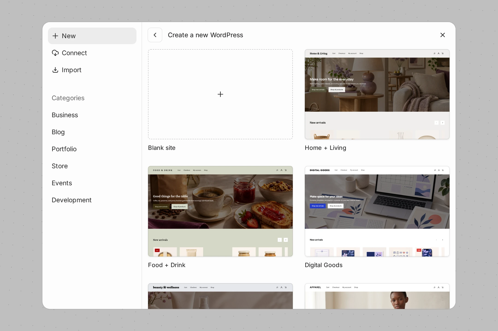
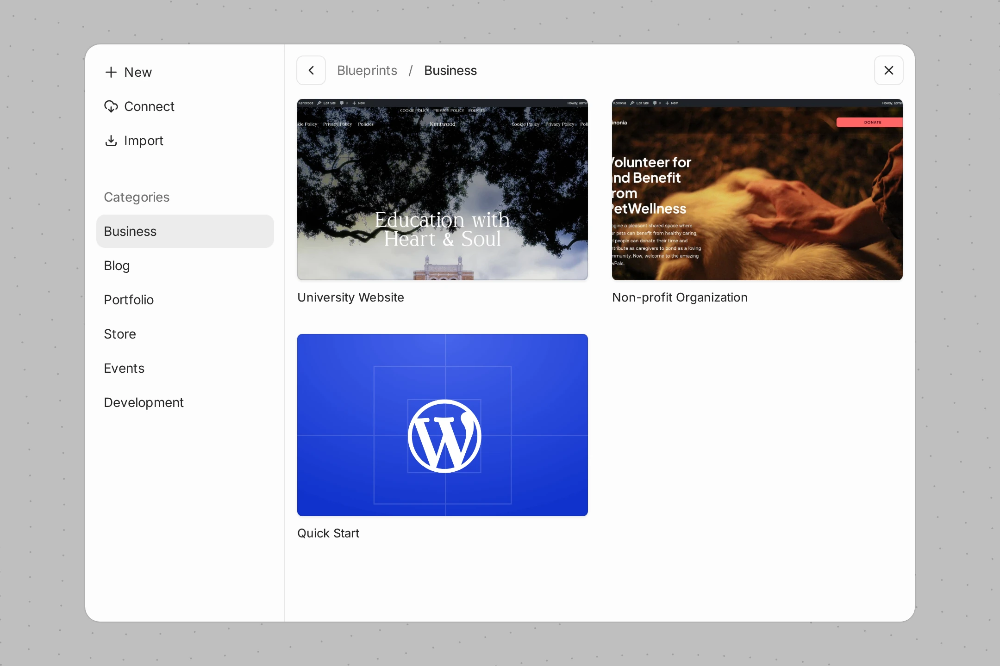
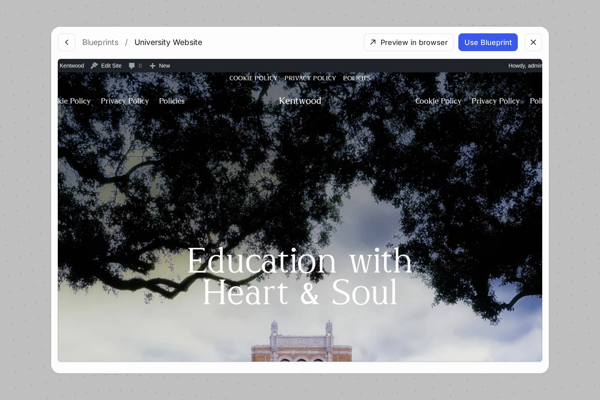
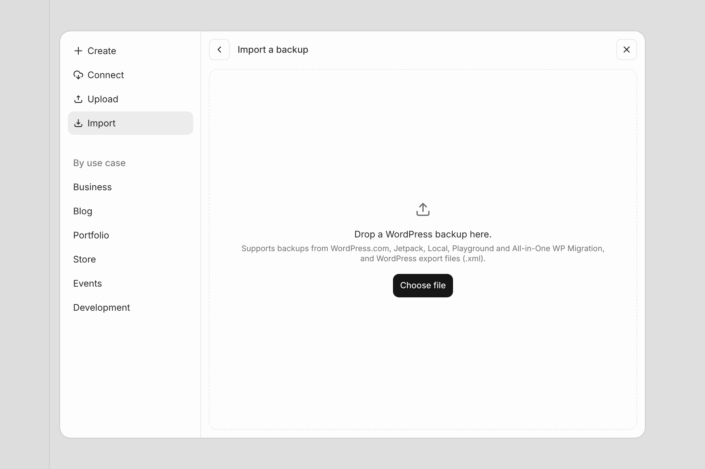

# Blueprints in WordPress Studio

A Blueprint is a JSON file that describes how to build a site in WordPress Studio. This “recipe” tells WordPress Studio which WordPress and PHP versions to use, which plugins and themes to install, what content or settings to apply, and more.

Unlike full-site Blueprints in other local development environments, WordPress Studio Blueprints are lightweight, declarative, and easy to share. Choose from one of our free starter Blueprints or upload a [Blueprint of your own](https://wordpress.studio/docs/blueprints/how-to-create-custom-blueprints/).

## [How Blueprints work in WordPress Studio](#0-how-blueprints-work-in-studio)

When you launch a site with a Blueprint, WordPress Studio reads the JSON file and builds the site according to the instructions inside. Instead of copying a pre-existing site, WordPress Studio installs and configures everything fresh each time. This ensures that anyone using the same Blueprint ends up with the same environment.

A Blueprint can configure:

-   **Core versions**: Specify which WordPress and PHP versions the site should use.
-   **Plugins and themes**: Define which should be installed and activated automatically.
-   **Site options**: Set values such as the site title, permalink structure, and other WordPress settings.
-   **Content**: Import demo posts, pages, or other starter content.
-   **Custom steps**: Run PHP or SQL commands during site creation to further customize the setup.

Blueprints in WordPress Studio follow the same format as [WordPress Playground](https://wordpress.org/playground/) Blueprints. That means a Blueprint you create for WordPress Studio can also be opened in Playground (and vice versa), making them portable across different development contexts.

## [Creating a WordPress Studio site from a Blueprint](#1-creating-a-studio-site-from-a-blueprint)

Creating local sites from Blueprints is incorporated into the site creation flow within WordPress Studio.

1.  Click the **Add site** (**+**) button next to **Sites** at the top of the WordPress Studio sidebar. The **Add site** dialog opens on **New**, which shows **Blank site** and the Blueprints library under **Create a new WordPress**.

2.  Browse the Blueprints library, or pick one of the **Categories** on the left: **Business**, **Blog**, **Portfolio**, **Store**, **Events**, or **Development**.

3.  Click a Blueprint to see a larger preview. Click **Preview in browser** to try it out first. To go back to the library, click **Blueprints** at the top of the dialog.
4.  Click **Use Blueprint**. The **Add site** form opens with the Blueprint under **Start from**, and the Blueprint’s name as the site name.
5.  Change the **Site name** and **Site folder** if you like. The folder must be empty. Click **Advanced** to review the WordPress and PHP versions, the admin credentials, and the domain name.
6.  Click **Add site**.

To use your own Blueprint:

1.  In the **Add site** dialog, choose **Import**. The **Import a blueprint or backup** screen opens.
2.  Drop a Blueprint file (a `.json` file or a `.zip` bundle) on the **Drop your file here** area, or click **Choose file** and select it. You can also drop the file anywhere on the **Add site** dialog.
3.  The **Add site** form opens and shows the Blueprint under **Start from**. Give your site a name and click **Add site**.

You can also start from the form: click **Blank site**, then click **Choose…** under **Start from** and select the Blueprint file. In the desktop app, **File → Open Folder…** opens a Blueprint file, or a folder that contains a `blueprint.json`, the same way.

To swap the Blueprint, click **Browse Blueprints** next to it. To use a blank site instead, click **Remove Blueprint**.

A Blueprint that sets up a WordPress multisite requires a custom domain. When you pick one, the form shows “This Blueprint requires a custom domain.” under **Advanced**, and you need to enter a **Domain name** before you can add the site.

Behind the scenes, WordPress Studio builds the site from whichever Blueprint you selected or added. 

## [Featured Blueprints](#2-featured-blueprints)

WordPress Studio currently has three free featured Blueprints that you can use when setting up a new local site. Find them in the Blueprints library in the **Add site** dialog.

1.  **Development**: Designed for building themes and plugins, this Blueprint enables debug settings and includes tools like Query Monitor, Plugin Check, Theme Check, and Create Block Theme.
2.  **Quick Start**: An environment that mirrors a WordPress.com site. It includes the Business plan plugins and themes you’d find pre-installed on WordPress.com, so you can spin up a production-like site right away.
3.  **Commerce**: Tailored for launching an online store, this Blueprint comes with WooCommerce and companion plugins pre-installed, along with optional extensions such as payment, advertising, and product listing tools. It provides a store-ready framework that you can extend for client projects.

The rest of the Blueprints library, built into the **Add site** dialog, offers a growing set of pre-configured sites for things like blogging, ecommerce, portfolios, and organizations. Use the **Categories** on the left of the dialog to find one.

## [Building your own Blueprints](#3-building-your-own-blueprints)

Beyond the featured Blueprints, you can also create a custom JSON file to define your specific site requirements. For details on supported steps, JSON structure, and examples, refer to [How to create custom Blueprints](https://wordpress.studio/docs/blueprints/how-to-create-custom-blueprints/).

## [Opening Blueprints in WordPress Studio](#4-opening-blueprints-in-studio)

You can use a custom Blueprint when creating a new site in WordPress Studio, but you can also generate shareable links that open your Blueprint directly in the app (as long as the user has WordPress Studio installed). This makes it easy to share demos and examples that others can explore locally. Learn how to create your own links in the [Open in WordPress Studio button](https://wordpress.studio/docs/blueprints/open-in-wordpress-studio-button/).