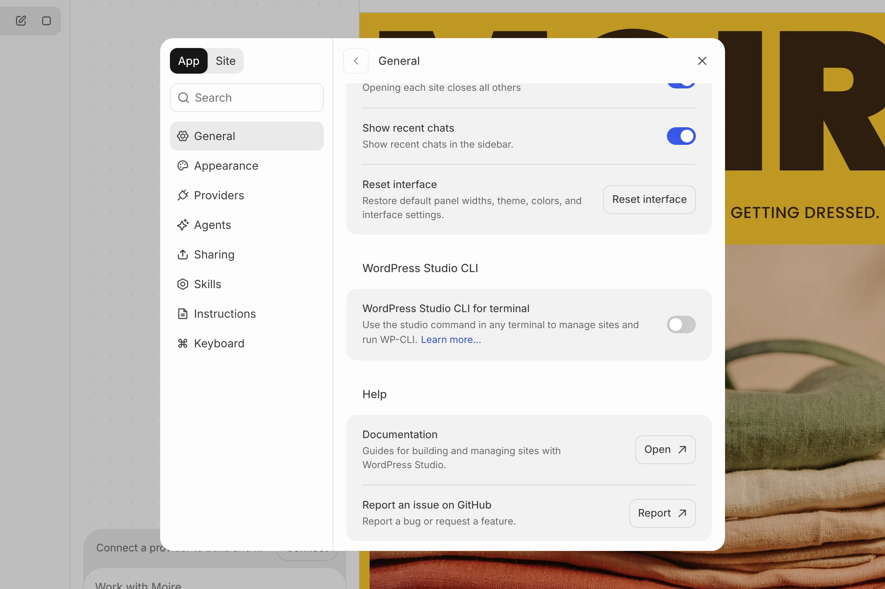

# WordPress Studio CLI

WordPress Studio CLI is the `studio` command. It lets you use [WordPress Studio](https://wordpress.studio/docs/) from your terminal to create and run local sites, share previews, publish and pull sites, and run WP-CLI, whether WordPress Studio is open or not. It comes with the WordPress Studio app, and you can also install it on its own.

**Applies to:** macOS, Windows, and Linux. The CLI comes with the WordPress Studio app, except the Microsoft Store version. You can also install it with the standalone installer or from npm as [wp-studio](https://www.npmjs.com/package/wp-studio). Commands for previews, publishing, and pulling need a WordPress.com account.

Use the CLI to:

- Manage local WordPress Studio sites.
- Create and update previews on WordPress.com.
- Publish and pull sites.
- Run WP-CLI commands.
- Work with AI coding agents. Every site comes with an `AGENTS.md` file.
- Add WordPress Studio to scripts and build steps.

## Installation

Choose one way to install the CLI. If you already have the WordPress Studio app, turn on the CLI in its settings.

### Turn on the CLI in the WordPress Studio app

1.  <a id="wordpress-studio-app"></a>Open WordPress Studio.
2.  Press ⌘, (Ctrl+, on Windows and Linux) to open **Settings**.
3.  On the **General** page, under **WordPress Studio CLI**, turn on **WordPress Studio CLI for terminal**.

No password is needed. WordPress Studio turns this option on the first time you open the app, unless you turned it off before. You can also open **Settings** with the **Settings** button at the bottom of the sidebar.



The option isn’t available in the Microsoft Store version of WordPress Studio, because that version can’t add `studio` to your `PATH`. Use the standalone installer or npm instead. If you installed the CLI with the standalone installer, the option is turned on and can’t be changed in the app.

### Install with the standalone installer

<a id="standalone-installer"></a>On macOS or Linux:

```bash
curl -fsSL https://wordpress.studio/install.sh | bash
```

On Windows, in PowerShell:

```powershell
irm https://wordpress.studio/install.ps1 | iex
```

Open a new terminal so `studio` is on your `PATH`, then check that it works:

```bash
studio --help
```

### Install with npm

<a id="npm"></a>Install the `wp-studio` package globally:

```bash
npm install -g wp-studio
```

### Uninstall the CLI

<a id="uninstall"></a>To remove a CLI installed with the standalone installer:

```bash
studio uninstall
```

This stops your running sites and removes the CLI and its `PATH` entry. Your sites and your WordPress Studio configuration in `~/.studio` stay. Add `--purge` to also delete `~/.studio`.

| Installed with | How to remove it |
| --- | --- |
| Standalone installer | `studio uninstall` |
| npm | `npm rm -g wp-studio` |
| WordPress Studio app | Uninstall the app |

## Usage

<a id="getting-help"></a>Commands that manage local sites, such as `studio create` or `studio start`, are top-level commands. Other commands are grouped by area:

```bash
studio <area> <command> [options]
```

Most commands run on the WordPress Studio site in the current directory. To target another site, add `--path`:

```bash
studio <area> <command> --path /path/to/site
```

To see every command, run `studio --help`:

```text
WordPress Studio CLI

Commands:
  studio auth                        Manage authentication
  studio code                        AI agent for building and managing WordPress sites
  studio create                      Create a new site
  studio list                        List sites
  studio start                       Start site
  studio stop                        Stop site(s)
  studio delete [sites..]            Delete site
  studio status                      Get status of site
  studio push                        Push your local site to a WordPress.com site, or
                                     publish it to Spacefast
  studio pull                        Pull a WordPress.com or Pressable site to your local
                                     site
  studio import <import-file>        Import a backup file to site
  studio export [export-file]        Export site to a backup file
  studio export-static [output-dir]  Export site as static HTML files
  studio ui                          Start the local Studio web UI and open it in your
                                     browser
  studio uninstall                   Uninstall the standalone Studio CLI
  studio preview                     Manage preview sites
  studio config                      Manage site configuration
  studio wp                          WP-CLI
  studio blueprint                   Browse and use blueprints
  studio mcp                         MCP server for AI agents

Options:
  -p, --path     Path to the WordPress files         [string] [default: Current directory]
  -v, --version  Show version number                                             [boolean]
  -h, --help     Show help                                                       [boolean]
```

Every command and subcommand supports `--help`, for example `studio preview create --help` or `studio config set --help`.

## Log in to WordPress.com

<a id="authentication-commands"></a>Previews, publishing, and pulling need a WordPress.com login.

```bash
studio auth login      # Log in to WordPress.com
studio auth status     # Check which account is logged in
studio auth logout     # Log out and clear stored credentials
```

`studio auth login` opens WordPress.com in your browser. Approve the connection, then paste the authentication token it gives you into the terminal.

If you run a command that needs a login while logged out, the CLI asks “You’re not logged in to WordPress.com. Log in now?” Answer yes to log in and continue. If you answer no, or the command runs without a terminal, for example from a script, it stops and asks you to run `studio auth login`.

## Manage local sites

| Command | What it does |
| --- | --- |
| `studio create` | Creates a new local site |
| `studio list` | Lists your local sites |
| `studio status` | Shows the status and details of a site |
| `studio start` | Starts a site |
| `studio stop` | Stops a site, or every site with `--all` |
| `studio delete` | Deletes one or more sites |
| `studio config get` | Shows a site’s settings |
| `studio config set` | Changes a site’s settings |

<a id="local-site-management-commands"></a>Earlier versions grouped these commands under `studio site`, for example `studio site create` and `studio site set`. Those forms still work but are deprecated. Use `studio create` and `studio config set` instead.

### Create a site

<a id="creating-a-local-site"></a>Run `studio create` from an empty directory, or from a directory with a WordPress site that isn’t in WordPress Studio yet.

```bash
# Create a site in the current directory, with the default options
studio create

# Create a site with a custom domain and HTTPS
studio create --https --domain hello.wp.local

# Create a site in another directory
studio create --path /path/to/site

# Create a site that keeps WordPress up to date automatically
studio create --wp auto-update
```

The CLI creates the site, starts it, and opens its front page in your browser. If the site comes from a Blueprint that sets a `landingPage`, it opens that page instead. Add `--skip-browser` to leave the browser closed. Run `studio create --help` for every option.

### Create a site from existing content

<a id="creating-a-site-from-existing-content"></a>Use `--from` to build a site from static content. This can be compiled build output, a directory, a zip archive, or a URL. With a URL, WordPress Studio recreates the site from the live website and names it after the site’s title.

```bash
# Create a site from a directory of static files
studio create --from ./build

# Create a site from a live website
studio create --from https://example.com
```

### Create a site from a Blueprint

<a id="creating-a-local-site-using-blueprints-gallery"></a>The [Blueprints library](https://wordpress.studio/docs/blueprints/) is available in the CLI too.

```bash
# List the Blueprints in the library
studio blueprint list

# Create a site from a Blueprint in the library
studio blueprint use <blueprint-slug> --name "<site-name>"
```

`studio create --blueprint` takes a library slug, a Blueprint URL, a JSON file, a folder, or a zip bundle, so you can combine it with the other `create` options:

```bash
studio create --blueprint <blueprint-slug> --name "<site-name>" --path /path/to/site
```

A URL is always fetched. A file at the given path wins over a library slug with the same name.

### List and inspect sites

```bash
# List every local site in WordPress Studio
studio list

# Show the status of the site in the current directory
studio status

# Show the status of a site by path
studio status --path /path/to/site
```

<a id="listing-and-inspecting-sites"></a>`studio status` shows:

- Whether the site is running.
- The local URL, for example `http://localhost:PORT`.
- **Email**, the folder where the site saves the emails it sends, as `.eml` files.
- Key settings: PHP version, WordPress version, file access, Xdebug, and the admin credentials.

### Start and stop sites

```bash
# Start or stop the site in the current directory
studio start
studio stop

# Start or stop a site by path
studio start --path /path/to/site
studio stop --path /path/to/site

# Stop every running site
studio stop --all
```

<a id="starting-and-stopping-sites"></a>Starting a site launches the local services it needs to open in a browser. Stopping it shuts them down.

### Delete a site

<a id="deleting-a-local-site"></a>`studio delete` removes a site from WordPress Studio.

```bash
# Remove the site from WordPress Studio and move its directory to the trash
studio delete

# Remove the site from WordPress Studio but keep its files
studio delete --no-files

# Delete several sites at once, by path or ID
studio delete /path/to/site-one /path/to/site-two

# Show what would be deleted, without deleting anything
studio delete /path/to/site-one --dry-run
```

### Change site settings

```bash
studio config set [options]
studio config get [<key>]
```

<a id="configuring-site-settings"></a>With `studio config set`, you can:

- Change the PHP version or WordPress version. Use `--wp auto-update` to let WordPress update itself.
- Change the site name, custom domain, or HTTPS.
- Switch file access.
- Set the number of PHP workers with `--php-workers`, from 1 to 64 (default 4). Workers cap how many requests the site serves at once. See [PHP workers](https://wordpress.studio/docs/php-runtimes/#php-workers).
- Turn debugging features on or off. These are Xdebug, the debug log, showing errors in the browser, script debug, and the environment type.

`studio config set --wp <version>` also works on a site that has never been started. If changing the admin credentials fails, WordPress Studio restores the previous credentials and tells you. Run `studio config set --help` for every option.

## Share previews

<a id="preview-site-commands"></a><a id="listing-preview-sites"></a>A [preview](https://wordpress.studio/docs/preview-sites/) is a temporary copy of your site on WordPress.com that anyone with its preview link can open. Preview commands need a WordPress.com login.

| Command | What it does |
| --- | --- |
| `studio preview create` | Creates a preview of the site and prints its preview link |
| `studio preview list` | Lists the site’s previews. Add `--all` for the previews of every local site |
| `studio preview update <host>` | Updates a preview with your local changes |
| `studio preview set <host>` | Changes a preview’s settings, such as its name |
| `studio preview delete <host>` | Deletes a preview, or every preview with `--all` |

### Create a preview

```bash
cd /path/to/your/studio-site
studio preview create
```

<a id="creating-a-preview-site"></a>Or name the site directory:

```bash
studio preview create --path /path/to/your/studio-site
```

The CLI validates the site, archives and uploads it, and prints the preview link:

```text
✔ Archive created
✔ Archive uploaded
✔ Preview site available at: https://wrenandbarley.wpcomstaging.com/?share=…
✔ Preview site saved to Studio
```

### Update or delete a preview

<a id="updating-and-deleting-preview-sites"></a>Each preview is identified by its host, for example `example-preview.wpcomstaging.com`. Run `studio preview list` to find it.

```bash
# Update a preview with your local changes
studio preview update <host>

# Delete a preview
studio preview delete <host>

# Delete all of your previews
studio preview delete --all
```

## Publish and pull

<a id="syncing-with-wordpresscom-and-pressable"></a>Use `studio push` to publish a local site to its connected WordPress.com or Pressable site, and `studio pull` to bring that site into the local site. Both need a WordPress.com login. See [Publish and pull your site](https://wordpress.studio/docs/sync/).

```bash
# Publish the local site to its connected website
studio push

# Pull the connected website into the local site
studio pull

# Choose the website by URL or ID, and publish only some parts of the site
studio push --remote-site example.com --options plugins,themes

# Publish a static copy to Spacefast
studio push --remote-site spacefast
```

`--options` takes a comma-separated list of `all`, `sqls` (the database), `uploads`, `plugins`, `themes`, and `contents`. For Spacefast, `--remote-site spacefast:<space>` takes a Space’s ID, URL, or slug. See [Publish a static copy to Spacefast](https://wordpress.studio/docs/sync/#publish-a-static-copy-to-spacefast).

## Import and export

<a id="importing-and-exporting"></a>Use `studio import` and `studio export` to import and export [backup files](https://wordpress.studio/docs/import-export/).

```bash
# Import a backup file into the local site
studio import /path/to/backup.zip

# Export the full site
studio export /path/to/backup.zip

# Export only the database
studio export /path/to/database.sql --mode db
```

Exports can be `.zip` or `.tar.gz`. Database-only exports can also be `.sql`. Use `--mode content` to export only the site content.

### Export static HTML

`studio export-static` exports the site as static HTML files you can host anywhere. If the site is stopped, WordPress Studio starts it for the export, then stops it.

```bash
# Export to a folder named after the site's folder, followed by -static
studio export-static

# Export to a folder, with links for the address where you'll host it
studio export-static /path/to/folder --base-url https://example.com
```

Without `--base-url`, links are root-relative. If the folder isn’t empty, add `--overwrite` to replace its contents.

## Run WP-CLI commands

<a id="using-wp-cli-through-wordpress-studio"></a>`studio wp` runs [WP-CLI](https://developer.wordpress.org/cli/commands/) on a WordPress Studio site. You don’t need to install WP-CLI. WordPress Studio sets the environment, paths, and credentials for the site, so commands work on the right database and files.

```bash
studio wp [<wp-cli-command>] [<wp-cli-arguments>...]
```

Run these from the site’s root directory, or add `--path`:

```bash
# Check the WordPress version
studio wp core version

# List installed plugins
studio wp plugin list

# Run database upgrades
studio wp core update-db

# List plugins of a site by path
studio wp plugin list --path /path/to/site
```

Run `studio wp help` or `studio wp help <command>` for every WP-CLI command.

## Start WordPress Studio Code

<a id="wordpress-studio-code"></a>`studio code` starts [WordPress Studio Code](https://wordpress.studio/docs/studio-code/), the agent, as a chat in your terminal. `studio ai`, the command’s older name, still works and points you to `studio code`.

```bash
studio code                            # Start a new chat
studio code "Create a portfolio site"  # Start with a first message
studio code sessions list              # List saved chats
studio code sessions resume latest     # Resume the most recent chat
studio code sessions delete <id>       # Delete a saved chat
```

`sessions resume` and `sessions delete` take a session ID, an ID prefix, or `latest`, and show a picker when you leave it out. See [Terminal-specific guidance](https://wordpress.studio/docs/studio-code/#terminal-specific-guidance) for every option.

## Open WordPress Studio in your browser

<a id="wordpress-studio-in-your-browser"></a>`studio ui` starts the WordPress Studio interface as a local web app and opens it in your browser. It shows the same sites, chats, and site preview as the desktop app, including attachments and generated images in WordPress Studio Code.

```bash
# Start it and open your browser
studio ui

# Use a specific port, without opening the browser
studio ui --port 8080 --no-open
```

Press Ctrl+C in the terminal to stop it.

## Run the MCP server

<a id="mcp-server"></a>`studio mcp` runs WordPress Studio’s MCP (Model Context Protocol) server. It lets AI agents create, configure, and inspect your local sites and work with your WordPress.com sites, and it serves WordPress Studio’s instructions and skills to the agent on demand. You don’t usually run it yourself. Add it to your agent’s MCP configuration instead. See [MCP on WordPress Studio](https://wordpress.studio/docs/mcp-on-studio/).

## Use the CLI with AI coding agents

<a id="using-wordpress-studio-cli-with-ai-coding-agents"></a><a id="typical-workflows-with-ai-agents"></a><a id="best-practices-when-using-ai-agents-with-wordpress-studio-cli"></a>Agents that can run shell commands, such as Claude Code and Cursor, can run `studio` commands for you. They can tell that a project is a WordPress Studio site, manage sites, previews, and WP-CLI tasks with `studio` commands, and use the output to guide their next change.

For example, you might ask *“Set up a new local WordPress site using PHP version 8.2 using WordPress Studio in this folder, start it, and tell me the local URL.”* The agent might run these commands:

```bash
studio create --php 8.2
studio start
studio status
```

You might also ask *“Create a preview of this project and give me the preview link. Then, after each code change, update the same preview.”* The agent might run these commands:

```bash
studio auth login              # if needed
studio preview create          # the first time
studio preview update <host>   # after each change
```

When you work with an agent:

- **Work from the site’s root directory.** Many commands use the current directory. Ask the agent to `cd` into the site’s folder or to use `--path`.
- **Set limits in your request.** Mention “use the `studio` CLI” and any limits, such as “Don’t delete existing sites,” “Ask for confirmation before running database migrations,” or “Only run read-only `studio wp` commands.”
- **Review commands that delete.** `studio delete` and `studio preview delete` remove sites and previews. Ask the agent to show the commands it plans to run first.
- **Check the account.** Commands that need WordPress.com, such as `studio auth login` and `studio preview`, start a login. Confirm which account the agent uses.

## Troubleshooting

### Why does my terminal say studio isn’t found?

After you install with the standalone installer, open a new terminal so `studio` is on your `PATH`. If you use the CLI that comes with the app, check that **WordPress Studio CLI for terminal** is turned on in **Settings → General**. The “not found” message comes from your shell, not from WordPress Studio.

### Why can’t I turn off WordPress Studio CLI for terminal?

You installed the CLI with the standalone installer, so the option stays on. Run `studio uninstall` to remove that CLI.

### Why does a command ask me to log in?

Previews, publishing, and pulling need a WordPress.com login. Answer yes to log in and continue, or run `studio auth login` first. Scripts can’t answer the prompt, so log in before you run them.

### Why does studio site create still work?

The `studio site` commands are deprecated but still work. Use `studio create` and `studio config set` instead.

## Related

- [Share a preview of your site](https://wordpress.studio/docs/preview-sites/)
- [Publish and pull your site](https://wordpress.studio/docs/sync/)
- [WordPress Studio Code](https://wordpress.studio/docs/studio-code/)
- [MCP on WordPress Studio](https://wordpress.studio/docs/mcp-on-studio/)
- [PHP runtimes](https://wordpress.studio/docs/php-runtimes/)
- [Import and export sites](https://wordpress.studio/docs/import-export/)
- [Blueprints](https://wordpress.studio/docs/blueprints/)
