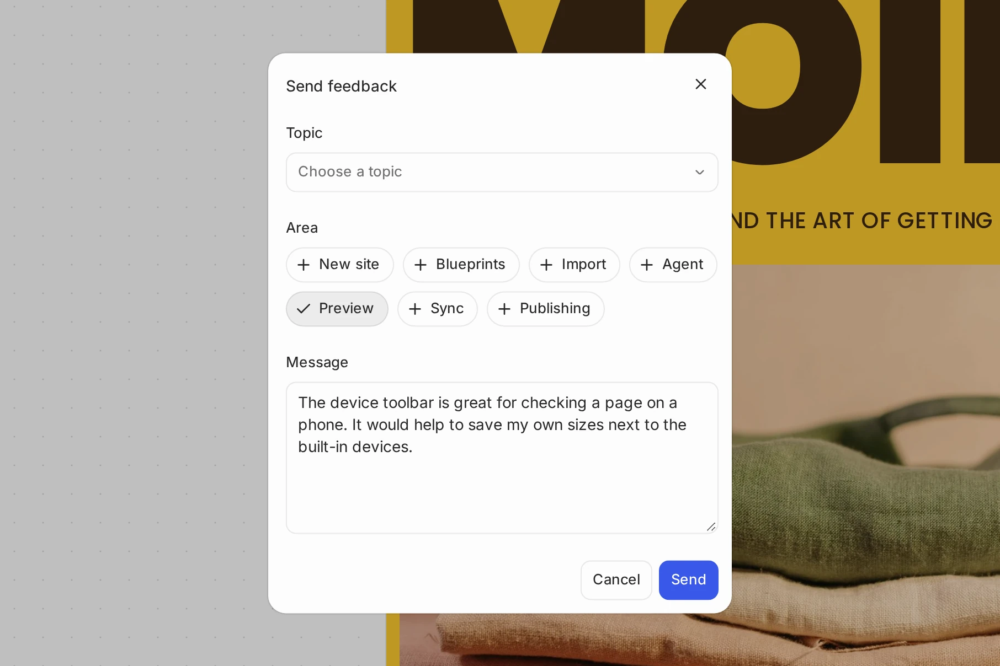

# WordPress Studio feedback

WordPress Studio is an open source local development app, with community input driving what we build. While we don’t commit to specific release dates, we aim to ship **two releases per month**: one focused on bug fixes and performance, and one introducing new features or capabilities. Occasionally, a release may take longer than two weeks if it includes a significant feature.

## [Help shape what we build](#0-help-shape-what-we-build)

We want WordPress Studio to reflect the needs of the WordPress dev community. To help, you can:

-   [Download WordPress Studio](https://wordpress.studio/download/)
-   [Send feedback from inside WordPress Studio](#send-feedback), straight to the WordPress Studio team
-   [Report a bug or request a feature on GitHub](https://github.com/Automattic/studio/issues), or choose **Help → Report an Issue** or **Help → Propose a Feature** in WordPress Studio. **Settings → General** has a **Report an issue on GitHub** button too
-   [Subscribe to our developer newsletter](https://developer.wordpress.com/newsletter/) to stay in the loop with all things WordPress development

## [Send feedback from WordPress Studio](#send-feedback)

You can send a bug report, a feature request, or general feedback to the WordPress Studio team without leaving the app. You need to be [logged in to WordPress.com](https://wordpress.studio/docs/#connect-to-wordpresscom).

To send feedback:

1.  Open the account menu at the bottom of the sidebar and choose **Support → Send feedback**. You can also press ⌘K (Ctrl+K on Windows and Linux) and search for **Send feedback** in the command palette.
2.  In the **Send feedback** dialog, choose a **Topic**: **Bug report**, **Feature request**, or **General feedback**.
3.  (Optional) Under **Area**, select the parts of WordPress Studio your feedback is about: **New site**, **Blueprints**, **Import**, **Agent**, **Preview**, **Sync**, or **Publishing**. You can select more than one.
4.  Type your feedback under **Message**.
5.  (Optional) If a WordPress Studio Code chat is open, select **Include this chat’s transcript** to send the conversation along with your message. Check first that it doesn’t contain anything you’d rather not share.
6.  Click **Send**.

WordPress Studio shows **Feedback sent** with a reference ID for your submission. Click **Done** to close the dialog.

If you’re logged out, the dialog offers **Log in**, or **Open GitHub** to report the issue there instead.

You can also send feedback from a WordPress Studio Code chat, in the desktop app or the terminal, with the `/feedback` command. WordPress Studio Code writes the report from what happened in the chat and shows it to you before anything is sent. See [Send feedback from a chat](https://wordpress.studio/docs/studio-code/#send-feedback-from-a-chat).
