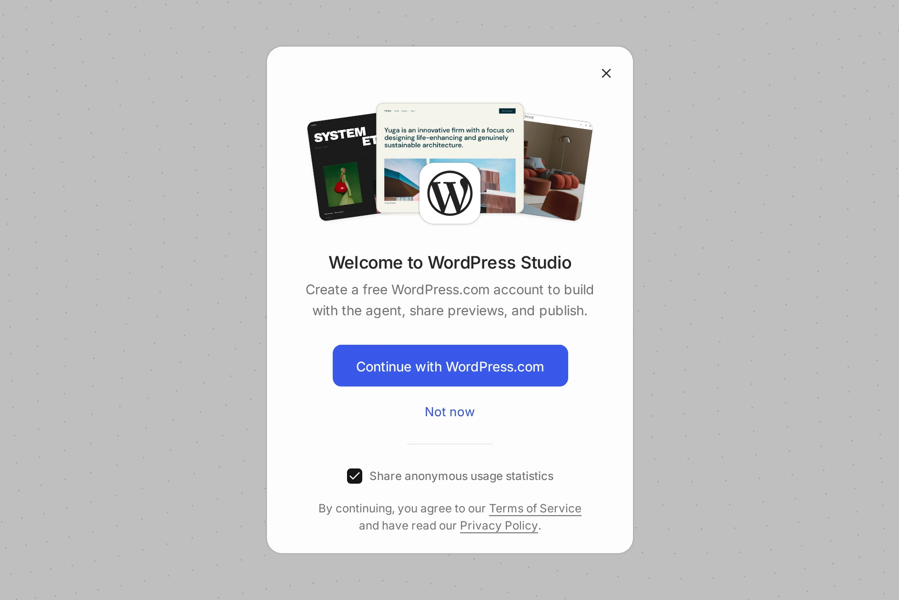
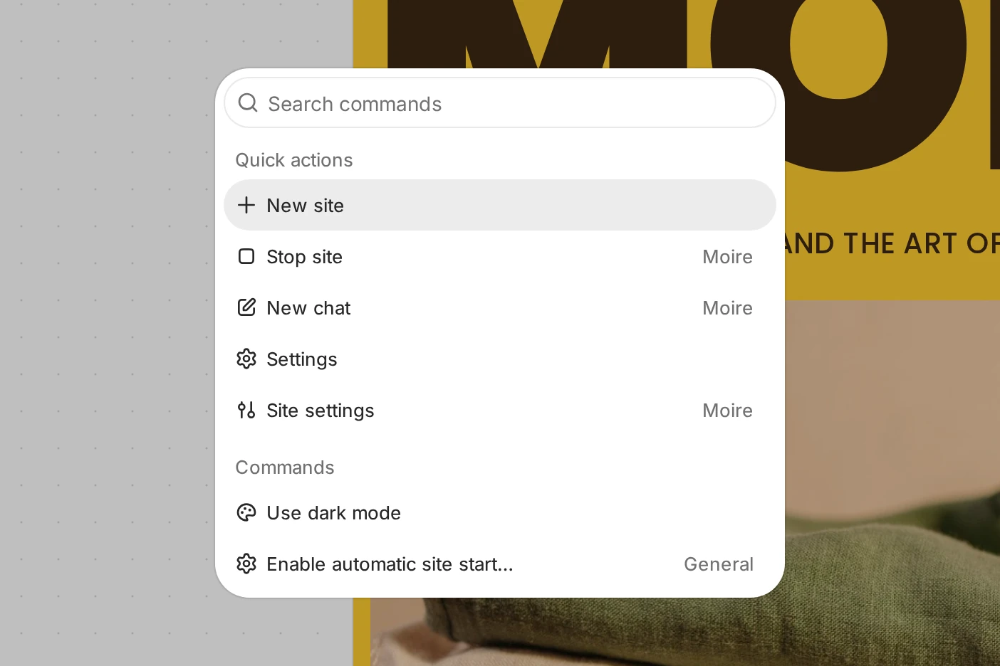
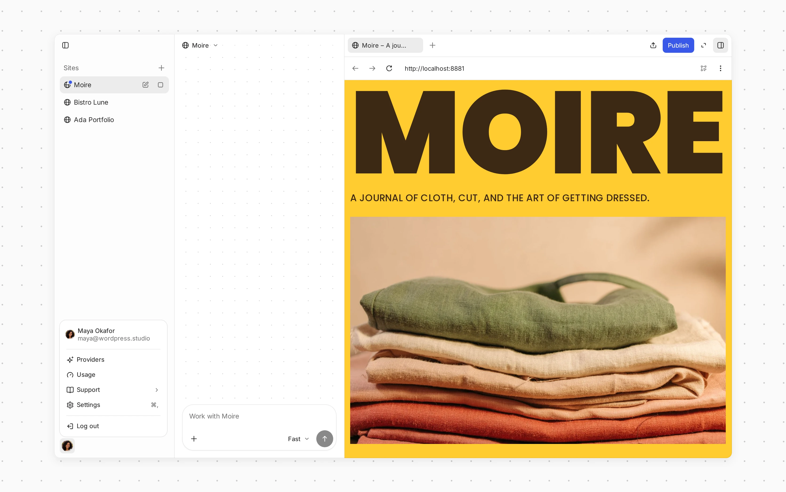

# WordPress Studio

[WordPress Studio](https://wordpress.studio/) is the agentic local development tool for WordPress. Spin up [local sites](https://wordpress.studio/docs/sites/) in seconds and generate anything from plugins, themes, images and content to full site builds using [WordPress Studio Code](https://wordpress.studio/docs/studio-code/), our custom WordPress AI agent. 

Your sites and their WordPress Studio Code chats share one sidebar, with the live site preview right beside the chat. The preview lets you browse the front end, WP Admin, and the site database without leaving the app. Batch smaller updates quickly and easily and dispatch them to the WordPress Studio Code agent with one click using the Annotate tool. 

WordPress Studio sites support [SSL](https://wordpress.studio/docs/ssl-in-studio/) and custom local domains to match your production environment. Use [Blueprints](https://wordpress.studio/docs/blueprints/) to define exactly which plugins, themes, and content each site starts with, so you can reproduce the same setup every time.

Manage your site from the terminal with [WordPress Studio CLI](https://wordpress.studio/docs/cli/) or use the [built-in debugging tools](https://wordpress.studio/docs/debugging/), including a debug log, phpMyAdmin, and [Xdebug](https://wordpress.studio/docs/xdebug/), to help you diagnose issues.

[Publish to WordPress.com and Pressable](https://wordpress.studio/docs/sync/) and pull changes back: bring an existing online site down to work on it locally, or publish any local site to production or staging when it’s ready. You can also [import from a backup](https://wordpress.studio/docs/import-export/) or export your local work as a ready-to-deploy archive. Use **Share** to send anyone a temporary [preview site](https://wordpress.studio/docs/preview-sites/) with a public URL.

## [Quick start](#0-quick-start)

To install WordPress Studio, visit the official [WordPress Studio page](https://wordpress.studio/download/) and download the installer for your operating system: macOS, Windows, or Linux. Alternatively, you can install WordPress Studio for Windows directly from the [Microsoft Store](https://apps.microsoft.com/detail/9pntbl35pzvs).

### [Requirements](#1-requirements)

-   Mac: macOS 13 (Ventura) or newer
-   Windows: 64-bit Windows
-   Linux: 64-bit Debian based.

### [Install WordPress Studio for macOS](#2-install-wordpress-studio-for-macos)

To install and start using WordPress Studio on macOS:

1.  [Download the correct installer](https://wordpress.studio/download/) for your computer’s specs: [Silicon or Intel](https://support.apple.com/en-us/116943).
2.  Open the downloaded file.
3.  Drag the WordPress Studio application to your Applications folder.
4.  Double-click the WordPress Studio icon to start the WordPress Studio app.
5.  Follow the [first-run steps](#first-run) to add your first site.

### [Install WordPress Studio for Windows](#3-install-wordpress-studio-for-windows)

To install and start using WordPress Studio on Windows from Microsoft Store:

1.  Access [WordPress Studio on the Microsoft Store](https://apps.microsoft.com/detail/9pntbl35pzvs) from your Windows computer.
2.  Click Install.
3.  Once installed, launch WordPress Studio from your Start menu.
4.  Follow the [first-run steps](#first-run) to add your first site.

To install and start using WordPress Studio on Windows from WordPress.com:

1.  [Download the Windows installer](https://wordpress.studio/download/).
2.  Open the setup `.exe` file.
3.  Wait for WordPress Studio to install, it will launch automatically once the installation is complete. 
4.  Follow the [first-run steps](#first-run) to add your first site.

### [Install WordPress Studio for Linux](#install-wordpress-studio-for-linux)

To install and start using WordPress Studio on a 64-bit Debian-based Linux system:

1.  Download the Debian package for your computer: [x64](https://appscdn.wordpress.com/downloads/wordpress-com-studio/linux-x64/latest/update) or [ARM64](https://appscdn.wordpress.com/downloads/wordpress-com-studio/linux-arm64/latest/update).
2.  Open your terminal and install the package with APT, replacing the path with the full path to the file you downloaded:

    ```bash
    sudo apt install /full/path/to/downloaded-package.deb
    ```

3.  Launch WordPress Studio from your application menu.
4.  Follow the [first-run steps](#first-run) to add your first site.

### [First run](#first-run)

The first time you open WordPress Studio, it walks you through a short setup:

1.  The **Welcome to WordPress Studio** dialog explains what a free WordPress.com account adds: building with the agent, sharing previews, and publishing. Click **Continue with WordPress.com** to log in or create a free account, or click **Not now** to go straight to creating your first local site. You can also choose whether to **Share anonymous usage statistics** here.
2.  The **Add site** dialog opens. You can create a new site, connect an existing WordPress.com or Pressable site, import a backup, or start from a Blueprint. See [WordPress Studio Sites](https://wordpress.studio/docs/sites/) for each option.
3.  Once your first site is ready, a short guide introduces the sidebar, building with WordPress Studio Code, and the live site preview. Click **Next** to step through it and **Let’s go** to finish, or **Skip** to close it.

If you’re upgrading from an earlier version of WordPress Studio, your existing sites carry over, and the same guide opens with **Welcome to WordPress Studio 2.0**. If you’ve already seen the guide, a short **What’s New** guide introduces what changed instead. To see either one again, choose **Help → Getting Started** or **Help → What’s New** in the menu bar (on Windows and Linux, click **Menu** at the top of the sidebar to open it).



### [Find your way around](#find-your-way-around)

The WordPress Studio window has three areas:

-   **Sidebar** (left): your sites, each with its WordPress Studio Code chats. Pinned sites and chats appear in a **Pinned** section at the top, and your latest chats appear under **Recent**. Click the **+** next to **Sites** to add a site. At the bottom of the sidebar you’ll find **Log in** (or your account menu once you’re logged in), **Settings**, and your notification history.
-   **Chat** (middle): WordPress Studio Code for the selected site.
-   **Site preview** (right): the selected site.


The header above the chat and preview starts with the **Site menu** button (globe), which opens the site’s actions menu, and **Close chat** (**Open chat** when the chat is closed). Then come the preview’s **Back**, **Forward**, and **Reload preview** buttons, **Responsive mode**, and the address bar, followed by **Annotate**, **Publish**, and **Share**.

When a new version of WordPress Studio is ready to install, an **Update available** button appears at the bottom of the sidebar, next to **Settings**. Click it to update WordPress Studio. If the update fails, WordPress Studio shows “Couldn’t update WordPress Studio” with the reason.

Press ⌘K (Ctrl+K on Windows and Linux) to open the command palette, where you can jump to any site or chat, run a site action, or change a setting. Press ⌘, (Ctrl+, on Windows and Linux) to open **Settings**, and ⌘B (Ctrl+B) to show or hide the sidebar. The full list of shortcuts is in **Settings → Keyboard**.



The shortcuts, as listed in **Settings → Keyboard**:

| Action | macOS | Windows and Linux |
| --- | --- | --- |
| Open command palette | ⌘K | Ctrl+K |
| Open settings | ⌘, | Ctrl+, |
| Add site | ⌘N | Ctrl+N |
| Toggle sidebar | ⌘B | Ctrl+B |
| Close dialog or menu | Esc | Esc |
| Back in settings or preview | ⌘[ | Ctrl+[ |
| Forward in settings or preview | ⌘] | Ctrl+] |
| Start or stop active site | ⌥⌘S | Alt+Ctrl+S |
| Rename site | ⌥⌘R | Alt+Ctrl+R |
| Pin or unpin site | ⌥⌘P | Alt+Ctrl+P |
| Rename chat | ⌥⌘R | Alt+Ctrl+R |
| Pin or unpin chat | ⌥⌘P | Alt+Ctrl+P |
| Archive chat | ⇧⌘A | Shift+Ctrl+A |
| Rename the focused site or chat | F2 | F2 |
| Answer with an option | 1–9 | 1–9 |
| Send message | ↩ | Enter |
| Insert newline | ⇧↩ | Shift+Enter |
| Stop response | Esc | Esc |
| Toggle site preview | ⇧⌘B | Shift+Ctrl+B |
| Reload preview | ⌘R | Ctrl+R |
| Go back in preview | ⌘← | Alt+← |
| Go forward in preview | ⌘→ | Alt+→ |

### [Connect to WordPress.com](#connect-wordpress-com)

By connecting your WordPress.com account to WordPress Studio, you unlock features like preview sites, publishing to WordPress.com and Pressable, and access to WordPress Studio Code with WordPress.com AI credits. It also ensures you’re ready for upcoming improvements that rely on a WordPress.com connection.

If you don’t already have a WordPress.com account, you can [create one for free](https://wordpress.com/start/).

To connect WordPress Studio to WordPress.com:

1.  Click **Log in** at the bottom of the sidebar. You can also log in from the welcome dialog when you first open WordPress Studio, from **Connect** under **Do more with WordPress.com** in **Settings → General**, or from the prompt that appears when you click **Publish** or **Share** while logged out.
2.  A new browser window will open. Log into WordPress.com.
3.  On the authorization screen, click **Approve** to connect WordPress Studio to your account.
4.  Once approved, a popup will appear prompting you to open the WordPress Studio app. Click on the **“Open Studio”** button to finalize the process.

Once you’ve logged into WordPress.com, your account menu replaces the **Log in** button at the bottom of the sidebar, WordPress Studio Code can use your WordPress.com AI credits, and the **Publish** and **Share** buttons above the site preview let you publish your site and share preview links. If they still ask you to log in, you might need to *restart* the desktop application.



## [Next steps and feedback](#7-next-steps-and-feedback)

We hope WordPress Studio effortlessly fits into your local development workflow. Be sure to check out our other docs about specific WordPress Studio features:

-   [WordPress Studio Sites](https://wordpress.studio/docs/sites/)
-   [Preview Sites](https://wordpress.studio/docs/preview-sites/)
-   [WordPress Studio Sync](https://wordpress.studio/docs/sync/)
-   [Import & Export](https://wordpress.studio/docs/import-export/)
-   [WordPress Studio Code](https://wordpress.studio/docs/studio-code/)
-   [SSL in WordPress Studio](https://wordpress.studio/docs/ssl-in-studio/)
-   [WordPress Studio CLI](https://wordpress.studio/docs/cli/)
-   [WordPress Studio Frequently Asked Questions](https://wordpress.studio/docs/frequently-asked-questions/)

WordPress Studio is an [open source project](https://github.com/Automattic/studio) that welcomes all contributions. If you spot a bug or the feature you need is missing, we have some options:

-   [Reach out to our Happiness Engineers](https://developer.wordpress.com/contact/) for specific questions about using WordPress Studio.
-   [Open an issue in the repository](https://github.com/Automattic/studio/issues) to report bugs, suggest ideas, or request new features.