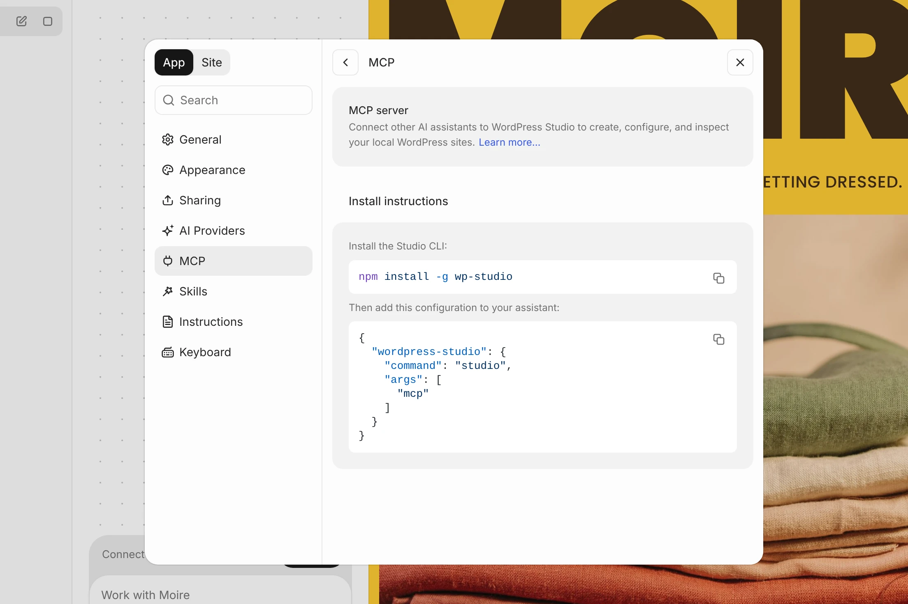

# MCP on WordPress Studio

Agent instruction files tell agents how to work with a WordPress Studio site, but they do not give agents direct access to it. For that, WordPress Studio also exposes an MCP (Model Context Protocol) server that agents connect to in order to create, start, stop, and interact with your local WordPress sites.

## [Install the WordPress Studio plugin](#install-the-wordpress-studio-plugin)

If you use Claude Code, Codex (in the ChatGPT app), Cursor, or Grok Build, install the WordPress Studio plugin to connect your agent to WordPress Studio. The plugin includes the WordPress Studio CLI, so there’s nothing else to install.

### [From WordPress Studio](#from-wordpress-studio)

The quickest way is from the app:

1.  Open **Settings** from the account menu at the bottom of the sidebar, or press ⌘, (Ctrl+, on Windows and Linux). Select **Agents**. In WordPress Studio 2.2.0, this page is called **MCP**.
2.  Next to **Claude Code**, **ChatGPT (Codex)**, **Cursor**, or **Grok Build**, click **Install** (**Connect** in 2.2.0). Apps WordPress Studio doesn’t find on your computer show **Not installed**.
3.  Start a new session or chat in that app. For ChatGPT, restart the app.

When a newer version of the plugin comes with a WordPress Studio update, the button shows **Update**.



You can also install the plugin from the terminal:

### [Claude Code](#claude-code)

Run these commands in your terminal:

```bash
claude plugin marketplace add Automattic/studio-plugins
claude plugin install wp-studio@studio
```

Claude Code runs the plugin with the Node.js on your `PATH`, version 22 or later. Start a new session afterwards, or run `/reload-plugins`.

### [Codex](#codex)

Run these commands in your terminal:

```bash
codex plugin marketplace add Automattic/studio-plugins
codex plugin add wp-studio@studio
```

If you use Codex in the ChatGPT app, restart the app afterwards.

## [Connect with manual MCP configuration](#connect-with-manual-mcp-configuration)

To configure MCP directly, open **Settings → Agents** (**Settings → MCP** in WordPress Studio 2.2.0). Run the CLI install command shown under **Manual MCP setup** (**Manual setup** in 2.2.0). Then use **Copy MCP configuration** and add the configuration to your agent’s MCP settings.

```json
{
  "wordpress-studio": {
    "command": "studio",
    "args": ["mcp"]
  }
}
```

For Claude Code or Codex you can also run the connection command directly from the terminal:

```
claude mcp add wordpress-studio -- studio mcp
codex mcp add wordpress-studio -- studio mcp
```

Common configuration file locations are:

-   Claude Desktop
    -   macOS: `~/Library/Application Support/Claude/claude_desktop_config.json`
    -   Windows: `%APPDATA%\Claude\claude_desktop_config.json`
-   Cursor:
    -   Project: `.cursor/mcp.json`
    -   Global `~/.cursor/mcp.json`

See the full setup guides for [Claude Code](https://code.claude.com/docs/en/mcp), [Claude Desktop,](https://modelcontextprotocol.io/docs/develop/connect-local-servers) [Codex](https://developers.openai.com/codex/mcp), [Cursor](https://cursor.com/docs/mcp#installing-mcp-servers), [Windsurf](https://docs.windsurf.com/windsurf/cascade/mcp), [VS Code](https://code.visualstudio.com/docs/copilot/customization/mcp-servers).

Once connected, the agent can use WordPress Studio tools such as creating sites, running WP-CLI commands, and taking screenshots, in addition to reading the instruction files and skills already present in the site directory.

## [What the agent gets](#0-what-the-agent-gets)

-   **WordPress Studio’s instructions and skills, on demand.** The agent calls a `studio_instructions` tool before its first WordPress task, so it follows the same workflow and rules as WordPress Studio Code, without WordPress Studio filling the agent’s context for every conversation.
-   **Local and WordPress.com sites.** The agent can work on your local WordPress Studio sites and on your WordPress.com sites, and can copy content between them.
-   **A picker for your site’s look and layout.** When you start a site, the agent can show rendered design options to choose from. In agents that render MCP Apps, such as Codex, you click an option. In other agents, the agent shows the previews in the chat and you reply with your choice. See [Designing a site](https://wordpress.studio/docs/studio-code/#designing-a-site).
-   **A WordPress tab.** In agent apps that render MCP Apps and support sidebar entries, a **WordPress** tab lists your local WordPress Studio sites and your WordPress.com sites.
-   **Site images.** When you’re logged in to WordPress.com, the agent can generate site images through WordPress Studio. Codex uses its own image tool instead. See [Image generation in WordPress Studio Code](https://wordpress.studio/docs/studio-code/image-generation/).
-   **Fewer approval prompts.** WordPress Studio tells the agent which tools only read, or only change, this machine, so agents like Codex don’t ask for approval before each of those calls.
