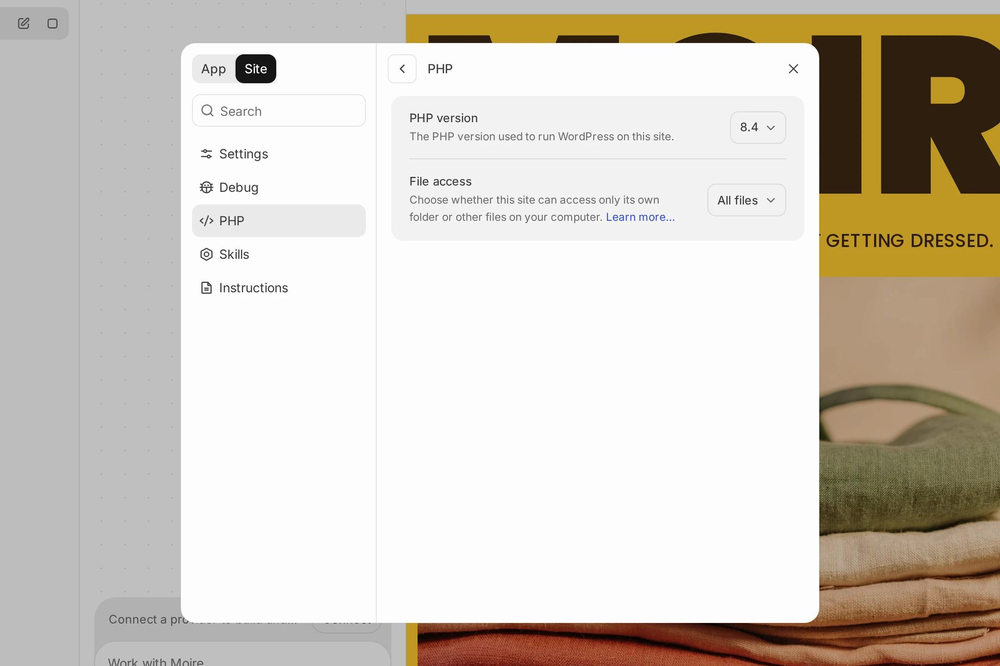

# PHP runtimes

WordPress Studio runs every site on native PHP binaries and supports PHP 8.2, 8.3, 8.4, and 8.5.

The backbone of every WordPress site is the PHP code that runs on the server. PHP is an interpreted language, meaning every WordPress site ships with actual source code rather than a compiled binary. To run this source code, a “PHP runtime” is needed.

Native PHP runs the code with few abstractions around the system, so sites are fast and behave like they would on a typical PHP server.

## PHP extensions

WordPress Studio’s PHP comes with the extensions most WordPress sites and plugins need, including APCu, BCMath, cURL, Exif, GD, igbinary, Intl, mbstring, MySQLi, OPcache, PDO MySQL and PDO SQLite, Redis, SOAP, Sockets, Sodium, SSH2, XSL, YAML, and Zip. On macOS and Linux, it also includes the Imagick extension, so WordPress can use ImageMagick to resize and convert images. [Xdebug](https://wordpress.studio/docs/xdebug/) is included and loads only on the site where you turn it on.

To check which extensions a site has, run `studio wp eval 'print_r( get_loaded_extensions() );'` from the site’s directory.

## PHP workers

Each site runs several PHP workers, and each worker serves one request at a time. By default, a site has 4 workers, so it can serve up to 4 requests at once. If a site serves many requests in parallel, for example from REST API clients, AI agents, or background tasks, you can give it more workers with the [WordPress Studio CLI](https://wordpress.studio/docs/cli/), from the site’s directory:

```
studio config set --php-workers 8
```

The number can be from 1 to 64. WordPress Studio restarts the site if it’s running. More workers don’t make a single request faster, and each one is another PHP process that uses more memory. To see the current number, run `studio config get php-workers`.

## [What happened to the Sandbox runtime?](#0-what-happened-to-the-sandbox-runtime-)

Earlier versions of WordPress Studio offered a second runtime, **Sandbox**, which ran sites on [WordPress Playground](https://wordpress.org/playground/) WebAssembly binaries. WordPress Studio 1.24.0 removed the Sandbox runtime and removed the PHP runtime setting from the create site form and site settings.

Sites that used the Sandbox runtime move to native PHP automatically the first time you open WordPress Studio or run a WordPress Studio CLI command after updating. You don’t need to do anything. If one of these sites was set to a PHP version that WordPress Studio no longer supports, such as PHP 7.4, WordPress Studio moves it to the closest supported version.

A few things to be aware of after the move:

-   Sites that are already running when you update aren’t restarted. They switch to native PHP the next time they start.
-   If you use Xdebug, you no longer need the `/wordpress` path mapping. Native PHP uses the real paths on disk, so remove any Sandbox path mappings from your editor. See [Xdebug in WordPress Studio](https://wordpress.studio/docs/xdebug/).
-   If you created a site with the experimental `pull-reprint` command while it was on the Sandbox runtime, you may need to pull it again.
-   Native PHP installs a site’s language pack if it’s missing, and WP-CLI can run as the root user, for example inside a Docker container.
-   On Windows, `wp-cli` steps in Blueprints don’t run yet on native PHP. This is a known issue.

The WordPress Studio CLI no longer accepts the `--runtime` option for `studio create` or `studio config set`.

## [File access](#1-file-access)

The **File access** setting controls which files PHP can access on your computer. It has two options:

-   **All files** (default): PHP can access any file on your system.
-   **Site directory:** PHP can only access the site directory, the system temporary directory, and a few WordPress Studio-specific directories, such as the one phpMyAdmin runs from.

Existing sites keep their current setting.

With **Site directory**, WordPress Studio applies PHP’s `open_basedir` directive and disables a small set of risky PHP functions, such as creating symlinks or sending signals to other processes. This is not a strict sandbox, but it provides some degree of protection around misbehaving or low-effort malicious code, such as path traversal bugs that try to read or delete files outside the site.

Symlinked files and directories inside the site, such as a plugin or theme you’ve symlinked from another folder, are allowed automatically. If you add a new symlink while the site is running, WordPress Studio restarts the site to allow it.

To restrict a site to its own directory, open the site’s settings (choose **Settings** from the site menu) and select the **PHP** page. Change the **File access** setting to **Site directory**, then click **Save** at the top of the dialog. **Site directory** makes pages load noticeably slower on Windows, because PHP turns off its file path cache when `open_basedir` is set. You can also choose the file access when creating a site, under **Advanced**.



To change the setting with the [WordPress Studio CLI](https://wordpress.studio/docs/cli/), run the following from the site’s directory:

```
studio config set --file-access site-directory
```

Use `--file-access all-files` to restore the default. You can also pass `--file-access` to `studio create`.

### [Child processes](#2-child-processes)

PHP can run external commands and spawn any child process, just like a typical local PHP installation. This keeps plugins and tools that shell out working, such as image processing, backups, and Git.

Child processes run as your user account and are not subject to the `open_basedir` restrictions of the main process. Because of this, the **Site directory** setting does not protect against deliberately malicious plugins or themes. Only install code you trust.
