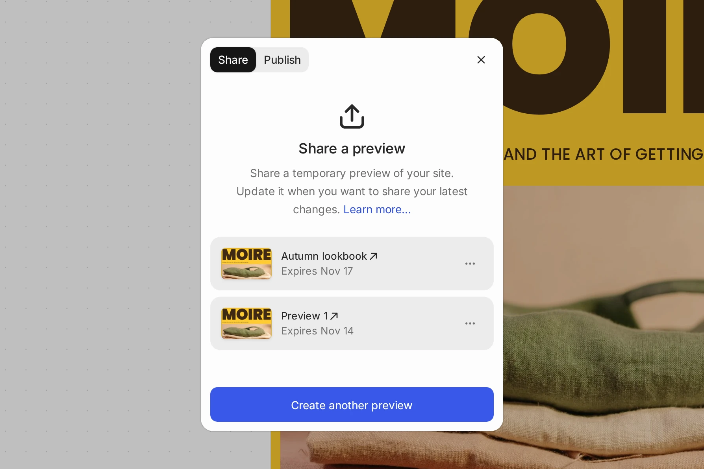
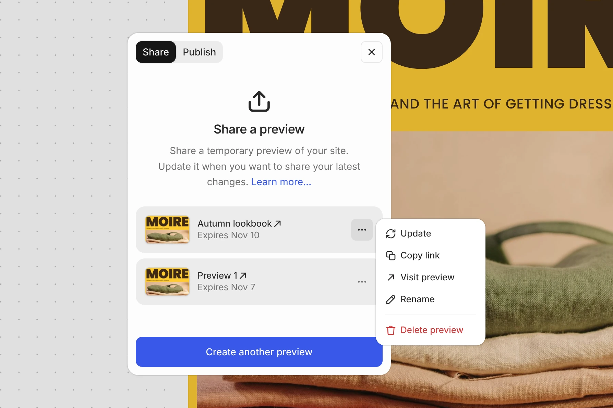
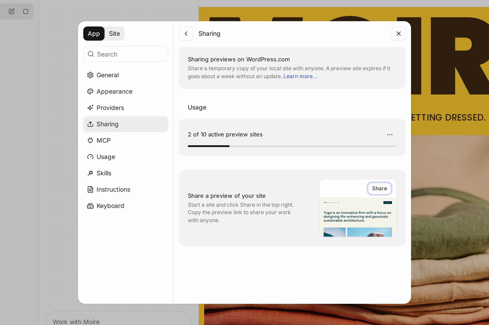

# Preview sites in WordPress Studio

With WordPress Studio, you can share your work with preview sites. Each preview is a temporary site on [WordPress.com](https://wordpress.com/?ref=dev-doc), shared through a preview link, and lets you share snapshots of your local sites with clients or team members. 

You can create up to ten preview sites at a time per WordPress.com account, and you can see how many you’re using in **Settings → Sharing** and **Settings → Usage** within the WordPress Studio app.

While preview sites are intended for sharing with clients and gathering early feedback for about a week, a hosting plan is required to make your site permanently accessible. Use [Publish](https://wordpress.studio/docs/sync/) or [Import/Export](https://wordpress.studio/docs/import-export/) to move your WordPress Studio site to a hosting plan.

## [Create a preview site](#0-create-a-preview-site)

To create a preview site: 

1.  Select the local site within WordPress Studio.
2.  Click **Share** above the site preview, next to **Publish**. You can also open the site menu and choose **Share → Create preview**, or **Share → Manage sharing** to open the panel. Once the site has previews, the **Share** submenu also has **Copy link** and **Visit preview** (**Copy links** and **Visit previews** when there are several).
3.  [Log in to WordPress.com](https://wordpress.studio/docs/#connect-to-wordpresscom) if you haven’t already.
4.  Under **Share a preview**, click **Create preview**. The button shows **Creating preview…** while WordPress Studio builds the preview.

Your preview site should be ready to view in about a minute, and anyone with its preview link can open it for about a week. You can close the panel while you wait. A notice shows the progress while the preview is being created or updated, and changes to a confirmation with a **Copy link** button when the preview is ready.

The **Share** panel lists the site’s previews, newest first. Each one shows its name and when it expires. Click a preview’s name to open it in your browser. When you open your own preview this way, WordPress Studio signs you in to it with your WordPress.com account; the link you copy for other people doesn’t. Open its **Preview actions** (**⋯**) menu to:

-   **Update** the preview with your latest local changes.
-   **Copy link** to the preview.
-   **Visit preview** in your browser.
-   **Rename** the preview.
-   **Delete preview**.

To create another preview of the same site, click **Create another preview** below the list.

Previews created with an earlier version of WordPress Studio, on a `wp.build` address, keep working until they expire. The first time you update one, WordPress Studio moves it to WordPress.com and its link changes, so share the new link. Previews of your sites that you created elsewhere with the same account, for example on another computer, are listed too.

WordPress Studio can’t create or update a preview when:

-   You’ve used all the preview sites available on your account. Delete a preview to make room. You can still copy and update your existing previews.
-   Preview sites aren’t available for your account.
-   You’re offline. Connect to the internet to create or update a preview.
-   The files WordPress Studio would upload are larger than 2 GB. Remove media files, plugins, or themes you don’t need, or [exclude them with .deployignore](#4-exclude-files-with-deployignore).
-   Another operation is running on the site. Wait for it to finish before creating or updating a preview.

## [Rename a preview site](#1-rename-a-preview-site)

You can create multiple preview sites per WordPress Studio site. To differentiate between them you can rename them inside WordPress Studio. To do so follow these steps:

1.  Select the local site within WordPress Studio, and click **Share**.
2.  Open the **Preview actions** (**⋯**) menu next to the preview you want to rename, and choose **Rename**.
3.  In the **Rename preview** dialog, enter a new name.
4.  Click **Save**.

Your preview site will display that name in WordPress Studio, while your remote preview site name will remain unchanged.

You can also rename any of your previews in **Settings → Sharing**.

## [Delete a preview site](#2-delete-a-preview-site)

To delete a preview site: 

1.  Select the local site within WordPress Studio, and click **Share**.
2.  Open the **Preview actions** (**⋯**) menu next to the preview you want to delete, and choose **Delete preview**.
3.  In the **Delete preview?** dialog, click **Delete preview** to confirm.

Your preview site will be deleted, and its shared link will stop working. You can also delete any of your previews in **Settings → Sharing**.

## [Update your preview site](#3-update-your-preview-site)

By design, preview sites are generated as one-time “snapshots” of your work. That said, you may synchronize local site changes with your preview site: 

1.  Select the local site within WordPress Studio, and click **Share**.
2.  Open the **Preview actions** (**⋯**) menu next to the preview you want to update, and choose **Update**.

Your preview site will be updated with the local changes in about a minute. While it updates, a notice shows the progress. This will also reset the preview site’s expiration date.

## [Exclude files with .deployignore](#4-exclude-files-with-deployignore)

When creating or updating a preview site, WordPress Studio uploads the contents of your site’s `wp-content` directory. If your site contains files you don’t want included — such as build artifacts, vendor dependencies, or large media folders — you can create a `.deployignore` file at the root of your site directory to exclude them.

The `.deployignore` file uses the same pattern syntax as `.gitignore`. For example:

\# Exclude vendor dependencies
wp-content/plugins/my-plugin/vendor

# Exclude all log files
\*.log

# Exclude old uploads
wp-content/uploads/2024

# Exclude a specific plugin
wp-content/plugins/wordpress-seo

You can also use negation patterns to re-include specific items:

\# Exclude vendor, but keep important-lib
wp-content/plugins/my-plugin/vendor/\*
!wp-content/plugins/my-plugin/vendor/important-lib

Note: Patterns are relative to the site root directory, not to `wp-content`. The following directories are excluded by default, even without a `.deployignore` file: `.git`, `node_modules`, `.DS_Store`, and `Thumbs.db`. WordPress Studio also leaves out themes that aren’t active (except the parent of the active theme), since they don’t change what the preview shows, and the plugins that WordPress.com provides on every site.

## [Preview site expiration](#5-preview-site-expiration)

Preview sites are temporary, and each preview site will be **automatically deleted about a week after its last update**. The **Share** panel shows the date each preview expires. This feature ensures that preview environments are used for short-term feedback and review purposes.

Expired previews no longer appear in the **Share** panel. To see them, open **Settings → Sharing** and click **Show expired previews (N)**, where N is the number of expired previews. They’re listed under **Expired previews**. Click **Remove expired preview** next to one to remove it from the list. To share the site again, create a new preview from the **Share** panel.

## [Manage all your preview sites](#manage-all-preview-sites)

**Settings → Sharing** lists the live previews of all your sites under **Live previews**, and how many of your preview sites you’ve used. For each preview, you can click its address to open it, see when it expires, and **Copy link**, **Rename preview**, or **Delete preview**. If you don’t have any live previews, the page shows **Share a preview of your site** instead.

## [Delete all preview sites](#7-delete-all-preview-sites)

To quickly delete all of your preview sites within WordPress Studio:

1.  Open **Settings** from the account menu at the bottom of the sidebar, or press ⌘, (Ctrl+, on Windows and Linux).
2.  Select the **Usage** page. You can also open it by choosing **Usage** from the account menu. Under **Usage**, WordPress Studio shows how many active preview sites you have, for example “3 of 10 active preview sites”.
3.  Open the **Preview site actions** (**⋯**) menu, click **Delete all preview sites**, and confirm.
