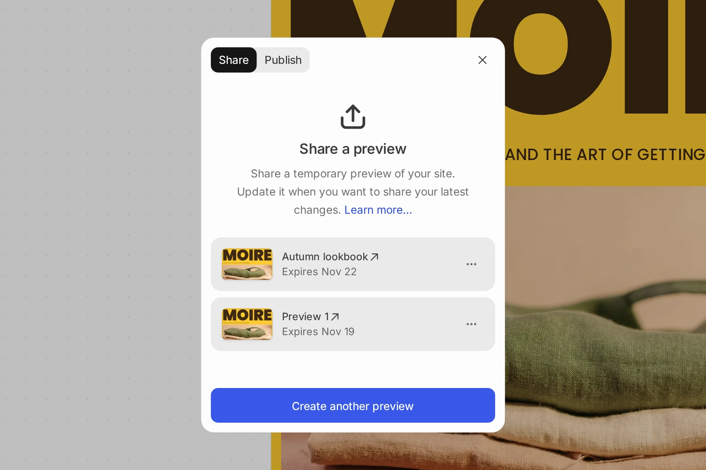

# Share a preview of your site

To share your local site with someone, create a preview in WordPress Studio. A preview is a temporary copy of your site on [WordPress.com](https://wordpress.com/?ref=dev-doc) that anyone with its preview link can open until it expires.

**Applies to:** the WordPress Studio app, with a WordPress.com account. Previews are hosted on WordPress.com.

Use previews to share work with clients or team members and gather early feedback. You can have up to ten previews at a time per WordPress.com account. To make your site permanently accessible, you need a hosting plan: use [Publish](https://wordpress.studio/docs/sync/) or [Import/Export](https://wordpress.studio/docs/import-export/) to move your WordPress Studio site to one.

## Before you start

- A local site in WordPress Studio.
- A WordPress.com account. Previews are hosted on WordPress.com, so you need a WordPress.com account even if your live site is somewhere else.

## Create a preview

1.  In WordPress Studio, select the local site.
2.  Click **Share** above the site preview, next to **Publish**.
3.  If you aren’t logged in, [log in to WordPress.com](https://wordpress.studio/docs/#connect-to-wordpresscom).
4.  Under **Share a preview**, click **Create preview**.

The button shows **Creating preview…** while WordPress Studio builds the preview. Your preview should be ready in about a minute. You can close the panel while you wait: a notice shows the progress, and when the preview is ready, the notice changes to a confirmation with a **Copy link** button. Anyone with the preview link can open the preview until it expires.

You can also start from the site menu: choose **Share → Create preview**, or **Share → Manage sharing** to open the **Share** panel. Once the site has previews, the **Share** submenu also has **Copy link** and **Visit preview** (**Copy links** and **Visit previews** when there are several).

### The Share panel

The **Share** panel lists the site’s previews, newest first. Each preview shows its name and when it expires. A [preview of changes to a live site](https://wordpress.studio/docs/preview-sites/#preview-changes-to-a-live-site) also shows which live site. Previews of your sites that you created elsewhere with the same WordPress.com account, for example on another computer, are listed too.

- Click a preview’s name to open it in your browser, the way visitors see it.
- Click **Create another preview** below the list to create another preview of the same site.
- Open a preview’s **Preview actions** (**⋯**) menu to **Update** it with your latest local changes, **Copy link**, **Visit preview** in your browser, open its **WordPress admin** (you sign in with your WordPress.com account on the way), **Rename** it, or **Delete preview**. The WordPress admin is the dashboard where you manage the site.

## Update a preview

A preview is a one-time snapshot of your local site. To bring a preview up to date with your local changes, update it. Updating also resets the preview’s expiration date.

1.  In WordPress Studio, select the local site.
2.  Click **Share**.
3.  Next to the preview, open the **Preview actions** (**⋯**) menu.
4.  Choose **Update**.

The preview is updated with your local changes in about a minute. While it updates, a notice shows the progress.

Previews created with an earlier version of WordPress Studio, on a `wp.build` address, keep working until they expire. When you update one, WordPress Studio makes a new preview on WordPress.com with a new preview link. Share the new preview link, because the old preview expires on its own.

## Preview expiration

Previews are temporary, for short-term feedback and review. A preview expires if it goes without an update for a while. WordPress.com sets the expiry date, and the **Share** panel shows it for each preview. When WordPress Studio has no expiry date from WordPress.com, for example for a preview on a `wp.build` address made by an earlier version of WordPress Studio, it shows an expiry one week after the preview’s last update.

Expired previews no longer appear in the **Share** panel. To see them:

1.  Press ⌘, (Ctrl+, on Windows and Linux) to open **Settings**.
2.  Select the **Sharing** page.
3.  Click **Show expired previews (N)**, where N is the number of expired previews.

Expired previews are listed under **Expired previews**. To remove one from the list, click **Remove expired preview** next to it. To share the site again, [create a new preview](https://wordpress.studio/docs/preview-sites/#create-a-preview) from the **Share** panel.

## Rename a preview

You can create more than one preview of a WordPress Studio site. Rename previews to tell them apart.

1.  In WordPress Studio, select the local site.
2.  Click **Share**.
3.  Next to the preview you want to rename, open the **Preview actions** (**⋯**) menu.
4.  Choose **Rename**.
5.  In the **Rename preview** dialog, enter a new name.
6.  Click **Save**.

The preview shows the new name in WordPress Studio. Its name on WordPress.com stays the same. You can also rename any of your previews in **Settings → Sharing**.

## Delete a preview

Deleting a preview deletes its copy of your site, and its preview link stops working.

1.  In WordPress Studio, select the local site.
2.  Click **Share**.
3.  Next to the preview you want to delete, open the **Preview actions** (**⋯**) menu.
4.  Choose **Delete preview**.
5.  In the **Delete preview?** dialog, click **Delete preview**.

You can also delete any of your previews in **Settings → Sharing**.

## Manage all your previews

**Settings → Sharing** lists the live previews of all your sites under **Live previews**, and how many of your previews you’ve used. For each preview, you can click its address to open it and see when it expires. You can also **Copy link**, **Rename preview**, or **Delete preview**. If you don’t have any live previews, the page shows **Share a preview of your site** instead.

To check how many previews you’re using, open **Settings → Sharing** or **Settings → Usage**.

## Delete all previews

To delete all of your previews at once, use the **Usage** page in **Settings**.

1.  Press ⌘, (Ctrl+, on Windows and Linux) to open **Settings**.
2.  Select the **Usage** page.
3.  Open the **Preview site actions** (**⋯**) menu.
4.  Click **Delete all preview sites**.
5.  Confirm.

You can also open **Settings** from the account menu at the bottom of the sidebar, or go straight to the **Usage** page by choosing **Usage** from the account menu. Under **Usage**, WordPress Studio shows how many active previews you have, for example “3 of 10 active preview sites”.

## Preview changes to a live site

When your local site is connected to a production WordPress.com site on a paid plan, its previews can show the changes you plan to publish to that live site. Share the preview so others can review the changes before you publish them.

This needs a local site that’s [connected](https://wordpress.studio/docs/sync/) to a production WordPress.com site on a paid plan. Staging sites and Pressable sites can’t be used for previews of changes.

1.  In WordPress Studio, select the local site.
2.  Click **Share** above the site preview, next to **Publish**.
3.  If the local site is connected to more than one production WordPress.com site on a paid plan, choose one under **Live site**.
4.  Click **Create preview**.

When the local site is connected to only one production WordPress.com site on a paid plan, new previews show changes to that site, so there’s nothing to choose. To create a preview that isn’t tied to a live site, choose **None** under **Live site**.

In the **Share** panel, a preview of changes to a live site shows **Changes to** and the live site’s name. Updating the preview keeps the live site it already shows.

To put the changes on the live site, [publish the local site to it](https://wordpress.studio/docs/sync/#publish-a-wordpress-studio-site-to-a-wordpresscom-site). If the local site has changed since the preview was last updated, the **Publish** panel warns you that publishing will also send changes the preview didn’t show.

If you buy a plan for a preview on WordPress.com, the preview becomes a WordPress.com site, and WordPress Studio connects it to the local site it was made from. The new WordPress.com site then appears in the local site’s **Publish** panel, and the local site’s next previews show changes to it.

From the command-line interface (CLI), `studio preview create` and `studio preview update` take `--live-site` with a connected site’s ID, or `none`.

## Troubleshooting

### Why can’t I create or update a preview?

WordPress Studio can’t create or update a preview when one of these is true:

- **You’ve used all the previews available on your account.** Delete a preview to make room. You can still copy and update your existing previews.
- **Previews aren’t available for your account.**
- **You’re offline.** Connect to the internet to create or update a preview.
- **The files WordPress Studio would upload are larger than 2 GB (gigabytes).** Remove media files, plugins, or themes you don’t need, or [exclude them with .deployignore](https://wordpress.studio/docs/deployignore/).
- **Another operation is running on the site.** Wait for it to finish, then create or update the preview.

### Why don’t my theme file edits show in the preview?

WordPress.com uses its own copy of the default WordPress themes, such as Twenty Twenty-Five. Changes you make to a default theme’s files, for example `parts/footer.html`, don’t show in a preview.

When the active theme is a default theme with edited files, the notice that the preview is ready warns “Theme file edits won’t show.” The preview is still created or updated. To see the changes in previews, make them in the Site Editor or in a child theme. The Site Editor is where you change your site’s design in WordPress. A child theme is a theme that builds on another theme.

### Why did my preview link change after I updated a preview?

The preview was created with an earlier version of WordPress Studio, on a `wp.build` address. Updating it makes a new preview on WordPress.com with a new preview link. Share the new preview link. The old preview keeps working until it expires.

### Why is a preview missing from the Share panel?

The preview has probably expired. A preview expires if it goes without an update for a while. See [Preview expiration](https://wordpress.studio/docs/preview-sites/#preview-expiration). To see expired previews, open **Settings → Sharing** and click **Show expired previews (N)**.

### Why doesn’t my preview show changes to my live site?

Check these:

- **The live site isn’t a production WordPress.com site on a paid plan.** Staging sites and Pressable sites can’t be used for previews of changes.
- **The local site isn’t connected to the live site.** [Connect it](https://wordpress.studio/docs/sync/) first.
- **The preview was created with Live site set to None, or for another live site.** Updating a preview keeps the live site it already shows. Create a new preview and choose the live site under **Live site**.

### Why does the Publish panel warn me before I publish a previewed site?

The local site has changed since the preview was last updated, so publishing would also send changes the preview didn’t show. Update the preview and review it again before you publish.

## Related

- [Exclude files from a preview with .deployignore](https://wordpress.studio/docs/deployignore/)
- [Publish](https://wordpress.studio/docs/sync/)
- [Import/Export](https://wordpress.studio/docs/import-export/)
