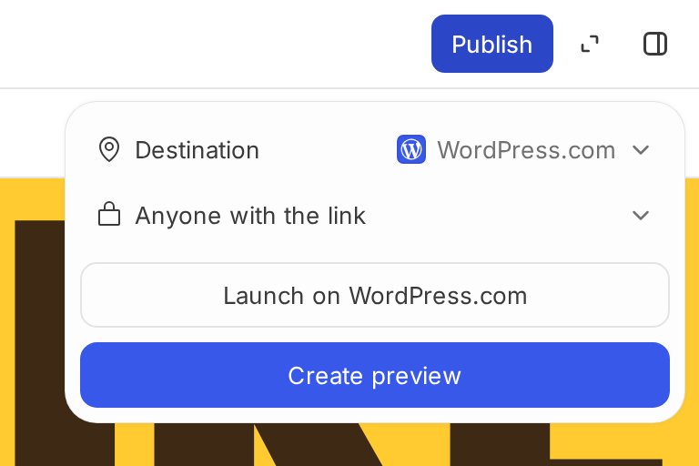
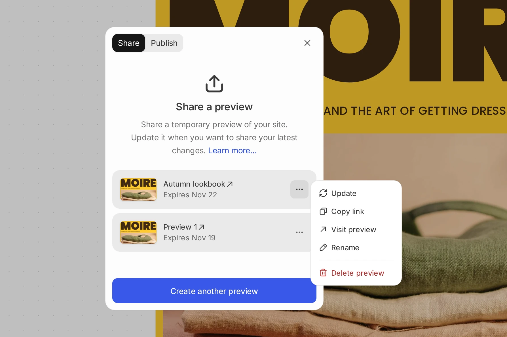

# Share a preview of your site

To share your local site, create a preview. A preview is a temporary copy of your site on WordPress.com that anyone with its link can open until it expires.

**Applies to:** the WordPress Studio app, with a WordPress.com account. Previews are hosted on WordPress.com.

Use previews to share work with clients or team members and gather early feedback. You can have up to ten previews at a time per WordPress.com account. Previews live in the **Publish** panel, next to the websites you [publish](https://wordpress.studio/docs/sync/) to. To make your site permanently accessible, publish it to a hosting plan, [make a preview your live site](https://wordpress.studio/docs/preview-sites/#make-a-preview-your-live-site), or use [Import/Export](https://wordpress.studio/docs/import-export/) to move it.

## Before you start

- A local site in WordPress Studio.
- A WordPress.com account. Previews are hosted on WordPress.com, so you need a WordPress.com account even if your live site is somewhere else.

## Create a preview

1.  In WordPress Studio, select the local site.
2.  Click **Publish** at the top right of the site preview.
3.  If the panel already shows a site or a preview, click **Publish somewhere else**.
4.  Under **Destination**, choose **WordPress.com**.
5.  Leave **Who can view** set to **Anyone with the link**.
6.  If you aren’t logged in, click **Connect to share previews** and [log in to WordPress.com](https://wordpress.studio/docs/#connect-to-wordpresscom).
7.  Click **Create preview**.

Your preview should be ready in about a minute. You can close the panel while you wait: a **Creating preview link…** notice shows the progress, and when the preview is ready, the notice changes to **Preview link ready** with a **Copy link** button. The **Publish** panel then shows the new preview’s **Preview details**. Anyone with the preview link can open the preview until it expires.

You can also start from the site menu: choose **Share → Create preview**. Once the site has previews, the **Share** submenu also has **Copy links** and **Visit previews**, which list the site’s previews by name.

### Preview details

To open a preview’s details, click **Publish**. If the site has more than one site or preview, choose the preview under **Choose a site**, where previews are listed below the websites. **Preview details** shows:

- The preview’s address. Click it to open the preview in your browser, the way visitors see it.
- **Preview actions** (**⋯**): **Copy link**, **Delete preview…**, and, when you can [pull from the preview](https://wordpress.studio/docs/preview-sites/#pull-changes-from-a-preview), **Pull from preview…**.
- **Who can view**: **Anyone with the link**.
- For a [preview of changes to a live site](https://wordpress.studio/docs/preview-sites/#preview-changes-to-a-live-site), **Changes to** and the live site’s name.
- **Update**, to [update the preview](https://wordpress.studio/docs/preview-sites/#update-a-preview) with your local changes.
- **Expires** and the date the preview expires.

To create another preview of the same site, click **Publish somewhere else** and follow the steps in [Create a preview](https://wordpress.studio/docs/preview-sites/#create-a-preview).

## Update a preview

A preview is a one-time snapshot of your local site. To bring a preview up to date with your local changes, update it. Updating also resets the preview’s expiration date.

1.  In WordPress Studio, select the local site.
2.  Click **Publish**.
3.  If the panel opens on **Choose a site**, click the preview.
4.  Click **Update**, or **Update…** when someone may have changed the preview.
5.  If WordPress Studio asks **Replace preview changes?**, or **Replace preview contents?** when it can’t tell whether anyone changed the preview, click **Replace preview**.

The preview is updated with your local changes in about a minute. While it updates, a notice shows the progress.

Previews created with an earlier version of WordPress Studio, on a `wp.build` address, keep working until they expire. When you update one, WordPress Studio makes a new preview on WordPress.com with a new preview link. Share the new preview link, because the old preview expires on its own.

## Pull changes from a preview

If the preview has changed since you last updated it, for example because someone edited it, **Preview details** says **Preview has changes**, or **Local and preview changes** when your local site has changed too. You can bring the preview into your local site.

1.  In the preview’s **Preview details**, click **Pull from preview…**.
2.  In **Update local site from** and the preview’s name, click **Replace local site**.

This replaces your local site with the preview, and any local changes are lost. Updating does the opposite: it replaces the preview with your local site.

When a preview has changes you can’t pull, **Preview details** says why, for example “Pulling from this preview is unavailable for this account.”

## Preview expiration

Previews are temporary, for short-term feedback and review. A preview expires if it goes without an update for a while. WordPress.com sets the expiry date. **Preview details** shows it next to **Expires**, and **Settings → Sharing** shows it for each preview. When WordPress Studio has no expiry date from WordPress.com, for example for a preview on a `wp.build` address made by an earlier version of WordPress Studio, it shows an expiry one week after the preview’s last update.

Expired previews no longer appear in the **Publish** panel. To see them:

1.  Press ⌘, (Ctrl+, on Windows and Linux) to open **Settings**.
2.  Select the **Sharing** page.
3.  Click **Show expired previews (N)**, where N is the number of expired previews.

Expired previews are listed under **Expired previews**. To remove one from the list, click **Remove expired preview** next to it. To share the site again, [create a new preview](https://wordpress.studio/docs/preview-sites/#create-a-preview).

## Rename a preview

You can create more than one preview of a WordPress Studio site. Rename previews to tell them apart.

1.  Press ⌘, (Ctrl+, on Windows and Linux) to open **Settings**.
2.  Select the **Sharing** page.
3.  Next to the preview you want to rename, click **Rename preview**.
4.  Under **Preview name**, enter a new name.
5.  Click **Save**.

The preview shows the new name in WordPress Studio. Its name on WordPress.com stays the same.

## Delete a preview

Deleting a preview deletes its copy of your site, and its preview link stops working. Your local site doesn’t change.

1.  In WordPress Studio, select the local site.
2.  Click **Publish**.
3.  If the panel opens on **Choose a site**, click the preview.
4.  Open the **Preview actions** (**⋯**) menu.
5.  Choose **Delete preview…**.
6.  In the **Delete preview?** dialog, click **Delete preview**.

You can also delete any of your previews in **Settings → Sharing**.

## Manage all your previews

**Settings → Sharing** lists the live previews of all your sites under **Live previews**, and how many of your previews you’ve used. For each preview, you can click its address to open it and see when it expires. You can also **Copy link**, **Rename preview**, or **Delete preview**. If you don’t have any live previews, the page shows **Share a preview of your site** instead.

To check how many previews you’re using, open **Settings → Sharing** or **Settings → Usage**.

## Delete all previews

To delete all of your previews at once, use the **Usage** page in **Settings**.

1.  Press ⌘, (Ctrl+, on Windows and Linux) to open **Settings**.
2.  Select the **Usage** page.
3.  Open the **Preview site actions** (**⋯**) menu.
4.  Click **Delete all preview sites**.
5.  Confirm.

You can also open **Settings** from the account menu at the bottom of the sidebar, or go straight to the **Usage** page by choosing **Usage** from the account menu. Under **Usage**, WordPress Studio shows how many active previews you have, for example “3 of 10 active preview sites”.

## Preview changes to a live site

When your local site is connected to a production WordPress.com site on a paid plan, its previews can show the changes you plan to publish to that live site. Share the preview so others can review the changes before you publish them.

This needs a local site that’s [connected](https://wordpress.studio/docs/sync/) to a production WordPress.com site on a paid plan. Staging sites and Pressable sites can’t be used for previews of changes.

[Create a preview](https://wordpress.studio/docs/preview-sites/#create-a-preview) as usual. When the local site is connected to one such live site, new previews show changes to it, so there’s nothing to choose. When it’s connected to more than one, **Create preview** opens **Live site**: choose the live site, or **None** for a preview that isn’t tied to a live site, then click **Create preview**.

A preview of changes to a live site shows **Changes to** and the live site’s name in its **Preview details**. Click it to open that live site in the **Publish** panel. Updating the preview keeps the live site it already shows.

To put the changes on the live site, [publish the local site to it](https://wordpress.studio/docs/sync/#publish-a-wordpress-studio-site-to-a-wordpresscom-site). If the local site has changed since the preview was last updated, **Publish changes?** warns you that publishing will also send changes the preview didn’t show.

From the command-line interface (CLI), `studio preview create` and `studio preview update` take `--live-site` with a connected site’s ID, or `none`.

## Make a preview your live site

A preview can become a WordPress.com site of its own: choose a paid plan for it on WordPress.com, and it goes live with everything built on it. This isn’t available for a preview of changes to a live site, which you publish to that site instead.

1.  Open the preview’s **Preview details**.
2.  Click **Launch on WordPress.com**, or choose **Everyone** under **Who can view** and click **Continue on WordPress.com**. WordPress.com opens in your browser.
3.  Choose a plan and complete the checkout.

If WordPress.com doesn’t offer this for the preview, **Who can view** shows only **Anyone with the link**.

When you buy a plan for a preview, the preview becomes a WordPress.com site, and WordPress Studio connects it to the local site it was made from. The new WordPress.com site then appears in the local site’s **Publish** panel, and the local site’s next previews show changes to it.

In the CLI, `studio preview create` and `studio preview update` print a “Make it your live site” link when WordPress.com offers one, and `studio preview launch <host>` opens it.

## Troubleshooting

### Why can’t I create or update a preview?

WordPress Studio can’t create or update a preview when one of these is true:

- **You’ve used all the previews available on your account.** **Create preview** opens **Preview limit reached**. Click **Open settings** and delete a preview to make room. You can still copy and update your existing previews.
- **Previews aren’t available for your account.** The panel says “Preview creation is temporarily unavailable for your account.”
- **You’re offline.** Connect to the internet to create or update a preview.
- **The files WordPress Studio would upload are larger than 2 GB (gigabytes).** Remove media files, plugins, or themes you don’t need, or [exclude them with .deployignore](https://wordpress.studio/docs/deployignore/).
- **Another operation is running on the site.** Wait for it to finish, then create or update the preview.

### Why don’t my theme file edits show in the preview?

WordPress.com uses its own copy of the default WordPress themes, such as Twenty Twenty-Five. Changes you make to a default theme’s files, for example `parts/footer.html`, don’t show in a preview.

When the active theme is a default theme with edited files, the notice that the preview is ready warns “Theme file edits won’t show.” The preview is still created or updated. To see the changes in previews, make them in the Site Editor or in a child theme. The Site Editor is where you change your site’s design in WordPress. A child theme is a theme that builds on another theme.

### Why did my preview link change after I updated a preview?

The preview was created with an earlier version of WordPress Studio, on a `wp.build` address. Updating it makes a new preview on WordPress.com with a new preview link. Share the new preview link. The old preview keeps working until it expires.

### Why is a preview missing from the Publish panel?

The preview has probably expired. A preview expires if it goes without an update for a while. See [Preview expiration](https://wordpress.studio/docs/preview-sites/#preview-expiration). To see expired previews, open **Settings → Sharing** and click **Show expired previews (N)**.

The **Publish** panel shows only the previews of the selected local site. A preview you made from a site on another computer is listed only in **Settings → Sharing**. If WordPress Studio lost track of which local site a preview was made from, for example because the preview’s first build failed, it shows the preview with that site again, as long as the site is on this computer.

### Why doesn’t my preview show changes to my live site?

Check these:

- **The live site isn’t a production WordPress.com site on a paid plan.** Staging sites and Pressable sites can’t be used for previews of changes.
- **The local site isn’t connected to the live site.** [Connect it](https://wordpress.studio/docs/sync/) first.
- **The preview was created with Live site set to None, or for another live site.** Updating a preview keeps the live site it already shows. Create a new preview and choose the live site under **Live site**.

### Why does Publish changes? warn me before I publish a previewed site?

The local site has changed since the preview was last updated, so publishing would also send changes the preview didn’t show. Update the preview and review it again before you publish.

## Related

- [Exclude files from a preview with .deployignore](https://wordpress.studio/docs/deployignore/)
- [Publish](https://wordpress.studio/docs/sync/)
- [Import/Export](https://wordpress.studio/docs/import-export/)
