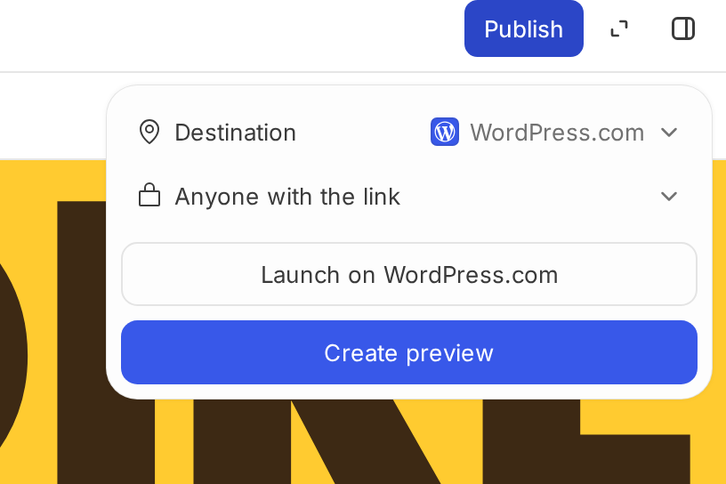
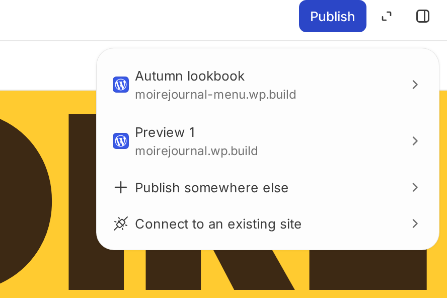
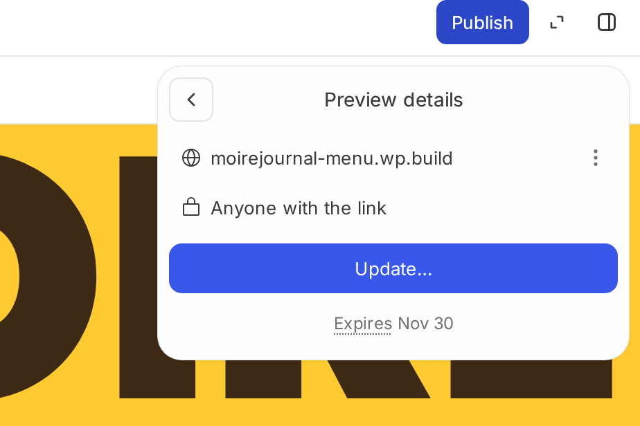
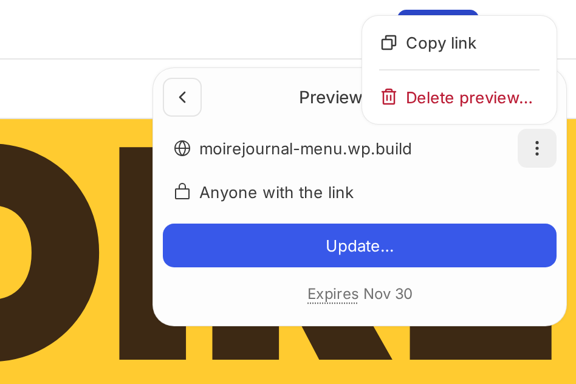
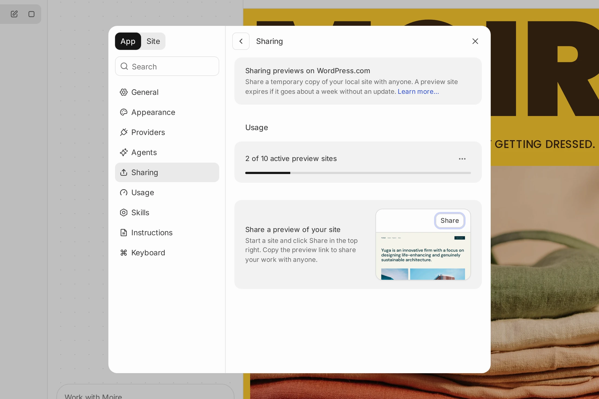

# Share a preview of your site

To share your local site, create a preview. A preview is a temporary copy of your site on WordPress.com that anyone with its link can open until it expires.

**Applies to:** the WordPress Studio app and WordPress Studio CLI, with a WordPress.com account. Previews are hosted on WordPress.com.

Use previews to share work with clients or team members and gather early feedback. You can have up to ten previews at a time per WordPress.com account. To make your site permanently accessible, you need a hosting plan: [make a preview your live site](https://wordpress.studio/docs/preview-sites/#make-a-preview-your-live-site), or use [Publish](https://wordpress.studio/docs/sync/) or [Import/Export](https://wordpress.studio/docs/import-export/) to move your WordPress Studio site to one.

## Before you start

- A local site in WordPress Studio.
- A WordPress.com account. Previews are hosted on WordPress.com, so you need a WordPress.com account even if your live site is somewhere else.

## Create a preview

1.  In WordPress Studio, select the local site.
2.  Click **Publish** at the top right of the site preview.
3.  If the site already has a website or a preview, click **Publish somewhere else**.
4.  Under **Destination**, choose **WordPress.com**, and leave **Who can view** on **Anyone with the link**.
5.  Click **Create preview**. If you aren’t logged in, the button says **Connect to share previews**: click it and [log in to WordPress.com](https://wordpress.studio/docs/#connect-to-wordpresscom) first.

The button shows **Creating preview** while WordPress Studio builds the preview. Your preview should be ready in about a minute. You can close the panel while you wait: a **Creating preview link…** notification shows the progress, and when the preview is ready, it changes to **Preview link ready** with a **Copy link** button. Anyone with the preview link can open the preview until it expires.

You can also start from the site menu: choose **Share → Create preview**. Once the site has previews, the **Share** submenu also has **Copy links** and **Visit previews**, which list the site’s previews by name.

### Find a preview

When a site has more than one preview or website, the **Publish** panel opens on **Choose a site**, which lists the site’s websites and then its previews by name. When it has just one, the panel opens on its details.

Click a preview to open **Preview details**:

-   Click the preview’s address to open it in your browser, the way visitors see it.
-   **Update…** brings the preview up to date with your local site. See [Update a preview](https://wordpress.studio/docs/preview-sites/#update-a-preview).
-   **Expires** shows when the preview expires.
-   The **Preview actions** (**⋯**) menu has **Copy link** and **Delete preview…**, and **Pull from preview…** when you can [pull from the preview](https://wordpress.studio/docs/preview-sites/#pull-changes-from-a-preview).

Previews of your sites that you created elsewhere with the same WordPress.com account, for example on another computer, are listed in **Settings → Sharing**.

## Update a preview

A preview is a one-time snapshot of your local site. To bring a preview up to date with your local changes, update it. Updating also resets the preview’s expiration date.

1.  In WordPress Studio, select the local site.
2.  Click **Publish**, and click the preview if the panel lists several.
3.  Click **Update…**.

If someone edited the preview, for example in its WordPress admin, or WordPress Studio can’t tell, it asks **Replace preview changes?** or **Replace preview contents?** first. Click **Replace preview** to replace them with your local site. To keep those edits, [pull them](https://wordpress.studio/docs/preview-sites/#pull-changes-from-a-preview) first. **Preview details** shows **Preview has changes** when the preview was edited, and **Local and preview changes** when both changed.

The preview is updated with your local changes in about a minute. While it updates, a notification shows the progress.

Previews created with an earlier version of WordPress Studio, on a `wp.build` address, keep working until they expire. When you update one, WordPress Studio makes a new preview on WordPress.com with a new preview link. Share the new preview link, because the old preview expires on its own.

## Pull changes from a preview

When people edit a preview, for example to add content, you can bring their changes into your local site.

1.  Open the preview’s **Preview details**.
2.  Click **Pull from preview…**, or choose it from the **Preview actions** (**⋯**) menu.
3.  In **Update local site from** the preview, click **Replace local site**.

This replaces your local site with the preview, and any local changes are lost. **Pull from preview…** appears only when your account can pull from that preview.

## Preview expiration

Previews are temporary, for short-term feedback and review. A preview expires if it goes without an update for a while. WordPress.com sets the expiry date, and **Preview details** shows it under the buttons. When WordPress Studio has no expiry date from WordPress.com, for example for a preview on a `wp.build` address made by an earlier version of WordPress Studio, it shows an expiry one week after the preview’s last update.

Expired previews no longer appear in the **Publish** panel. To see them:

1.  Press ⌘, (Ctrl+, on Windows and Linux) to open **Settings**.
2.  Select the **Sharing** page.
3.  Click **Show expired previews (N)**, where N is the number of expired previews.

Expired previews are listed under **Expired previews**. To remove one from the list, click **Remove expired preview** next to it. To share the site again, [create a new preview](https://wordpress.studio/docs/preview-sites/#create-a-preview).

## Rename a preview

You can create more than one preview of a WordPress Studio site. Rename previews to tell them apart.

1.  Open **Settings** and select the **Sharing** page.
2.  Next to the preview, click **Rename preview**.
3.  In the **Rename preview** dialog, enter a new name.
4.  Click **Save**.

The preview shows the new name in WordPress Studio. Its name on WordPress.com stays the same.

## Delete a preview

Deleting a preview deletes its copy of your site, and its preview link stops working.

1.  In WordPress Studio, select the local site.
2.  Click **Publish**, and click the preview if the panel lists several.
3.  Open the **Preview actions** (**⋯**) menu.
4.  Choose **Delete preview…**.
5.  In the **Delete preview?** dialog, click **Delete preview**.

You can also delete any of your previews in **Settings → Sharing**.

## Manage all your previews

**Settings → Sharing** lists the live previews of all your sites under **Live previews**, and how many of your previews you’ve used. For each preview, you can click its address to open it and see when it expires. You can also **Copy link**, **Rename preview**, or **Delete preview**. If you don’t have any live previews, the page shows **Share a preview of your site** instead.

To check how many previews you’re using, open **Settings → Sharing** or **Settings → Usage**.

## Delete all previews

To delete all of your previews at once, use the **Usage** page in **Settings**.

1.  Press ⌘, (Ctrl+, on Windows and Linux) to open **Settings**.
2.  Select the **Usage** page.
3.  Open the **Preview site actions** (**⋯**) menu.
4.  Click **Delete all preview sites**.
5.  Confirm.

You can also open **Settings** from the account menu at the bottom of the sidebar, or go straight to the **Usage** page by choosing **Usage** from the account menu. Under **Usage**, WordPress Studio shows how many active previews you have, for example “3 of 10 active preview sites”.

## Preview changes to a live site

When your local site is connected to a production WordPress.com site on a paid plan, its previews can show the changes you plan to publish to that live site. Share the preview so others can review the changes before you publish them.

This needs a local site that’s [connected](https://wordpress.studio/docs/sync/) to a production WordPress.com site on a paid plan. Staging sites and Pressable sites can’t be used for previews of changes.

1.  In WordPress Studio, select the local site.
2.  [Create a preview](https://wordpress.studio/docs/preview-sites/#create-a-preview).
3.  If the local site is connected to more than one production WordPress.com site on a paid plan, the **Live site** dialog asks which one the preview shows changes to. Choose one, and click **Create preview**.

When the local site is connected to only one production WordPress.com site on a paid plan, new previews show changes to that site, so there’s nothing to choose. To create a preview that isn’t tied to a live site, choose **None** under **Live site**.

In **Preview details**, a preview of changes to a live site shows **Changes to** and the live site’s name. Click it to open that site’s details. Updating the preview keeps the live site it already shows.

To put the changes on the live site, [publish the local site to it](https://wordpress.studio/docs/sync/#publish-a-wordpress-studio-site-to-a-wordpresscom-site). If the local site has changed since the preview was last updated, WordPress Studio warns you that publishing will also send changes the preview didn’t show.

From the command-line interface (CLI), `studio preview create` and `studio preview update` take `--live-site` with a connected site’s ID, or `none`.

## Make a preview your live site

To keep a preview, buy a WordPress.com plan for it. The preview becomes a WordPress.com site, and WordPress Studio connects it to the local site it was made from.

1.  Open the preview’s **Preview details**.
2.  Click **Launch on WordPress.com**, or set **Who can view** to **Everyone** and click **Continue on WordPress.com**.
3.  Choose a plan and complete the checkout in your browser.

The new WordPress.com site then appears in the local site’s **Publish** panel, and the local site’s next previews show changes to it. A preview of changes to a live site can’t be made live, and these choices only appear when WordPress.com offers a plan for the preview.

In the CLI, `studio preview launch <host>` opens the checkout for a preview, and `studio preview create` and `studio preview update` print a **Make it your live site** link.

## Troubleshooting

### Why can’t I create or update a preview?

WordPress Studio can’t create or update a preview when one of these is true:

- **You’ve used all the previews available on your account.** WordPress Studio shows **Preview limit reached**. Click **Open settings** and delete a preview in **Settings → Sharing** to make room. You can still copy and update your existing previews.
- **Previews aren’t available for your account.**
- **You’re offline.** Connect to the internet to create or update a preview.
- **The files WordPress Studio would upload are larger than 2 GB (gigabytes).** Remove media files, plugins, or themes you don’t need, or [exclude them with .deployignore](https://wordpress.studio/docs/deployignore/).
- **Another operation is running on the site.** Wait for it to finish, then create or update the preview.

### Why don’t my theme file edits show in the preview?

WordPress.com uses its own copy of the default WordPress themes, such as Twenty Twenty-Five. Changes you make to a default theme’s files, for example `parts/footer.html`, don’t show in a preview.

When the active theme is a default theme with edited files, the notice that the preview is ready warns “Theme file edits won’t show.” The preview is still created or updated. To see the changes in previews, make them in the Site Editor or in a child theme. The Site Editor is where you change your site’s design in WordPress. A child theme is a theme that builds on another theme.

### Why did my preview link change after I updated a preview?

The preview was created with an earlier version of WordPress Studio, on a `wp.build` address. Updating it makes a new preview on WordPress.com with a new preview link. Share the new preview link. The old preview keeps working until it expires.

### Why is a preview missing from the Publish panel?

The preview has probably expired, or it was made on another computer: the **Publish** panel lists only the previews of the selected local site. A preview expires if it goes without an update for a while. See [Preview expiration](https://wordpress.studio/docs/preview-sites/#preview-expiration). To see expired previews, open **Settings → Sharing** and click **Show expired previews (N)**.

### Why doesn’t my preview show changes to my live site?

Check these:

- **The live site isn’t a production WordPress.com site on a paid plan.** Staging sites and Pressable sites can’t be used for previews of changes.
- **The local site isn’t connected to the live site.** [Connect it](https://wordpress.studio/docs/sync/) first.
- **The preview was created with Live site set to None, or for another live site.** Updating a preview keeps the live site it already shows. Create a new preview and choose the live site under **Live site**.

### Why does WordPress Studio warn me before I publish a previewed site?

The local site has changed since the preview was last updated, so publishing would also send changes the preview didn’t show. Update the preview and review it again before you publish.

## Related

- [Exclude files from a preview with .deployignore](https://wordpress.studio/docs/deployignore/)
- [Publish](https://wordpress.studio/docs/sync/)
- [Import/Export](https://wordpress.studio/docs/import-export/)
