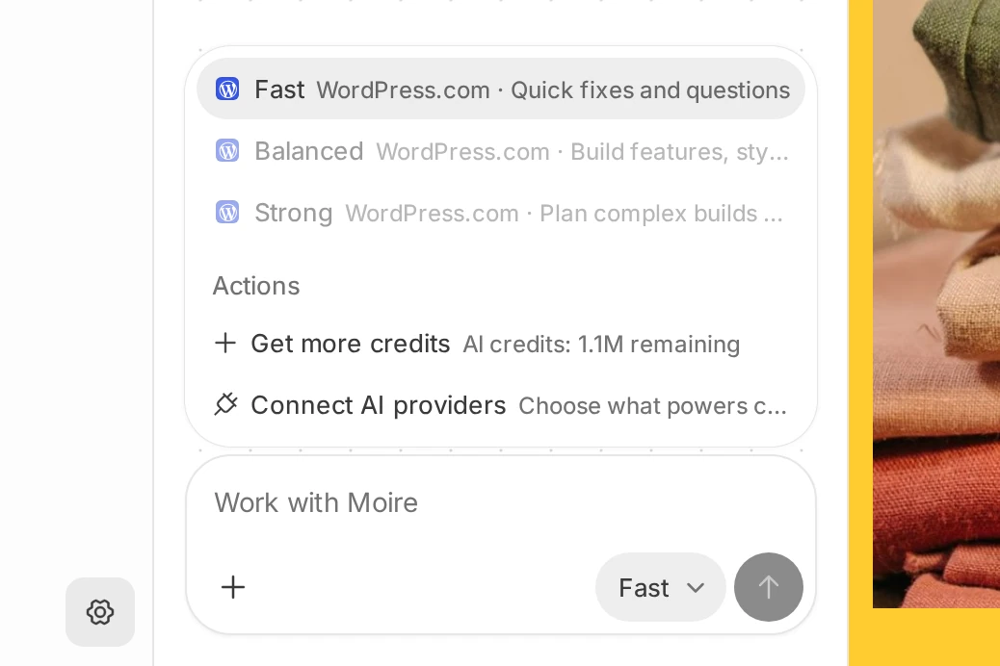

# Providers in WordPress Studio

Providers are the accounts WordPress Studio works with. **AI providers** power the chat in [WordPress Studio Code](https://wordpress.studio/docs/studio-code/), and **hosting providers** are where you publish your sites. You connect both kinds on one page, **Settings → Providers**.

WordPress.com is both an AI provider and a hosting provider, and logging in to WordPress.com connects it as both. Every other provider is optional: connect the ones you already pay for or prefer.

## Open the Providers page

-   **Desktop app and the `studio ui` browser app**: open **Settings** from the account menu at the bottom of the sidebar, or press ⌘, (Ctrl+, on Windows and Linux), and select **Providers**. You can also choose **Providers** from the account menu, or **Connect AI providers** from the chat box’s **+** menu or the model menu.
-   **Terminal**: use `/connect`, `/disconnect`, and `/provider` in `studio code`. See [Providers in the terminal](#providers-in-the-terminal).

The page has three groups: your defaults at the top, then **AI providers**, then **Hosting providers**. A provider you’ve connected is marked **Connected**.

## AI providers

WordPress Studio Code needs at least one connected AI provider before you can chat. Each provider brings its own models and its own billing:

| Provider | Connect with | Usage is billed to | Models | Generates images |
| --- | --- | --- | --- | --- |
| **WordPress.com** | Your WordPress.com account | Your [AI credits](https://wordpress.studio/docs/studio-code/ai-credits-guidelines/) | Fast, Balanced, Strong | Yes |
| **OpenAI** | A ChatGPT plan, or an API key | Your ChatGPT plan, or your OpenAI account | GPT-6.1 Terra, GPT-6.1 Sol | With an API key only |
| **Anthropic** | An API key, or a Claude subscription | Your Anthropic account, or your Claude plan | Sonnet 5.5, Opus 5.5 | No |
| **Google Gemini** | An API key | Your Google AI Studio project | Gemini 3.8 Flash, Gemini 4 Argon | Yes |
| **GitHub Copilot** | A GitHub account with Copilot access | Your Copilot plan | The models your plan offers among Sonnet 5.5, GPT-6.1 Terra, and Gemini 4 Argon | No |
| **Meta** | An API key | Your Meta Model API account | Muse Spark 1.3, Muse Wonder | Yes |

When a provider offers more than one way to connect, **Connect** opens a menu of them. A key or token is saved when you click **Save**, and WordPress Studio then shows only its last characters.

### WordPress.com

Click **Connect** and log in with your WordPress.com account in your browser. This is the default provider. It needs no API key: every account starts with a one-time free allowance of AI credits, and you buy more as you go. Once you’re logged in, the button becomes **Manage AI credits**.

Instead of naming models, WordPress.com offers three tiers. See [Choosing an AI model tier in WordPress Studio Code](https://wordpress.studio/docs/studio-code/choosing-an-ai-model-tier-in-studio-code/).

### OpenAI

Click **Connect** and choose one of:

-   **ChatGPT plan**: WordPress Studio opens ChatGPT’s sign-in in your browser. Sign in and approve, then return to WordPress Studio. If you closed the browser tab, click **Try again**. Usage counts against your [ChatGPT plan](https://help.openai.com/en/articles/20001542-using-your-chatgpt-plan-in-other-apps-and-sites).
-   **API key**: create a key in the [OpenAI Platform](https://platform.openai.com/api-keys), paste it in **OpenAI API key**, and click **Save**. Usage is billed through your OpenAI account.

Only the API key can [generate images](https://wordpress.studio/docs/studio-code/image-generation/).

### Anthropic

Click **Connect** and choose one of:

-   **API key**: create a key in the [Claude Console](https://platform.claude.com/settings/keys), paste it in **Anthropic API key**, and click **Save**. Usage is billed through your Anthropic account.
-   **Claude subscription**: use your Claude plan, such as Pro or Max, instead of a key.
    1.  Install [Claude Code](https://code.claude.com/docs/en/setup), if you don’t have it yet.
    2.  Run `claude setup-token` in a terminal, and sign in with your Claude account.
    3.  Paste the token it prints in **Claude subscription token**, and click **Save**. The token starts with `sk-ant-oat01-`; an API key isn’t accepted here.

    Usage counts against your Claude plan.

### Google Gemini

Click **Connect**, create a key in [Google AI Studio](https://aistudio.google.com/apikey), paste it in **Gemini API key**, and click **Save**. Usage is billed through your Google AI Studio project.

### GitHub Copilot

Click **Connect**. WordPress Studio shows a sign-in code next to **GitHub Copilot**: approve that code on GitHub in your browser, with a GitHub account that has [Copilot access](https://github.com/features/copilot/plans). Usage counts against your Copilot plan, and the model menu lists only the models your plan offers.

### Meta

Click **Connect**, create a key in the API keys tab of the [Meta Model API dashboard](https://dev.meta.ai), paste it in **Meta API key**, and click **Save**. Usage is billed through your Meta Model API account.

### Change or disconnect an AI provider

-   **OpenAI and Anthropic**: click **Manage**, then choose the other way to connect, or **Disconnect**.
-   **Google Gemini and Meta**: click **Manage** to enter a new key, or click **Disconnect**.
-   **GitHub Copilot**: click **Disconnect**.
-   **WordPress.com**: choose **Log out** from the account menu. This also disconnects WordPress.com as a hosting provider.

### Choose the provider and model for a chat

Use **Default AI provider**, at the top of the page, to choose which connected provider new chats use.

The model menu in the chat box lists the models of every connected provider, so you can pick a different one for a particular chat. WordPress.com models appear as tiers, and other providers’ models appear by name. When you’re connected with a ChatGPT, Claude, or Copilot plan, the menu says which plan you’re using and links to **Manage usage** for it.

Switching a chat to another provider’s model starts a new chat, because the models don’t share memory. WordPress Studio asks you to confirm first (**Start a new chat?**), and your previous chat stays in the sidebar.

Only some providers generate site images: WordPress.com, OpenAI with an API key, Google Gemini, and Meta. WordPress Studio Code uses the chat’s provider when it can, and otherwise the first connected provider that can. See [Image generation in WordPress Studio Code](https://wordpress.studio/docs/studio-code/image-generation/).

## Hosting providers

Hosting providers are where **Publish** sends your site.

| Provider | What you can publish | Connect with |
| --- | --- | --- |
| **WordPress.com** | A new site, or an existing site on WordPress.com or Pressable. You can also pull a site into WordPress Studio and share [preview sites](https://wordpress.studio/docs/preview-sites/). | Your WordPress.com account |
| **Spacefast** | A static copy of your site, in a Spacefast Space. Publishing only: you can’t pull from Spacefast. | Your Spacefast account |

### WordPress.com and Pressable

Click **Connect** and log in with your WordPress.com account. If you’re already logged in, WordPress.com is connected.

Pressable isn’t connected separately. Your Pressable sites appear with your WordPress.com sites once Jetpack on the Pressable site is connected to the same WordPress.com account you use in WordPress Studio. See [Compatible sites](https://wordpress.studio/docs/sync/#supported-sites) for which sites you can publish to.

### Spacefast

Click **Connect** next to **Spacefast**. The **Connect to Spacefast** dialog shows a sign-in code: click **Open Spacefast**, check that the code in your browser matches, and approve the connection. To disconnect, click **Disconnect**.

See [Publish a static copy to Spacefast](https://wordpress.studio/docs/sync/#publish-a-static-copy-to-spacefast) for what a static copy includes and how to publish one.

### Choose where Publish goes

Use **Default hosting provider**, at the top of the page, to choose which connected provider WordPress Studio opens when you publish a site you haven’t published yet. If you’ve connected only one, WordPress Studio opens that one. Without a default, it asks **Where do you want to publish?** From a provider’s publishing setup, click **Choose another host** to pick a different one.

For the full publishing steps, see [WordPress Studio Sync](https://wordpress.studio/docs/sync/).

## Providers in the terminal

In `studio code`, manage providers with slash commands:

| Command | What it does |
| --- | --- |
| `/connect` | Connect a provider. Choose one from the list, or name it: `/connect wpcom`, `/connect anthropic`, `/connect openai`, `/connect gemini`, `/connect github-copilot`, `/connect meta`, or `/connect spacefast`. Running it for a connected provider lets you change its key. |
| `/disconnect` | Disconnect a provider. Disconnecting WordPress.com logs you out. |
| `/provider` | Switch the AI provider. This also changes the **Default AI provider**. |
| `/model` | Switch the AI model or tier. |
| `/login`, `/logout` | Log in to or out of WordPress.com. |

Providers you connect in the terminal are connected in the desktop app too, and the other way around.

## What needs a WordPress.com account

You can chat in WordPress Studio Code without a WordPress.com account, as long as another AI provider is connected. These features still need a WordPress.com login:

-   WordPress.com AI credits and the Fast, Balanced, and Strong tiers.
-   [Preview sites](https://wordpress.studio/docs/preview-sites/).
-   Publishing to, and pulling from, WordPress.com and Pressable sites.
-   Working on your WordPress.com sites from a chat.
-   [Sending feedback from a chat](https://wordpress.studio/docs/studio-code/#send-feedback-from-a-chat).

## Providers and agents

Providers bring AI models and hosting *into* WordPress Studio. The **Agents** page of Settings does the reverse: it connects other agent apps, such as Claude Code, ChatGPT (Codex), Cursor, and Grok Build, to WordPress Studio, so they can work on your sites with their own models and accounts. See [MCP on WordPress Studio](https://wordpress.studio/docs/mcp-on-studio/).
