# WordPress Studio sites

A WordPress Studio site is a WordPress instance running locally on your computer, and each of your sites will be listed in the WordPress Studio sidebar. 

WordPress Studio allows you to create, maintain, and work on **unlimited local WordPress websites**.

## [Add a new site](#0-add-a-new-site)

To add a new site to WordPress Studio:

1.  Click the **Add site** (**+**) button next to **Sites** at the top of the sidebar, or press ⌘N (Ctrl+N on Windows and Linux), to open the **Add site** dialog.
2.  The dialog lists the ways to add a site on the left: **New**, **Connect** (see [WordPress Studio Sync](https://wordpress.studio/docs/sync/)), and **Import** (see [Import & export](https://wordpress.studio/docs/import-export/) and [Blueprints](https://wordpress.studio/docs/blueprints/)), followed by Blueprint **Categories**.

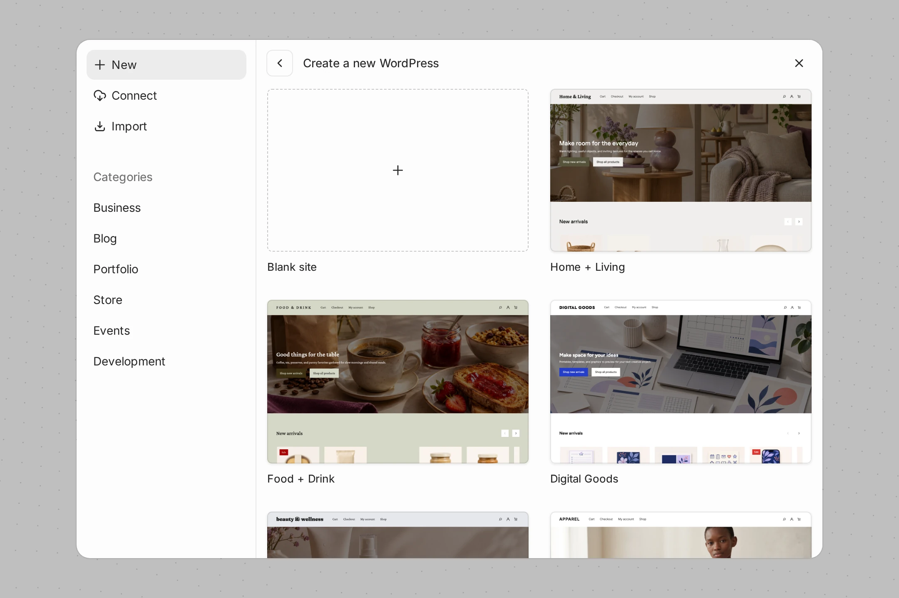

3.  For now, stay on **New**. Under **Create a new WordPress**, click **Blank site**.
4.  On the **Add site** form, enter a **Site name**. WordPress Studio fills in the **Site folder** from the name, inside your default directory. You can type another folder name, or click **Change…** to choose a different folder. The folder must be empty, or contain an existing WordPress site.
5.  (Optional) Under **Start from**, click **Choose…** to start the site from an existing WordPress folder, a Blueprint, a backup, or a WordPress export. See [Blueprints](https://wordpress.studio/docs/blueprints/) and [Import & export](https://wordpress.studio/docs/import-export/).
6.  (Optional) Click **Advanced** to change the following settings:
    -   **WordPress version**: keep **Auto-update** to let WordPress update itself, or pick a specific version
    -   **PHP version**
    -   **File access**: see [PHP runtimes](https://wordpress.studio/docs/php-runtimes/)
    -   **WordPress credentials**: click **Change** to set the admin **Username**, **Password**, and **Email**
    -   **Domain name** and **HTTPS**: see [Using a custom domain and SSL](#Using-a-custom-domain-and-SSL)
7.  Click **Add site**.

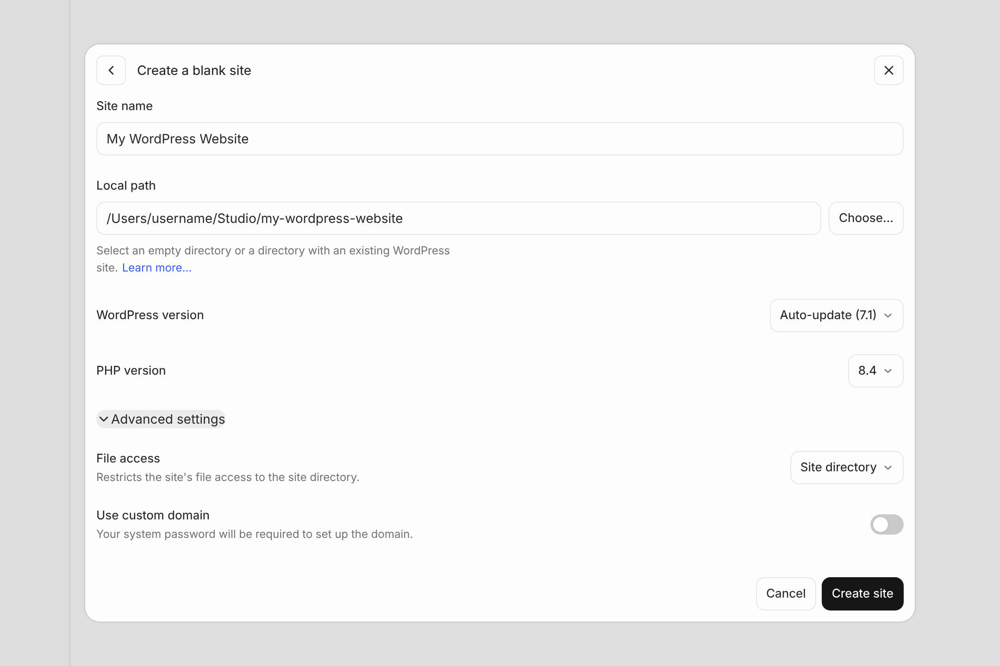

Any new site is started by default and opens in the site preview. If the site can’t be created, the error stays on screen until you dismiss it.

To go back to an earlier screen of the **Add site** dialog, click **Back** at its top left. WordPress Studio keeps what you entered.

New sites are created in the **Default directory** set in **Settings → General**.

### [Using a custom domain and SSL](#Using-a-custom-domain-and-SSL)

By default, new WordPress Studio sites use `localhost`. If you prefer to use a custom domain, click **Advanced** when creating the site and enter it under **Domain name**. Custom domains must end in `.local`.

After clicking **Add site**, you will be prompted to enter your system password. Once confirmed, the custom domain will then point to your WordPress Studio site.

You can optionally enable HTTPS (SSL) for your custom domain by turning on **HTTPS** next to the domain name. Refer to the [“SSL in WordPress Studio” doc page](https://wordpress.studio/docs/ssl-in-studio/) to learn more about this functionality.

### [Add a new site using an existing WordPress directory](#2-add-a-new-site-using-an-existing-wordpress-directory)

You can also add a site to WordPress Studio using an existing WordPress directory:

1.  Remove `wp-config.php` file from the existing WordPress site directory.
2.  Click the **Add site** (**+**) button and choose **Blank site**.
3.  Under **Start from**, click **Choose…** and select the directory with the existing WordPress site. You can also click **Change…** next to **Site folder** and select it there. WordPress Studio shows “Studio will use this WordPress site in place. No files will be moved.”
4.  Name your site and click **Add site**.

In the desktop app, you can also choose **File → Open Folder…** (⌘O, or Ctrl+O on Windows and Linux) and select the directory. Adding an existing WordPress folder isn’t available in the `studio ui` browser app.

If you’d prefer to use an existing `wp-config.php` file, [you can follow these instructions](https://wordpress.studio/docs/frequently-asked-questions/#how-can-i-use-wordpress-studio-with-the-mysql-server-of-my-choice).

## [Starting and stopping sites](#start-stop)

A site needs to be running to show in the site preview. If you open a stopped site in your browser from the site menu’s **Open in** submenu, or open one of its **Tools**, WordPress Studio starts it first.

Each site in the sidebar has a **Start site** or **Stop site** button next to its name. Click it to start or stop the site.

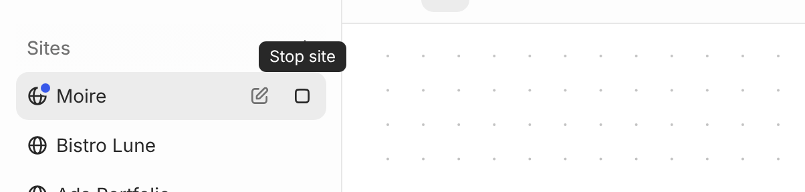

When a site is stopped, WordPress Studio shows a saved image of the site’s home page with a start button over it. Click the image to start the site. The send button in the chat box also becomes **Start site**.

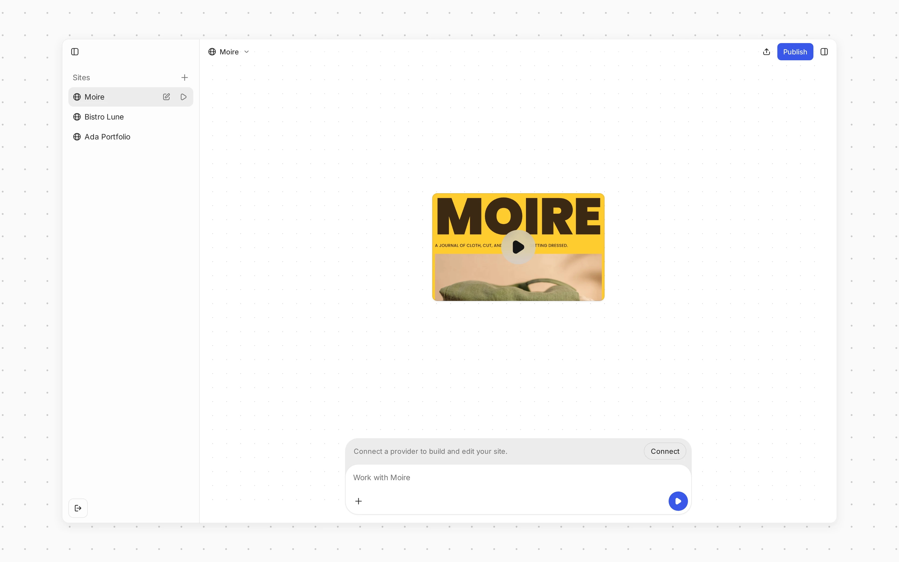

You can also start and stop a site from its [site menu](#site-menu), or press ⌥⌘S (Ctrl+Alt+S on Windows and Linux) to start or stop the active site. When several sites are running, the menu’s **Stop** becomes a submenu with **Stop site**, **Stop other sites**, and **Stop all sites**. To restart a site, search for **Restart site** in the command palette.

When you quit WordPress Studio while sites are running, WordPress Studio asks what to do with them. To choose a default, open **Settings → General** and set **When WordPress Studio quits** to **Keep sites running**, **Stop, restart on next launch**, or **Stop sites**.

To have WordPress Studio start a stopped site when you send it a WordPress Studio Code message, turn on **Start site when sending a prompt** in **Settings → General**, or click **+** in the chat box and choose **Auto-start**. To choose whether the chat shows beside the panel when you start a site, turn **Start sites with chat** on or off in the same place.

### [View sites](#4-view-sites)

The selected site is shown in the panel on the right of the WordPress Studio window. The panel works like a small browser: it has tabs, and each tab has **Back**, **Forward**, and **Reload** buttons, an address bar, **Annotate**, and **Browser options** (**⋮**). Above the tabs you’ll find **Share**, **Publish**, **Expand panel**, and **Hide panel**.

To open something in a new tab, click **New tab** (**+**) next to the tabs and choose:

-   **Browser**: the site’s front end
-   **Admin**: WP Admin, logged in
-   **Design System**: the site’s design system, when it has one (see [Designing a site](https://wordpress.studio/docs/studio-code/#designing-a-site))
-   **Database**: phpMyAdmin (see [Debugging in WordPress Studio](https://wordpress.studio/docs/debugging/))
-   **Email log**: the emails the site has sent (see [Site email](#site-email))

Each one has a single-letter shortcut, shown in the menu (B, A, S, D, and E), which works when a new tab is open. The same list is in the site menu, under **Tools**.

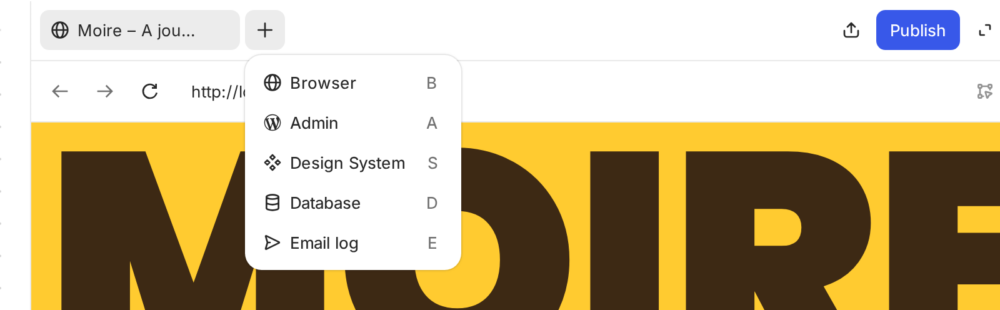

Drag tabs to reorder them. Right-click a tab for **New tab**, **Close tab**, **Close other tabs**, **Close tabs to the right**, and **Close all tabs**, or to open its page in your browser.

In the address bar, type a path or an address on the site and press Enter. Click the address bar to go back to a page under **Recent pages**.

You do not need a username or password to view your site’s dashboard in the preview, as you will be automatically logged in.

To view a running site in your browser:

-   **Open this page**: Click **Open this page in your browser** at the end of the address bar to open the page shown in the preview in your browser.
-   **Open site**: Open the site menu and choose **Open in → Browser** to open your local site’s homepage. The front end opens in your external browser without logging you into WP Admin.

Links in the site preview that open a new window, such as **View post** and the editor’s **Preview**, open in the preview. Links to other websites open in your system browser.

To give the preview more room, click **Expand panel** in the header, which hides the chat. Click **Show chat** to bring it back. To hide the panel instead, click **Hide panel** or press ⇧⌘B (Ctrl+Shift+B on Windows and Linux). In the desktop app, the **View** menu also switches between **Chat** (⌘1), **Split view** (⌘2), and **Panel** (⌘3). Each site remembers its layout and how wide the chat and panel are. To restore the defaults, click **Reset interface** in **Settings → General**.

### [Browser options](#browser-options)

The **Browser options** (**⋮**) menu at the end of the address bar has:

-   **Show admin bar** or **Hide admin bar**: shows or hides the WordPress admin bar on the site’s front end, for this site. To hide it on all your local sites by default, turn on **Hide admin bar** in **Settings → General**.
-   **Show device toolbar** or **Hide device toolbar**: see [Device toolbar](#responsive-mode)
-   **Take screenshot**: attaches a picture of the page shown in the preview to the site’s chat, so you can send it to WordPress Studio Code. Available in the desktop app.

In the desktop app, the menu also has **Appearance** (**System**, **Light**, or **Dark**: the color scheme the previewed page is shown in), **Developer tools**, and **Clear browsing data**.

When the WordPress Studio window is narrow, **Annotate** moves into this menu too.

### [Device toolbar](#responsive-mode)

The device toolbar shows the site preview at the size of another screen, such as a phone, a tablet, or a large desktop, so you can check how your site looks there.

To turn it on, open **Browser options** (**⋮**) and choose **Show device toolbar**. A toolbar appears above the preview, and the page is shown at the chosen size:

-   The device menu, at the start of the toolbar: choose **Responsive** to set any size, or pick a device such as **iPhone 17**, **Pixel 10**, **iPad mini**, or **Desktop**. Each device shows its width and height.
-   **Width** and **Height**: type a size in pixels and press Enter. Sizes can be from 100 to 3840 pixels. Press Escape to cancel.
-   **Rotate to landscape** or **Rotate to portrait**: swaps the width and height.
-   The zoom menu: **Fit** scales the page to fit the preview. You can also choose 50%, 75%, 100%, 125%, 150%, or 200%.

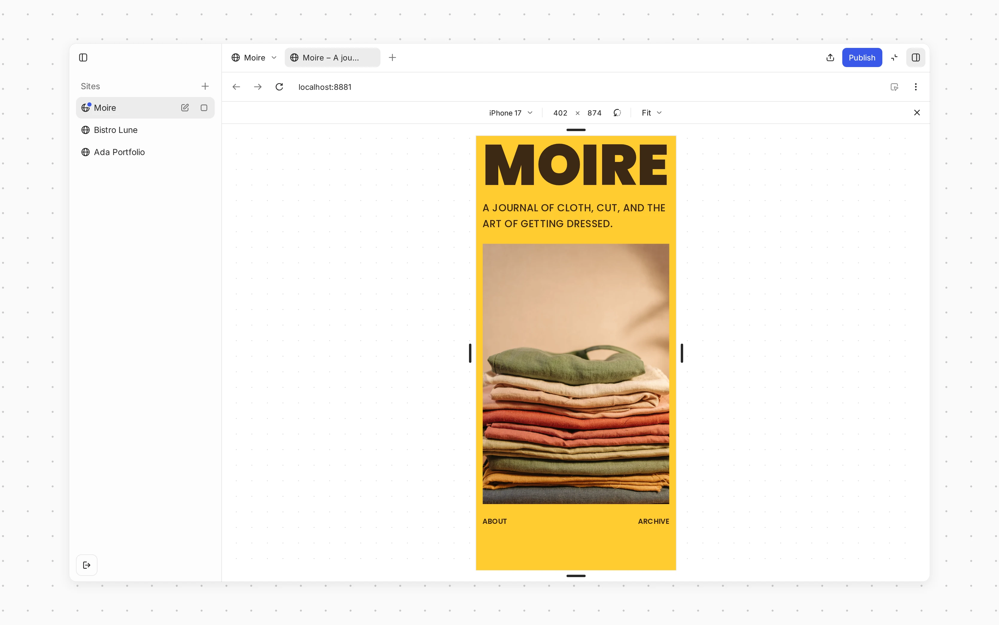

To resize the page by hand, drag any of its edges. You can also click an edge and use the arrow keys; hold Shift to move 10 pixels at a time. When you change the size by hand, the device menu switches to **Responsive**.

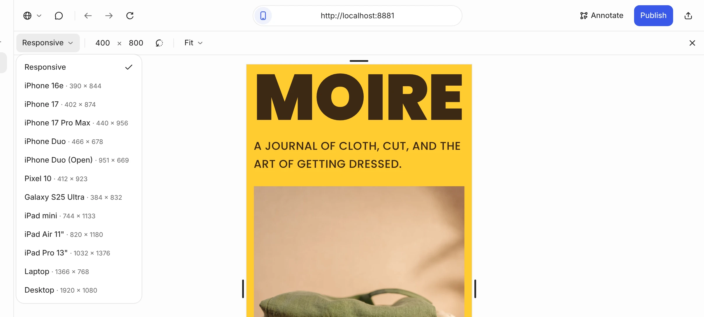

Each site keeps its device toolbar settings until you stop the site or quit WordPress Studio. The device toolbar isn’t available while the preview shows the **Database**, the **Email log**, or the **Design System**. To go back to the full-size preview, click **Hide device toolbar** (**×**) at the end of the toolbar, or choose **Hide device toolbar** from **Browser options**.

## [Site menu](#site-menu)

Each site has a menu with quick access to everything you can do with it. To open it, click the **Site menu** button, which shows the site’s name, at the top left of the site’s header, or right-click the site in the sidebar.

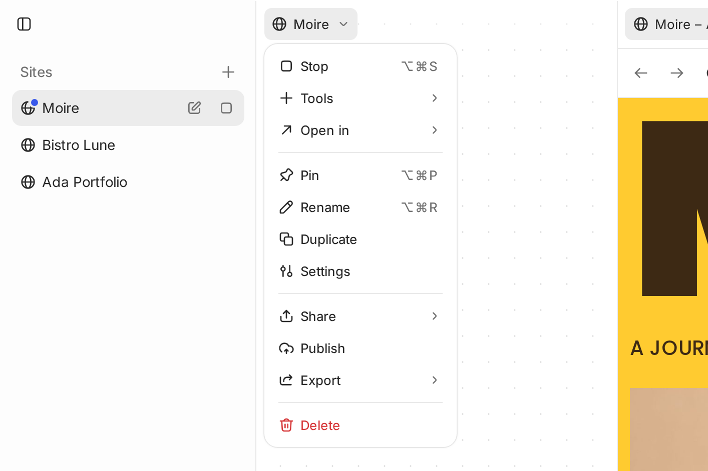

The site menu includes:

-   **New chat**: starts a new [WordPress Studio Code](https://wordpress.studio/docs/studio-code/) chat for the site. It appears once you’ve connected an AI provider.
-   **Start** or **Stop** (a submenu with **Stop site**, **Stop other sites**, and **Stop all sites** when several sites are running)
-   **Tools**: opens the site’s **Browser**, **Admin**, **Design System** (when it has one), **Database**, or **Email log** in the site preview (see [View sites](#4-view-sites))
-   **Open in**: opens the site in other apps (see below)
-   **Pin** or **Unpin**: keeps the site in the **Pinned** section at the top of the sidebar
-   **Rename**
-   **Duplicate**: a notice shows the progress while WordPress Studio copies the site
-   **Settings**: opens the site’s [settings](#site-settings)
-   **Share**: see [Preview sites](https://wordpress.studio/docs/preview-sites/)
-   **Publish**: see [WordPress Studio Sync](https://wordpress.studio/docs/sync/)
-   **Export** (**Export site** or **Export database**): see [Import & export](https://wordpress.studio/docs/import-export/)
-   **Delete**

Site actions are also available in the command palette: press ⌘K (Ctrl+K on Windows and Linux) and start typing. A few actions are only there, such as **Restart site**, **Import backup…**, and **Copy site URL**.

On macOS, you can also open a site from Spotlight: search for the site’s name and choose **Open** followed by the name. WordPress Studio starts the site if it’s stopped and shows it in the preview. **New WordPress Studio Site** opens the **Add site** dialog.

### [Site email](#site-email)

WordPress Studio saves the emails your site sends, such as password resets and notifications, instead of sending them. To read them, open the site menu and choose **Tools → Email log**, or click **New tab** (**+**) above the preview and choose **Email log**.

The **Email log** lists the site’s emails. Select one to read it: you’ll see who it’s **From** and **To**, its **Date**, and any attachments, and you can switch between its **HTML**, **Text**, and **Source**. To open the folder where the emails are saved, click the **Open in** button at the top of the list, which names your file manager, such as **Open in Finder**.

Each email is saved as an `.eml` file, which opens in your mail app. The folder is in `~/.studio/email/`, not in the site’s files, so emails aren’t exported, published, or shared with the site. WordPress Studio keeps the 100 most recent emails for each site, and deletes the folder when you delete the site. In the terminal, `studio status` shows the folder as **Email**.

### [“Open in” menu](#8--open-in-menu)

The **Open in** submenu lists the apps on your computer that can open the site:

-   **Browser**, or the name of your default browser: the site’s front end, in that browser
-   **Finder** (macOS), **File Explorer** (Windows), or your **File manager** (Linux)
-   Your code editor
-   Your terminal
-   **phpMyAdmin**

If the site is stopped, **Browser** and **phpMyAdmin** start it first.

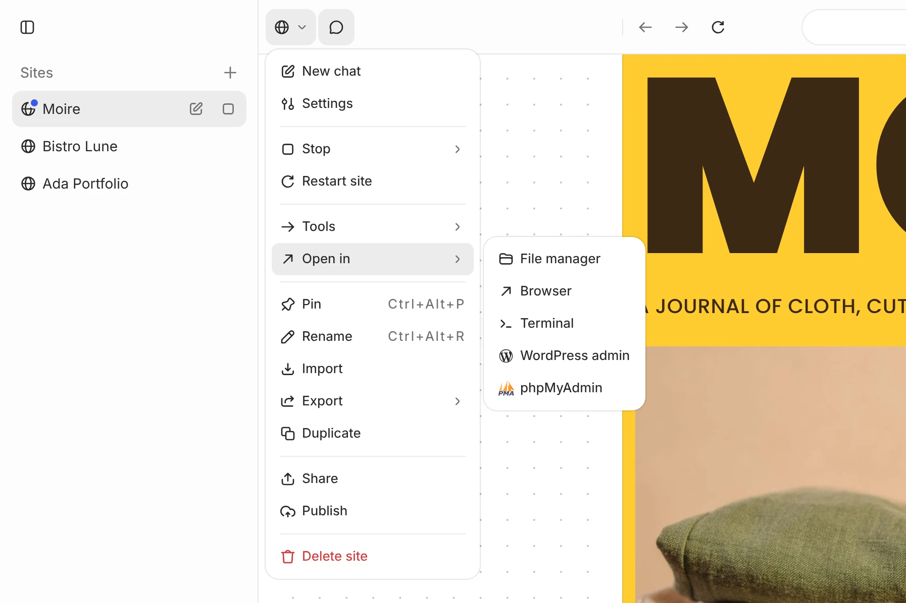

WordPress Studio can open sites in the following code editors:

-   Antigravity IDE
-   Cursor
-   PhpStorm
-   Sublime Text
-   Visual Studio Code
-   WebStorm
-   Windsurf
-   Zed

You can also open your sites with several terminal applications:

-   Terminal (opens Terminal on macOS, Command Prompt on Windows, and your system terminal on Linux)
-   iTerm (macOS)
-   Warp
-   Ghostty (macOS and Linux)

To select a preferred code editor, browser, or terminal application, open **Settings** from the account menu at the bottom of the sidebar, or press ⌘, (Ctrl+, on Windows and Linux). On the **General** page, choose a **Default code editor**, **Default browser**, and **Default terminal app**. With **Default browser** set to **System**, sites open in your computer’s default browser. You can choose another installed browser instead, such as Google Chrome, Safari, Firefox, Microsoft Edge, Brave, or Arc.

## [Site settings](#site-settings)

WordPress Studio keeps the settings for the app and for each site in one **Settings** dialog. Use the **App** and **Site** switch at the top left to move between them, or search for a setting by name.

To open a site’s settings, choose **Settings** from the [site menu](#site-menu), or search for **Site settings** in the command palette.

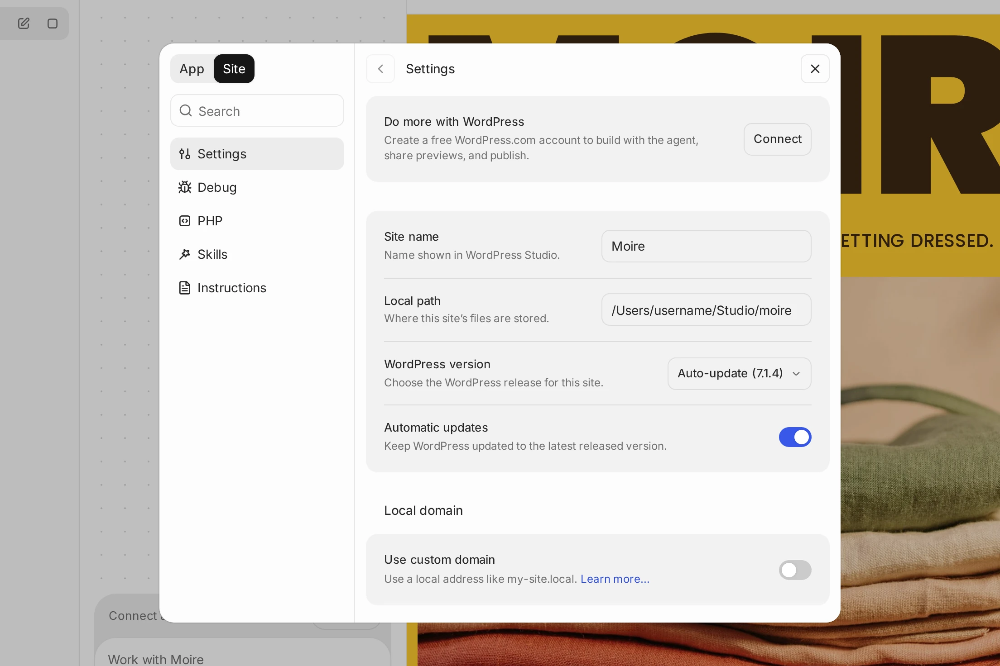

A site’s settings are grouped into these pages:

**Settings:**

-   **Site name**: Your local site’s name, as shown in WordPress Studio.
-   **Local path**: The folder where the site’s files are stored. You can’t change it here.
-   **WordPress version**: The WordPress release for this site. Turn on **Automatic updates** to keep WordPress updated to the latest released version.
-   **Local domain**: **Use custom domain**, **Domain**, and **Enable HTTPS**. See [Using a custom domain and SSL](#Using-a-custom-domain-and-SSL).
-   **WordPress credentials**: The **Username**, **Password**, and **Email** for the admin account, each with a copy button. You can use them to log into WP Admin on your local site and on your preview sites.

**Debug:** **Environment**, **Xdebug**, **Debug log**, **Script debugging**, and **Show errors in browser**. See [Debugging in WordPress Studio](https://wordpress.studio/docs/debugging/).

**PHP:** **PHP version** and **File access**. See [PHP runtimes](https://wordpress.studio/docs/php-runtimes/).

**Skills** and **Instructions:** the agent skills and instruction files installed on this site. See [Agent Skills in WordPress Studio](https://wordpress.studio/docs/agent-skills-wordpress-studio/).

### [Edit a site](#10-edit-a-site)

To edit a site, change any of its settings. **Save** and **Discard** buttons appear at the top of the dialog as soon as you change something; click **Save** to apply your changes. You can edit the site’s name, switch to different PHP and WordPress versions, and change the admin credentials and domain. Saving settings doesn’t overwrite the WordPress admin email, and changing only the admin username renames the admin user. You can also change the WordPress version of a site that has never been started.

Please note that when selecting different PHP and WordPress versions, ensure they are compatible with the plugins and themes installed on your site. If you encounter any errors on your WordPress Studio site after making these changes, reviewing your active plugins and themes is a good first step in troubleshooting.

Site actions such as starting, stopping, and editing a site are unavailable while a publish, pull, import, or export is running on that site.

### [Organize the sidebar](#organize-the-sidebar)

Each site in the sidebar can be expanded to show its WordPress Studio Code chats. To keep the sidebar tidy:

-   **Pin** the sites and chats you use most, from their menus or with ⌥⌘P (Ctrl+Alt+P on Windows and Linux). They appear in the **Pinned** section at the top of the sidebar.
-   Drag sites and chats to reorder them, or use the **Sort by** menu next to **Sites** to sort sites by **Status** or **Manual order**, and chats by **Last updated** or **Manual order**.
-   ⌘-click (Ctrl-click on Windows and Linux) or Shift-click to select several sites or chats and act on them together, for example to pin, mark as read, archive, or delete them.
-   In **Settings → General**, turn on **Collapse sidebar groups** so that opening a site closes all others, or turn off **Show recent chats** to hide the **Recent** section. You can also change these from the command palette.
-   Click **Collapse all** next to **Sites** to close every site’s list of chats.

### [Delete a site](#12-delete-a-site)

To delete a local site, choose **Delete** from the [site menu](#site-menu). WordPress Studio asks you to confirm that you want to remove the site from WordPress Studio. To also delete its files from your computer, select **Also move files and database to Trash**, then click **Remove site**.

To delete several sites at once, select them in the sidebar, right-click the selection, and choose **Delete *N* sites**. To keep one of them, click **Exclude** (**×**) next to its name in the confirmation, then click **Remove sites**.

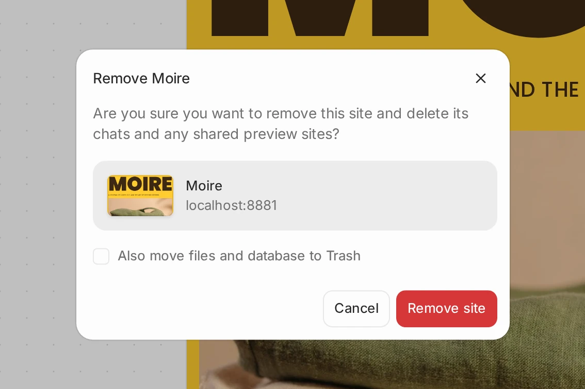
