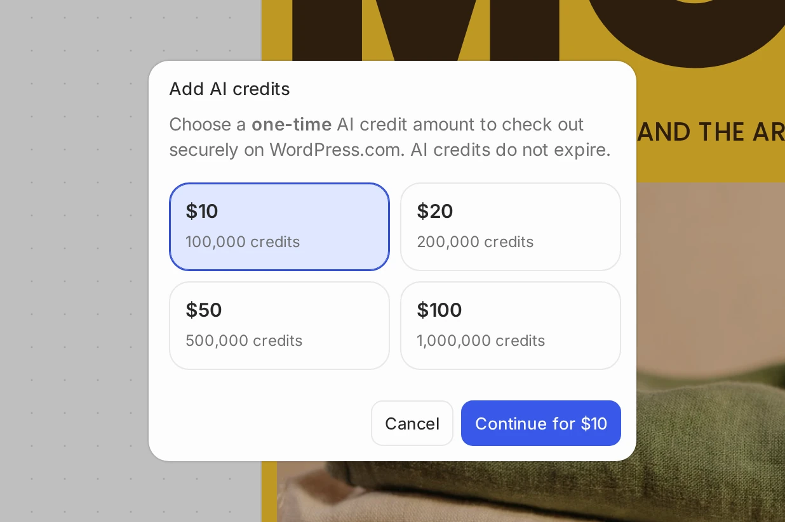

# How AI Credits Work

This page explains how AI Credits work in WordPress Studio. It applies alongside our [Terms of Service](https://automattic.com/tos/), which governs your use of WordPress Studio. If anything here conflicts with the Terms of Service, the Terms of Service controls.

## [What AI Credits are](#0-what-ai-credits-are)

AI Credits are how you pay for AI usage in WordPress Studio Code — things like generating code, building out a site, or running other AI-powered features. They’re not money. You can’t withdraw them, exchange them for cash, or use them outside WordPress Studio. Buying AI Credits means you’re buying access to WordPress Studio’s AI features, not depositing funds with us. They’re not a gift card, stored-value account, or financial instrument of any kind.

## [Your allowance](#1-your-allowance)

We will give you a limited, one-time free allowance of AI Credits that you can use to try WordPress Studio Code. You can use it with Fast right away. Your first purchase unlocks Balanced and Strong, and you can then use any remaining free allowance with those tiers. See [Choosing an AI model tier in WordPress Studio Code](https://wordpress.studio/docs/studio-code/choosing-an-ai-model-tier-in-studio-code/) for details. We may change the size of this allowance or discontinue it, particularly as WordPress Studio moves out of beta.

Your free allowance is consumed at the same variable rate as purchased credits (see below).

## [Buying more](#2-buying-more)

You can buy AI Credits at any time. Purchased AI Credits don’t expire and stay on your account until you use them. On every tier, your account draws from your free allowance first, then from purchased AI Credits. Purchases are non-refundable and non-transferable, except where law requires otherwise.

The purchase amounts currently available are $10, $20, $50, and $100, but the amounts and availability may change.

## [Why similar tasks can cost more or less](#3-why-similar-tasks-can-cost-more-or-less)

What your AI Credits get you can vary. The cost of AI usage depends partly on what our AI providers charge us, which we don’t fully control. It also depends on choices you make — different tiers cost different amounts to run, and longer or more complex prompts generally cost more than shorter ones.  
  
Any estimates we show of how far your AI Credits will go, such as how many pages or tasks a balance covers, are illustrative only and not guarantees; your actual usage depends on a variety of factors.

## [Your balance belongs to your account](#4-your-balance-belongs-to-your-account)

You can’t share, transfer, sell, or gift your AI Credits to another user or account.

## [Changes](#5-changes)

We may change how AI Credits work, including pricing or whether we offer them at all. For changes that affect purchased AI Credits, we’ll contact you in advance.

## [Misuse](#6-misuse)

If we believe your account is being used to abuse these terms — for example by creating multiple accounts to claim extra free allowances, accessing WordPress Studio’s AI features other than through WordPress Studio, or by circumventing usage limits — we may limit, suspend, or revoke your access to AI Credits or your account, without a refund.
