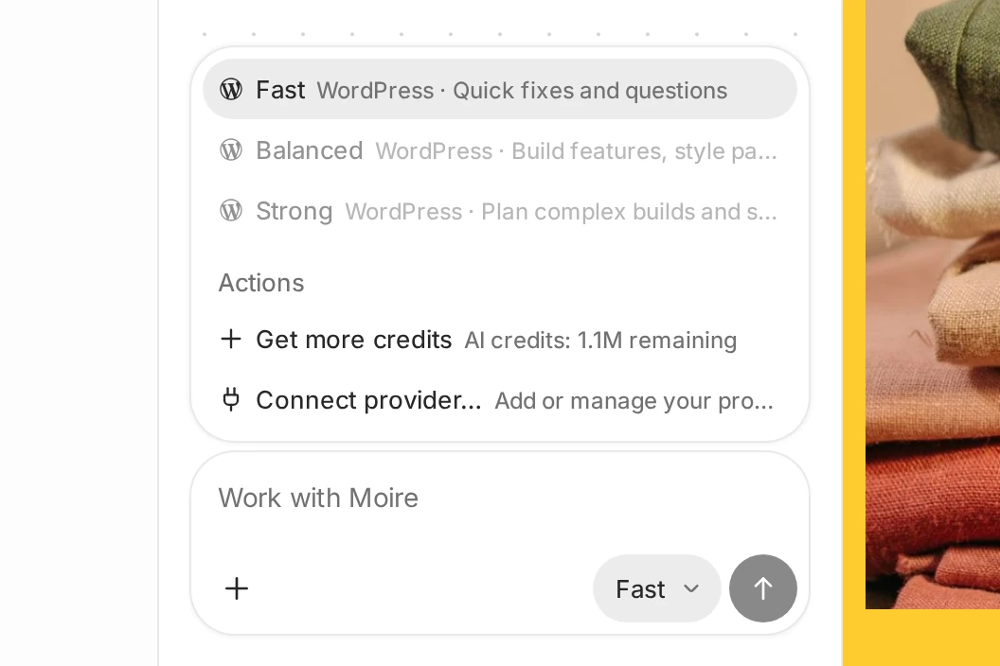

# Choosing an AI model tier in WordPress Studio Code

## [The short version](#0-the-short-version)

When you use WordPress.com as your AI provider, pick the tier that fits the job.

| Tier | What it’s for | Can use free allowance? |
| --- | --- | --- |
| Fast | Everyday changes: small edits, quick fixes, straightforward requests | Yes |
| Balanced | Work that benefits from more careful reasoning, without the cost of the top tier | Yes, after your first purchase |
| Strong | Complex, high-stakes, or architecture-level work | Yes, after your first purchase |

You can switch tiers at any point in a conversation, including mid-task. WordPress Studio uses whichever tier is selected for each new message.

Fast reads text only: it can’t look at images you attach or at screenshots of your site. Use Balanced or Strong when the task needs the agent to see the page.

The models behind each tier are updated as newer models become available. For example, WordPress Studio 1.23 moved Balanced and Strong to newer models. You don’t need to change anything when this happens: you keep choosing by tier.

## [All tiers use AI credits](#1-all-tiers-use-ai-credits)

Every message in WordPress Studio Code spends AI credits, whichever tier you choose. Balanced and Strong use credits at a higher rate than Fast.

Every WordPress.com account starts with a one-time free allowance of [AI credits](https://wordpress.studio/docs/studio-code/ai-credits-guidelines/). Fast is available from the start.

## [Balanced and Strong require purchased credits](#2-balanced-and-strong-require-purchased-credits)

Your first AI credit purchase unlocks Balanced and Strong. Until then, the desktop model menu shows them as **Purchased credits required**, and the terminal’s `/model` command lists Fast with a note to add credits. To buy credits in the desktop app, choose **Get more credits** from the model menu.

Once unlocked, Balanced and Strong stay available even after you spend your purchased balance. All three tiers draw from any remaining free allowance first, then from purchased credits.

## [How credit consumption actually works](#3-how-credit-consumption-actually-works)

-   **Every reply costs credits — including when you continue an existing conversation.** There’s no free “continue” action once a conversation has started; WordPress Studio Code doesn’t distinguish between a brand-new question and the fifth follow-up in the same thread.
-   **Cost isn’t a flat per-message fee.** It scales with how much the model has to read (your prompt, plus the conversation and project context it’s carrying) and how much it has to write in response. A short, targeted request costs less than one that requires the model to work through a lot of surrounding code or produce a long answer.
-   **Stronger tiers cost more per turn.** Balanced and Strong use more capable models that cost more to run, so the same question costs more on Strong than on Fast, even a trivial one.
-   **Switching tiers doesn’t change what you already spent.** Cost is locked in per message, at the tier that was active when you sent it. Moving from Fast to Strong partway through a conversation only affects what you send from that point on.
-   **Longer-running or more exploratory work adds up faster than a single question would suggest.** If a task involves several rounds of back-and-forth, retries, or the model investigating before it acts, each round is its own cost, on top of the original request.

WordPress Studio Code doesn’t show you exactly how many credits any given reply costs in advance—what it costs depends on what you asked and how the model chose to answer, and that can vary. What you can rely on is the balance itself, which updates as you go (see below), and the relative ordering: Fast is the cheapest way to get something done, Strong is the most expensive, Balanced sits in between.

## [Keeping an eye on your balance](#4-keeping-an-eye-on-your-balance)

WordPress Studio Code shows a running AI credits meter as you work, combining whatever’s left of your free allowance with anything you’ve purchased. When you’re getting close to empty, WordPress Studio Code will tell you before you run out entirely.

When both balances are empty, prompts through WordPress.com pause until you add more AI credits. You can buy credits from inside WordPress Studio Code. See [How AI Credits Work](https://wordpress.studio/docs/studio-code/ai-credits-guidelines/) for purchase and account details.

## [FAQ](#5-faq)

**Does starting a new conversation cost more than continuing an old one?** No — cost depends on what’s being read and written in that specific turn, not on whether the conversation is new. A long-running conversation can cost more per reply than a fresh one simply because the model has more context to carry, but that’s a side effect of size, not age.

**Can I use different tiers in the same project, or even the same conversation?** Yes. Tier is a per-message choice. A common pattern is starting a task on Fast and switching to Balanced or Strong only for the parts that need it.

**Why can’t I switch to Balanced or Strong even though I still have free allowance left?** Your first purchase unlocks those tiers. After that, you can use any remaining free allowance with either tier.
