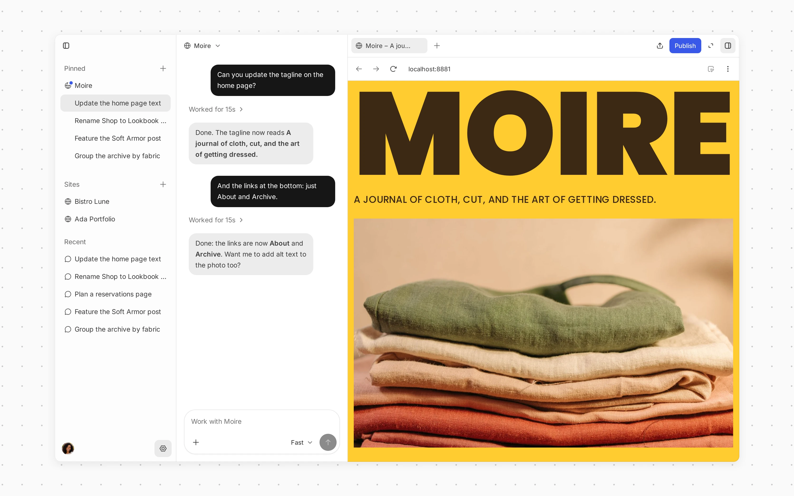
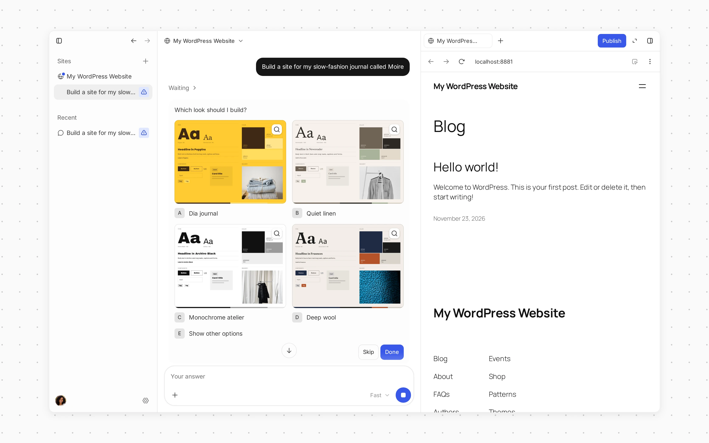
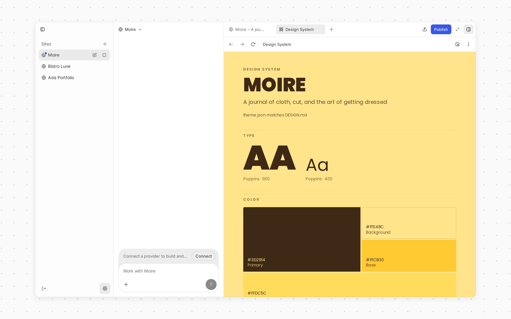
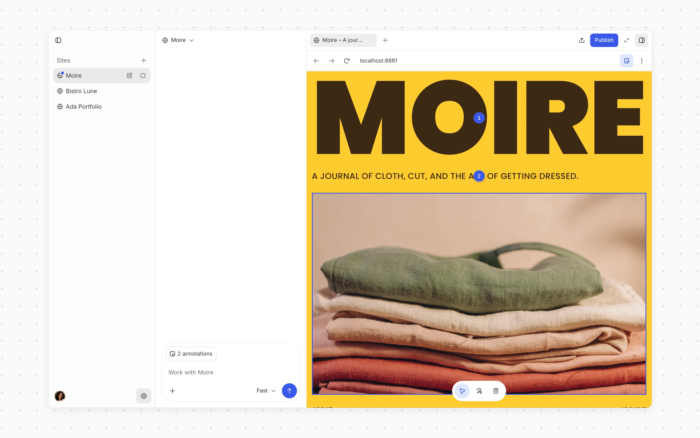
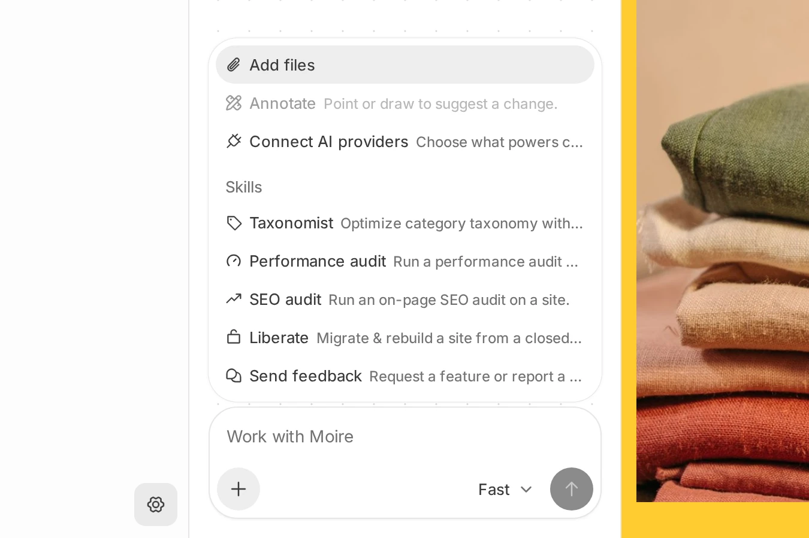
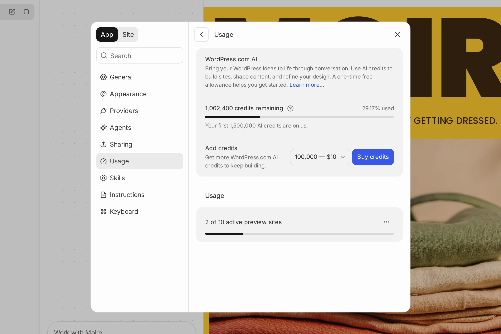

# WordPress Studio Code

WordPress Studio Code is the agent built into WordPress Studio. Describe what you want in the chat, and it builds and changes your site for you.

WordPress Studio Code creates themes and plugins, edits files, runs WP-CLI commands, creates previews, and publishes your site.

**Applies to:** the WordPress Studio desktop app and WordPress Studio CLI (`studio code`). The agent needs an AI provider. This can be WordPress.com, with a WordPress.com account and a payment method, or another provider such as a ChatGPT plan, a Claude subscription, or your own API key.

## Before you start

- <span id="getting-started"></span>An AI provider. To use WordPress.com AI credits, log in with your WordPress.com account and [add a payment method on WordPress.com](http://wordpress.com/me/purchases/add-payment-method), which is required to prevent abuse. To use another provider instead, see [AI providers](https://wordpress.studio/docs/studio-code/#ai-providers).
- For the terminal only: [WordPress Studio CLI](https://wordpress.studio/docs/cli/#installation), or Node.js to run it with `npx`.

## Start a chat in the desktop app

1.  <span id="wordpress-studio-code-in-wordpress-studio-desktop"></span>In the sidebar, select a site, or [add a new site](https://wordpress.studio/docs/sites/).
2.  Type your request in the chat box at the bottom of the chat, next to the site preview.
3.  Send the message.

The agent replies in the chat and makes the changes in your site. If you haven’t connected an AI provider yet, the chat box shows “Connect a provider to build and edit your site.” Click **Connect** to open **Settings → Providers**.



## Start a chat in the terminal

<span id="wordpress-studio-code-in-wordpress-studio-cli"></span>If the WordPress Studio app is installed with the [CLI turned on](https://wordpress.studio/docs/cli/#installation), run:

```bash
studio code
```

Otherwise, run it with `npx`:

```bash
npx wp-studio@latest code
```

Or install it globally:

```bash
npm i -g wp-studio@latest
studio code
```

Press ↓ to work in your local WordPress Studio sites, or ↓ and then → to work in your WordPress.com or Jetpack-connected sites.

### Log in to WordPress.com from the terminal

1.  <span id="connect-to-wordpresscom"></span>Run `studio code`.
2.  Type `/login` in the chat.
3.  In the browser window that opens, log in to your WordPress.com account.
4.  Approve the connection.
5.  Paste the authorization token into the terminal.

To use another AI provider instead, type `/connect` and choose one. In the desktop app, log in from the [account menu](https://wordpress.studio/docs/#connect-to-wordpresscom) or connect a provider in **Settings → Providers**.

## Describe what you want

<span id="using-wordpress-studio-code"></span><span id="example-workflows"></span>Type your request in your own words. The agent creates files, runs commands, and changes your site. Here are some examples:

- **Create a site and customize it:** “Create a new WordPress site called ‘My Portfolio’ with PHP 8.2.” “Build a minimal portfolio theme with a dark color scheme.” “Add a homepage with a hero section and project grid.”
- **Share your work:** “Create a preview so I can share this with my client.” “Update the preview with my latest changes.”
- **Publish your work:** “Publish ‘My Portfolio’ site to examplesite.com.”

The agent can read and write files in your site directory, run WP-CLI commands, take screenshots of your site, and publish changes to a connected site on WordPress.com or to another [hosting provider](https://wordpress.studio/docs/sync/#hosting-providers) such as Spacefast. It asks you to confirm the site before it publishes. After the agent builds a site, it suggests a performance audit and an SEO audit.

To give the agent instructions for every new chat, across all your sites, add them under **Custom instructions** in **Settings → Instructions** in the desktop app. For example: “Always answer in French. My sites are for restaurants.” A site’s own instruction files, such as `AGENTS.md`, are listed on the **Instructions** page of that site’s settings.

### Designing a site

When you ask the agent to build a site, it first offers four looks, then four layouts shown in the look you picked. It skips these questions when your request already describes a design. Your choice is saved as `DESIGN.md` in the site’s root folder, and later chats and other coding agents follow it. Fonts chosen in `DESIGN.md` are self-hosted on the site.



To review the design system, click **New tab** (**+**) above the site preview and choose **Design System**. It shows the colors, type scale, spacing and corners, components, and guidelines from `DESIGN.md`. You can also choose **Tools → Design System** from the site menu, or click the link when the agent mentions the design system in a chat.

If the theme’s `theme.json` no longer matches `DESIGN.md`, WordPress Studio lists each difference. Choose **Use DESIGN.md** or **Keep theme.json** for each one, or **Apply all from DESIGN.md**.



The agent can also make images for your site. See [Image generation in WordPress Studio Code](https://wordpress.studio/docs/studio-code/image-generation/).

### Add files and images

- <span id="uploads"></span>**Desktop:** drag files into the chat, paste them, or click **+** in the chat box and choose **Add files**. To attach a screenshot of the site preview, choose **Take screenshot** from **Browser options** above the preview.
- **Terminal:** drag files into the chat, or point to a local file or folder.

The Fast tier reads text only. To send an image, choose Balanced or Strong, or another provider’s model, first.

## Annotate the site preview

<span id="annotate"></span>Instead of describing which part of the page you mean, point at it. Annotate works on a local site’s preview in the desktop app. If the site is stopped, turning on Annotate starts it.

1.  Click **Annotate** at the end of the site preview’s address bar. The annotation tools appear at the bottom of the preview: **Select** (V), **Draw** (D), and **Discard annotations** (the trash can).
2.  With **Select**, click an element in the preview, or drag to select an area. With **Draw**, sketch on the page. A numbered marker appears, with a note box.
3.  Type your note in **Describe the change**.
4.  Press Enter. The note is staged in the chat box, shown as one attachment such as “2 annotations”.
5.  Add more notes the same way.
6.  Send the message from the chat box.

The agent gets your message and every note, each with the element or area it points at. A selected area or a drawing also comes with a screenshot of that part of the page, including the drawing.

You can also turn on Annotate from the chat box’s **+** menu, or press ⇧⌘. (Ctrl+Shift+. on Windows and Linux). To add a reference image to a note, click **Attach image** (the paperclip), or paste or drop a PNG, JPEG, GIF, or WebP image into the note. Instead of pressing Enter, you can click **Add annotation to batch** (the arrow).




### Edit, send, or discard notes

- **Edit a note:** click its marker, or the note in the chat box’s list of annotations.
- **Delete a note:** click its marker, then **Delete annotation** (the trash can), or delete it from the list in the chat box.
- **Send one note right away:** press ⌘Enter (Ctrl+Enter on Windows and Linux) in the note.
- **Send every note as soon as you finish it:** turn off **Batch notes** in **Settings → General** (“Collect annotations and send them together instead of one at a time.”). Enter then sends the note.
- **Close a note:** press Esc.
- **Leave annotation mode:** press Esc again, or click **Annotate** again (**Stop annotating**). Your notes are kept.
- **Delete every note and leave annotation mode:** click **Discard annotations**.

If the agent is still replying, a note you send waits in the queue until the reply ends. Notes staged in the chat box also wait, because they point at the page as it is now.

### Annotate limits

- Send screenshots of selected areas and drawings with a model that reads images, not Fast.
- You can add up to 100 notes before you send them.
- Annotate isn’t available for the **Database** view or for chats that work on the live site.
- In the `studio ui` browser app, you can annotate the design system but not the site itself yet.

## Work on WordPress.com sites

<span id="working-with-wordpresscom-sites"></span>One agent handles both your local sites and your WordPress.com sites, so a single chat can, for example, copy a live post into a local site. When the active site is a WordPress.com site, the agent works on the live site and only makes a local copy if you ask.

When a chat for a local site that’s [connected to a WordPress.com site](https://wordpress.studio/docs/sync/) works on the live site, a **Live** chip appears in the chat box. To switch back, click **+** and choose **Work on local site**, or remove the chip. The agent never pulls a live site over a local one without your confirmation.

When the agent edits a block theme’s template, template part, or styles that you’ve customized in the WordPress Site Editor, it makes the change in your customized copy too, keeps your other edits, and tells you.

## Choose a model tier

<span id="ai-model-tiers"></span>With WordPress.com, you choose a tier instead of a model by name:

| Tier | Use it for |
| --- | --- |
| **Fast** | Everyday changes, small edits, and quick fixes |
| **Balanced** | Work that benefits from more careful reasoning |
| **Strong** | Complex, multi-step, or architecture-level work |

New chats start on Fast. Once your account has purchased AI credits, new chats start on Balanced. Balanced and Strong need purchased AI credits. See [Choosing an AI model tier in WordPress Studio Code](https://wordpress.studio/docs/studio-code/choosing-an-ai-model-tier-in-studio-code/).

To switch tiers, including mid-conversation:

- **Desktop:** click the model button in the chat box, which shows the current tier, such as **Fast**. You can also type `/model` and choose **Choose model**.
- **Terminal:** run `/model`.

With another provider, the model menu lists that provider’s models by name instead, such as **Sonnet 5.5** and **Opus 5.5** for Anthropic. For those models, **Thinking** in the same menu sets how long the model thinks before it answers in this chat: **Off**, **Low**, **Medium** (the default), or **High**. In the terminal, run `/thinking`.

## AI providers

<span id="use-your-own-anthropic-api-key"></span>The agent needs an AI provider to build. Use the AI you already have, or start with the one-time free allowance from WordPress.com.

- **WordPress.com**, with your WordPress.com account
- **OpenAI**, with a ChatGPT plan or an API key
- **Anthropic**, with a Claude subscription or an API key
- **Google Gemini**, with an API key
- **GitHub Copilot**, with a Copilot plan
- **Meta**, with an API key
- **xAI**, with a SuperGrok or X Premium plan, or an API key
- **OpenRouter**, with an OpenRouter sign-in or an API key
- **Local LLM**, with a model server you run, such as Ollama or LM Studio


Set them up in **Settings → Providers** in the desktop app, or with `/connect` in the terminal. [Providers in WordPress Studio](https://wordpress.studio/docs/providers/) has the steps for each one, including [your own Anthropic API key](https://wordpress.studio/docs/providers/#anthropic), the models each offers, and who bills you.

**Default AI provider**, at the top of **Settings → Providers**, sets which connected provider new chats use. The model menu in the chat box lists the models of every connected provider, so you can choose another one for a chat. In the terminal, `/provider` switches providers and also changes the **Default AI provider**.

## Start a new chat

- <span id="new-conversations"></span>**Desktop:** hover over the site in the sidebar and click **New chat** (the pencil icon). You can also choose **New chat** from the site menu or the command palette, or press ⇧⌘N (Ctrl+Shift+N on Windows and Linux).
- **Terminal:** run `/clear`.

In the desktop app, each site’s chats are listed under the site in the sidebar, and your latest chats also appear under **Recent**. When you switch to another site and back, WordPress Studio reopens the chat you last had open there. Right-click a chat to **Pin**, **Rename**, **Mark as unread**, or **Archive** it. Archiving removes the chat from the sidebar. To bring it back, click **Undo** in the notification.

## Send feedback from a chat

The agent can send your feedback about WordPress Studio to the WordPress Studio team. This can be a bug, a feature request, or general feedback. Sending feedback needs a WordPress.com login.

1.  Type `/feedback` in the chat, followed by what you want to say. In the desktop app, you can also choose **Send feedback** from the **+** menu.
2.  Read the report the agent writes. It draws on what happened in the chat, such as the tool that failed and its error, and shows you the exact message.
3.  Reply to send it, ask for changes, or cancel.

Nothing is sent until you approve the message. If you don’t say what the feedback is about, the agent asks, and offers **Bug report**, **Feature request**, and **General feedback**. After sending, the agent gives you the feedback ID. The report includes your WordPress Studio version and operating system, and leaves out passwords, API keys, and private site content unless you ask to include them.

You can also ask the agent in your own words to report something to the WordPress Studio team. To send feedback without a chat, see [WordPress Studio feedback](https://wordpress.studio/docs/feedback/).

## Slash commands

In the desktop app, type `/` in the chat box to list the commands and skills that match, or click **+** to see the common ones: **Add files** and the commands first, then the skills under **Skills**. The desktop app shows commands and skills by name, for example **Choose model** for `/model`, **Performance audit** for `/need-for-speed`, **SEO audit** for `/rank-me-up`, and **Send feedback** for `/feedback`.



| Command | Description | Available in |
| --- | --- | --- |
| `/annotate` | Open a visual inspector to annotate page elements and give the agent instructions | Terminal and desktop |
| `/auto-start` | Start stopped sites when you send a chat message (shown as **Auto-start** while it’s off) | Desktop |
| `/browser` | Open the active site in your browser | Terminal |
| `/clear` | Clear the conversation and start a new session | Terminal |
| `/connect` | Connect a provider: choose one from the list, or name it, such as `/connect anthropic`, `/connect openai`, `/connect gemini`, `/connect github-copilot`, `/connect meta`, `/connect xai`, `/connect openrouter`, or `/connect local-llm` | Terminal |
| `/connect-provider` | Open **Settings → Providers** to choose what powers chat (shown as **Connect AI providers**) | Desktop |
| `/credits` | Show your AI credit balance and buy more AI credits | Terminal |
| `/disconnect` | Disconnect a provider | Terminal |
| `/exit` | Exit the chat | Terminal |
| `/feedback` | Send feedback about WordPress Studio to the WordPress Studio team (shown as **Send feedback**). See [Send feedback from a chat](https://wordpress.studio/docs/studio-code/#send-feedback-from-a-chat) | Terminal and desktop |
| `/liberate` | Migrate and rebuild a site from a closed platform to WordPress | Terminal and desktop |
| `/local` | Switch a chat that works on the live site back to the local site (shown as **Work on local site**) | Desktop |
| `/login` | Log in to WordPress.com | Terminal |
| `/logout` | Log out of WordPress.com | Terminal |
| `/model` | Switch the AI model or tier (shown as **Choose model** in the desktop app) | Terminal and desktop |
| `/need-for-speed` | Run a performance audit on your site | Terminal and desktop |
| `/preview` | Create or update a preview of the active site on WordPress.com | Terminal |
| `/provider` | Switch the AI provider, such as WordPress.com, Anthropic, or OpenAI | Terminal |
| `/publish` | Publish the active site to WordPress.com | Terminal |
| `/rank-me-up` | Run an on-page SEO audit on your site | Terminal and desktop |
| `/start`, `/stop` | Start or stop the active site (shown as **Start site** and **Stop site**) | Desktop |
| `/thinking` | Set how long the model thinks in this chat: `default`, `off`, `low`, `medium`, or `high`. In the desktop app, use **Thinking** in the model menu | Terminal |
| `/swag` | Treat yourself to some WordPress swag | Terminal |
| `/taxonomist` | Optimize your category taxonomy | Terminal and desktop |

## Terminal-specific guidance

<span id="sessions"></span><span id="resume-a-session"></span><span id="delete-a-session"></span><span id="command-references"></span>The terminal version saves your conversation history as sessions, so you can pick up where you left off.

```bash
studio code                                # Start a new chat session
studio code "Create a portfolio site"      # Start with a first message
studio code --path /path/to/site           # Start with a specific site directory
studio code --json "Add a contact page"    # Run one turn without the chat, printing events as JSON
studio code sessions list                  # List saved sessions
studio code sessions resume                # Choose a session to resume from a picker
studio code sessions resume latest         # Resume the most recent session
studio code sessions resume <id>           # Resume a session by ID
studio code sessions delete                # Choose a session to delete from a picker
studio code sessions delete <id>           # Delete a session by ID
studio code --help                         # Show every option
```

## AI credits and usage limits

<span id="usage-limits"></span><span id="ai-credits"></span>With WordPress.com as your AI provider, you start with a one-time free allowance of AI credits for the Fast tier. Your first purchase unlocks Balanced and Strong, and any remaining free allowance works with all three tiers. See [How AI Credits Work](https://wordpress.studio/docs/studio-code/ai-credits-guidelines/) for purchases and account rules.

### Check your usage

- **Desktop:** the model menu in the chat box, and **Settings → Usage**.
- **Terminal:** the stats line at the end of each turn, and the `/credits` command.

The agent warns you when you’ve used 80% and 90% of your AI credits.



### What happens when you reach the limit

AI responses pause until you add more AI credits. Your local sites keep running, and only the agent is unavailable. You can:

- **Buy more AI credits.** In the desktop app, click **Add credits** in the chat box, or choose **Get more credits** from the model menu, and pick an amount in **Add AI credits**. In the terminal, run `/credits`.
- **Connect another AI provider**, such as your own Anthropic API key or your ChatGPT plan. That provider bills you, and it doesn’t use AI credits. See [Providers in WordPress Studio](https://wordpress.studio/docs/providers/).

## Troubleshooting

### Why can’t I send a message?

<span id="when-the-chat-box-cant-send"></span>In the desktop app, when a WordPress.com chat can’t send yet, the chat box says why and offers the next step. You can still read the chat while the notice shows.

| The chat box shows | What to do |
| --- | --- |
| “Connect a provider to build and edit your site.” | Click **Connect** to open **Settings → Providers**, and log in with WordPress.com or connect another AI provider. |
| “Add a payment method to use WordPress.com AI.” | Click **Set up** to add one on WordPress.com. WordPress Studio checks again when you come back to the app. |
| “Studio Code AI is currently available through limited beta access.” | Click **Learn more**. |
| “Connect a different provider to continue this chat.” | Click **Connect** to open **Settings → Providers**. |
| “Add AI credits to send another message.” | Click **Add credits** to buy more. See [What happens when you reach the limit](https://wordpress.studio/docs/studio-code/#what-happens-when-you-reach-the-limit). |

### Why can’t I choose Balanced or Strong?

Balanced and Strong need purchased AI credits. Until your account has bought some, the desktop model menu shows them as **Purchased credits required**, and the terminal’s `/model` command hides them.

### Why doesn’t the agent see my image or screenshot?

The Fast tier reads text only. Choose Balanced or Strong, or another provider’s model, and send the image again.

### Why did switching models start a new chat?

Models from different providers don’t share memory, so switching a chat to another provider’s model starts a new chat. In the desktop app, WordPress Studio asks **Start a new chat?** first, and your previous chat stays in the sidebar.

### Why does Annotate ask me to connect an AI provider?

You haven’t connected an AI provider yet, so turning on Annotate or sending notes opens **Put your feedback to work**. Click **Continue with WordPress.com** to log in, or **Choose a different provider** to open **Settings → Providers**.

## Related

- [Providers in WordPress Studio](https://wordpress.studio/docs/providers/)
- [Choosing an AI model tier in WordPress Studio Code](https://wordpress.studio/docs/studio-code/choosing-an-ai-model-tier-in-studio-code/)
- [How AI Credits Work](https://wordpress.studio/docs/studio-code/ai-credits-guidelines/)
- [Image generation in WordPress Studio Code](https://wordpress.studio/docs/studio-code/image-generation/)
- [WordPress Studio CLI](https://wordpress.studio/docs/cli/)
- [MCP on WordPress Studio](https://wordpress.studio/docs/mcp-on-studio/)
