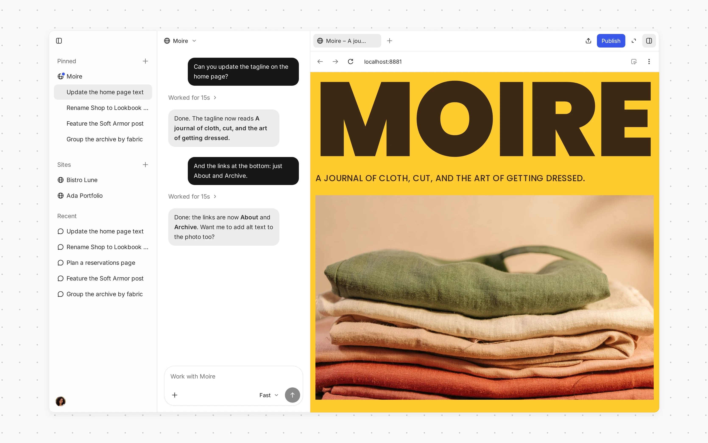
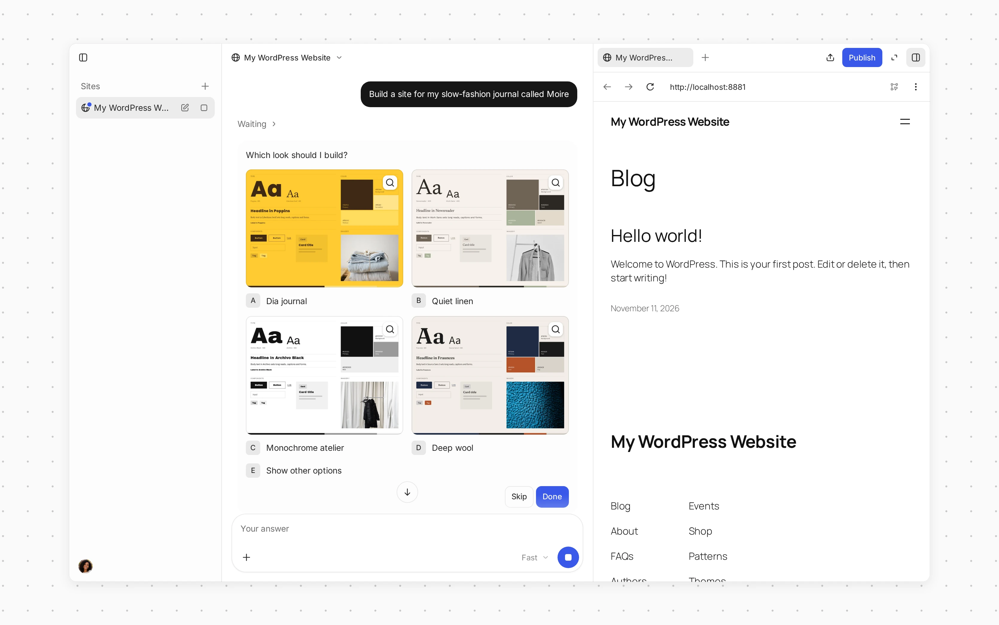
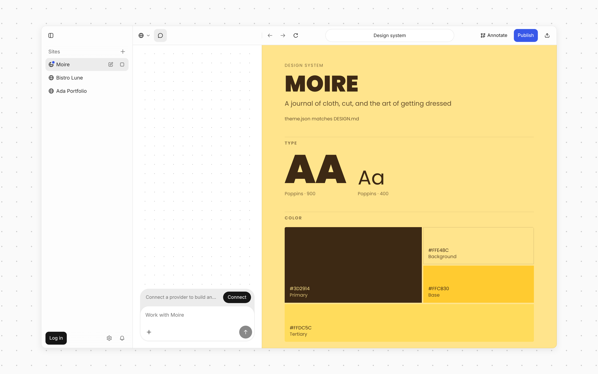
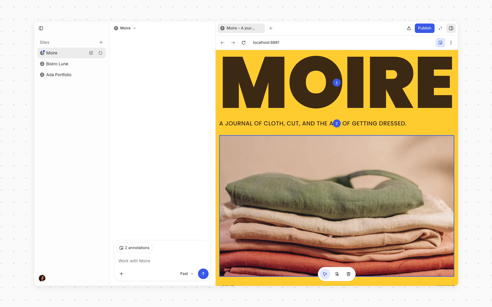
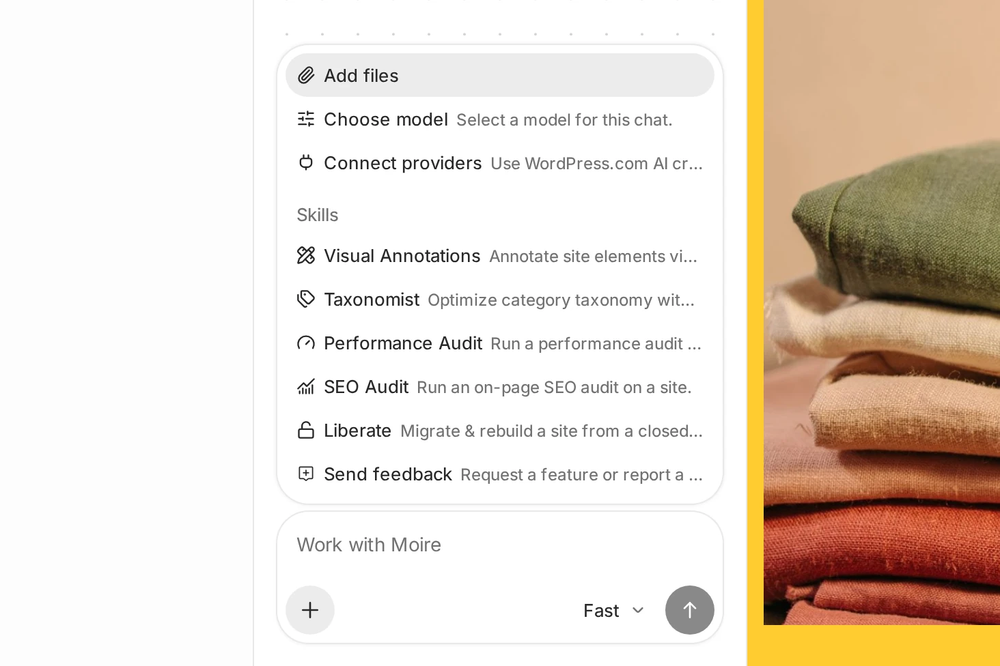
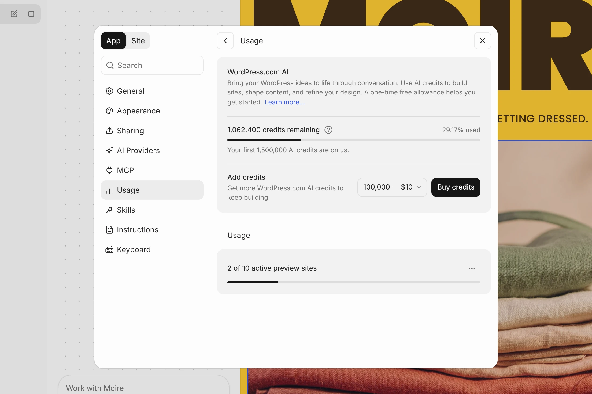
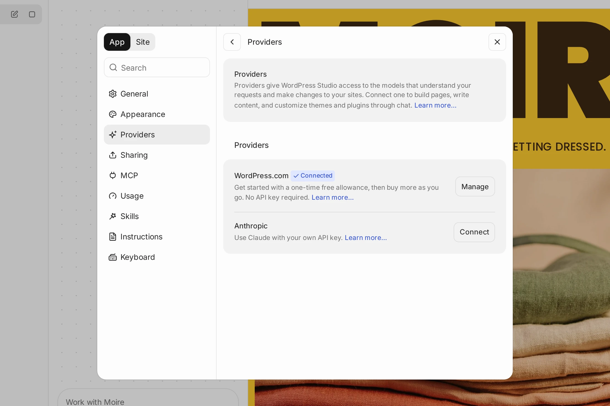

# WordPress Studio Code

WordPress Studio Code is an agentic coding tool built into the WordPress Studio desktop app and [WordPress Studio CLI](https://wordpress.studio/docs/cli/).

It gives you an interactive chat where you can build, customize, and manage WordPress sites conversationally, creating themes and plugins, editing files, running WP-CLI commands, deploying previews and publishing your site.

To use it with WordPress.com AI credits, you need to be logged into your WordPress.com account, and [having a payment method on WordPress.com is required](http://wordpress.com/me/purchases/add-payment-method) to prevent abuse. You can also [use your own Anthropic API key](#use-your-own-anthropic-api-key) instead. 

## [Getting started](#0-getting-started)

WordPress Studio Code is available in the WordPress Studio desktop app and as part of the standalone WordPress Studio CLI npm package.

### [WordPress Studio Code in WordPress Studio Desktop](#1-studio-code-in-studio-desktop)

WordPress Studio Code in the WordPress Studio desktop app is built into a friendly, familiar interface and doesn’t require npm dependencies.

Open your WordPress Studio desktop app and select a site in the sidebar (or add a new site). WordPress Studio Code is the chat next to the site preview: type your request in the chat box at the bottom. If you haven’t connected an AI provider yet, the chat box shows “Connect a provider to build and edit your site.” Click **Connect** to log in with WordPress.com or add your own Anthropic API key.



### [WordPress Studio Code in WordPress Studio CLI](#2-studio-code-in-studio-cli)

If you have the WordPress Studio desktop app installed with the [CLI enabled](https://wordpress.studio/docs/cli/#installation), you can directly use `studio code` from the terminal.

Otherwise, you can run it directly with `npx`:

npx wp-studio@latest code

And can install it globally to use `studio code` directly:

npm i -g wp-studio@latest
studio code

Press the ↓ arrow to work in your local WordPress Studio sites, or ↓ and → to work in your WordPress.com- or Jetpack-connected sites.

## [Connect to WordPress.com](#3-connect-to-wordpress-com)

By default, WordPress Studio Code uses WordPress.com infrastructure to generate AI responses. Log in to WordPress.com to get started — [in the desktop app](https://wordpress.studio/docs/#connect-to-wordpresscom) or in your terminal by following the instructions below:

1.  Run `studio code` in your terminal.
2.  Type /login in the chat.
3.  A browser window will open. Log into your WordPress.com account and approve the connection.
4.  Paste the authorization token back into the terminal to complete the login.

Alternatively, you can [use your own Anthropic API key](#use-your-own-anthropic-api-key): type `/connect anthropic` in the chat in the terminal, or connect **Anthropic** in **Settings → Providers** in the desktop app.

### [When the chat box can’t send](#when-the-chat-box-cant-send)

In the desktop app, when a WordPress.com chat can’t send a message yet, the chat box tells you why and offers the next step:

-   “Connect a provider to build and edit your site.” Click **Connect** to log in with WordPress.com or add an Anthropic API key.
-   “Add a payment method to use WordPress.com AI.” Click **Set up** to add one on WordPress.com. WordPress Studio checks again when you come back to the app.
-   “Studio Code AI is currently available through limited beta access.” Click **Learn more**.
-   “Connect a different provider to continue this chat.” Click **Connect** to open **Settings → Providers**.
-   “Add AI credits to send another message.” Click **Add credits** to buy more. See [What happens when you reach the limit](#20-what-happens-when-you-reach-the-limit).

You can still read the chat while the notice shows.

## [Using WordPress Studio Code](#5-using-studio-code)

Type your request in natural language and the AI agent will execute for you, creating files, running commands, and making changes to your site.

### [Example workflows](#6-example-workflows)

**Create a new site and customize it:**

-   Create a new WordPress site called “My Portfolio” with PHP 8.2
-   Build a minimal portfolio theme with a dark color scheme
-   Add a homepage with a hero section and project grid

**Share your work:**

-   Create a preview site so I can share this with my client
-   Update the preview site with my latest changes

**Publish your work:**

-   Publish “My Portfolio” site to examplesite.com

The agent can read and write files in your site directory, run WP-CLI commands, take screenshots of your site, and publish changes to WordPress.com, all based on your instructions.

### [Designing a site](#designing-a-site)

When you ask WordPress Studio Code to build a site, it first offers you four looks, and then four layouts previewed in the look you picked. It skips these questions when your request already describes a design. Your choice is saved as `DESIGN.md` in the site’s root folder, and later chats, as well as other coding agents, follow it. Fonts chosen in `DESIGN.md` are self-hosted on the site.



To review the design system, click **New tab** (**+**) above the site preview and choose **Design System**, or choose **Tools → Design System** from the site menu. When WordPress Studio Code mentions the design system in a chat, the link opens it too. It shows the colors, type scale, spacing and corners, components, and guidelines from `DESIGN.md`. If the theme’s `theme.json` no longer matches `DESIGN.md`, WordPress Studio lists each difference: choose **Use DESIGN.md** or **Keep theme.json** for each one, or **Apply all from DESIGN.md**.



WordPress Studio Code can also generate images for your site. See [Image generation in WordPress Studio Code](https://wordpress.studio/docs/studio-code/image-generation/).

To give WordPress Studio Code instructions that apply to every new chat, across all your sites, add them under **Custom instructions** in **Settings → Instructions** in the desktop app. For example: “Always answer in French. My sites are for restaurants.” The instruction files installed in a particular site, such as `AGENTS.md`, are listed on the **Instructions** page of that site’s settings.

### [Annotate](#annotate)

Instead of describing which part of the page you mean, you can point at it. In the desktop app, annotate a local site’s preview. If the site is stopped, clicking **Annotate** starts it first:

1.  Click **Annotate** at the end of the site preview’s address bar, or press ⇧⌘. (Ctrl+Shift+. on Windows and Linux). The preview switches to annotation mode.
2.  Click an element in the preview, or drag to select an area of the page. A numbered marker appears, with a note box.
3.  Type your note in **Describe the change**. To add a reference image, click **Attach image** (the paperclip), or paste or drop a PNG, JPEG, GIF, or WebP image into the note.
4.  Press Enter, or click **Add annotation to batch** (the arrow). The note is staged in the chat box, shown as one attachment such as “2 annotations”, so you can add a message before you send.
5.  Add more notes the same way. Click a marker, or the note in the chat box’s list of annotations, to edit it, or click **Delete annotation** (the trash can) to remove it.
6.  Send from the chat box. WordPress Studio Code gets your message and every note, each with the element or area it points at.




To send a single note right away, press ⌘Enter (Ctrl+Enter on Windows and Linux) in it. If WordPress Studio Code is still replying, the note waits in the queue and is sent when the reply ends. Notes staged in the chat box also wait for the reply to end, because they point at the page as it is now.

If you’d rather send every note as soon as you finish it, turn off **Batch notes** in **Settings → General** (“Collect annotations and send them together instead of one at a time.”). Enter then sends the note.

To stop:

-   Press Esc to close an open note. Press Esc again, or click **Annotate** again (**Exit annotation mode**), to leave annotation mode. Your notes are kept.
-   To delete a note, click its marker and then **Delete annotation**, or delete it from the list of annotations in the chat box.

You can add up to 100 notes before you send them. Annotate isn’t available for the **Database** view or for chats that work on the live site. In the `studio ui` browser app, you can annotate the design system but not the site itself yet.

If you haven’t connected an AI provider, clicking **Annotate** opens **Put your feedback to work**. Click **Continue with WordPress.com** to log in, or **Choose a different provider** to open **Settings → Providers**.

### [Working with WordPress.com sites](#working-with-wordpress-com-sites)

One WordPress Studio Code agent handles both your local sites and your WordPress.com sites, so a single chat can, for example, copy a live post into a local site. When the active site is a WordPress.com site, the agent works on the live site and only makes a local copy if you ask.

In the desktop app, when a chat for a local site that’s [connected to a WordPress.com site](https://wordpress.studio/docs/sync/) works on the live site, a **Live** chip appears in the chat box. To switch back, click **+** and choose **Work on local site**, or remove the chip. The agent never pulls a live site over a local one without your confirmation. See [WordPress Studio Sync](https://wordpress.studio/docs/sync/) for how pulling and publishing work.

When the agent edits a block theme’s template or template part that you’ve customized in the Site Editor, it makes the change in your customized copy too, keeps your other edits, and tells you.

### [Slash commands](#10-slash-commands)

While chatting, you can use slash commands for quick actions. In the desktop app, type `/` in the chat box to list the commands and skills that match, or click **+** to see them all: **Add files** and the commands come first, followed by the skills under **Skills**. The desktop app shows commands and skills by name, for example **Choose model** for `/model`, **Performance Audit** for `/need-for-speed`, **SEO Audit** for `/rank-me-up`, and **Send feedback** for `/feedback`.



| Command | Description | Available in… |
| --- | --- | --- |
| /annotate | Open a visual inspector to annotate page elements and give the AI agent instructions | Terminal and desktop |
| /auto-start | Start stopped sites when you send a chat message (shown as **Auto-start** while it’s off) | Desktop |
| /browser | Open the active site in your browser | Terminal |
| /clear | Clear the conversation and start a fresh session | Terminal |
| /connect | Connect a provider, such as `/connect anthropic` for your own Anthropic API key | Terminal |
| /connect-provider | Open **Settings → Providers** to use WordPress.com AI credits or your own API key (shown as **Connect providers**) | Desktop |
| /credits | Show your AI credit balance and buy more AI credits | Terminal |
| /disconnect | Disconnect a provider | Terminal |
| /exit | Exit the chat | Terminal |
| /feedback | Send feedback about WordPress Studio to the WordPress Studio team (shown as **Send feedback**). See [Send feedback from a chat](#send-feedback-from-a-chat) | Terminal and desktop |
| /liberate | Migrate and rebuild a site from a closed platform to WordPress | Terminal and desktop |
| /local | Switch a chat that works on the live site back to the local site (shown as **Work on local site**) | Desktop |
| /login | Log in to WordPress.com | Terminal |
| /logout | Log out of WordPress.com | Terminal |
| /model | Switch the AI model tier (shown as **Choose model** in the desktop app) | Terminal and desktop |
| /need-for-speed | Run a performance audit on your site | Terminal and desktop |
| /preview | Create or update a preview site of the active site on WordPress.com | Terminal |
| /provider | Switch between WordPress.com and Anthropic API | Terminal |
| /publish | Publish the active site to WordPress.com | Terminal |
| /rank-me-up | Run an on-page SEO audit on your site | Terminal and desktop |
| /swag | Treat yourself to some WordPress swag | Terminal |
| /taxonomist | Optimize your category taxonomy | Terminal and desktop |

After WordPress Studio Code builds a site, it suggests running a performance audit and an SEO audit on it.

### [Send feedback from a chat](#send-feedback-from-a-chat)

WordPress Studio Code can send your feedback about WordPress Studio to the WordPress Studio team: a bug, a feature request, or general feedback.

1.  Type `/feedback` in the chat, followed by what you want to say, or choose **Send feedback** from the **+** menu in the desktop app. If you don’t say what the feedback is about, WordPress Studio Code asks, and offers **Bug report**, **Feature request**, and **General feedback**.
2.  WordPress Studio Code writes the report, using what happened in the chat (for example, the tool that failed and its error), and shows you the exact message.
3.  Reply to send it, ask for changes, or cancel. Nothing is sent until you approve the message.

After sending, WordPress Studio Code gives you the feedback ID. The report includes your WordPress Studio version and operating system. WordPress Studio Code leaves out passwords, API keys, and private site content unless you ask to include them.

Sending feedback requires being logged in to WordPress.com. You can also ask WordPress Studio Code in your own words to report something to the WordPress Studio team. To send feedback without a chat, see [WordPress Studio feedback](https://wordpress.studio/docs/feedback/).

### [AI model tiers](#11-ai-model-tiers)

WordPress Studio Code doesn’t ask you to pick a model by name. Instead, you choose a tier based on how much depth the task needs:

-   **Fast**: everyday changes, small edits, and quick fixes
-   **Balanced**: work that benefits from more careful reasoning
-   **Strong**: complex, multi-step, or architecture-level work

New chats start on Fast. Once your account has purchased AI Credits, new chats start on Balanced instead.

Balanced and Strong require purchased AI Credits. Until your account has bought some, the desktop model menu shows them as **Purchased credits required**, and the terminal’s `/model` command hides them. For how tiers differ and how they use credits, see [Choosing an AI model tier in WordPress Studio Code.](https://wordpress.studio/docs/studio-code/choosing-an-ai-model-tier-in-studio-code/)

Switch tiers at any time, including mid-conversation:

-   **Desktop**: click the model button in the chat box (it shows the current tier, such as **Fast**), or choose **Choose model** from the **+** menu
-   **Terminal**: run the `/model` command

If you use your own Anthropic API key, the model menu lists **Sonnet 5.5** and **Opus 5.5** instead of tiers. See [AI providers](#ai-providers).

### [Uploads](#12-uploads)

Upload images and files into WordPress Studio Code to use across your project:

-   **Desktop**: drag files into the chat, paste them, or click **+** in the chat box and choose **Add files**
-   **Terminal**: drag into the chat or point to a specific local file or folder

The Fast tier reads text only. To send an image, choose Balanced or Strong (or, with your own API key, Sonnet 5.5 or Opus 5.5) first.

### [New conversations](#13-new-conversations)

Clear your conversation and start a new one:

-   **Desktop**: hover over the site in the sidebar and click **New chat** (the pencil icon), choose **New chat** from the site menu or the command palette (⌘K, or Ctrl+K on Windows and Linux), or press ⇧⌘N (Ctrl+Shift+N)
-   **Terminal**: run the `/clear` command

In the desktop app, each site’s chats are listed under the site in the sidebar, and your latest chats also appear under **Recent**. When you switch to another site and back, WordPress Studio reopens the chat you last had open there. Right-click a chat to **Pin**, **Rename**, **Mark as unread**, or **Archive** it. Archiving removes the chat from the sidebar; click **Undo** in the notification to bring it back.

### [AI providers](#ai-providers)

You can choose how AI responses are generated, in both the desktop app and the terminal:

-   **WordPress.com** (default): uses your WordPress.com account and AI Credits. No additional setup is required beyond logging in.
-   **Anthropic API key**: uses your own API key for direct access to Claude. In the desktop app, connect **Anthropic** in **Settings → Providers**. In the terminal, set it with `/connect anthropic`.
-   **Google Gemini API key**: uses your own key from [Google AI Studio](https://aistudio.google.com/apikey) for **Gemini 3.8 Flash** and **Gemini 4 Argon**. Google bills usage to the key’s project. In the desktop app, connect **Google Gemini** in **Settings → Providers**. In the terminal, set it with `/connect gemini`.

With your own key, the model menu offers that provider’s models, such as **Sonnet 5.5** and **Opus 5.5**, instead of Fast, Balanced, and Strong. In the desktop app, choose the provider for each chat from the model menu, and set the provider new chats use with **Default provider** in **Settings → Providers**. In the terminal, switch providers with the `/provider` command.

Switching a chat between WordPress.com and Anthropic models starts a new chat, because the models don’t share memory. In the desktop app, WordPress Studio asks you to confirm first (**Start a new chat?**), and your previous chat stays in the sidebar.

## [Terminal-specific guidance](#terminal-specific-guidance)

The terminal version of WordPress Studio Code has a few additional capabilities:

### [Sessions](#16-sessions)

WordPress Studio Code automatically saves your conversation history so you can pick up where you left off.

#### Resume a session

```plain
studio code sessions list                  # View all saved sessions

studio code sessions resume                # Interactive picker

studio code sessions resume latest         # Resume the most recent session

studio code sessions resume <id>           # Resume a specific session by ID
```

#### Delete a session

```plain
studio code sessions delete                # Interactive picker

studio code sessions delete <id>           # Delete a specific session
```

#### Command references

```plain
studio code                                # Start a new chat session

studio code "Create a portfolio site"      # Start with a first message

studio code --path /path/to/site           # Start with a specific site directory

studio code --json "Add a contact page"    # Run one turn without the chat, printing events as JSON

studio code sessions list                  # List saved sessions

studio code sessions resume [id]           # Resume a session

studio code sessions delete [id]           # Delete a session
```

For the full set of options:

```plain
studio code --help
```

## [Usage limits](#17-usage-limits)

### [AI Credits](#18-ai-credits)

When you use the default WordPress.com provider, WordPress Studio Code’s AI usage is paid for with AI Credits. Every account starts with a one-time free allowance, which can be used with the Fast tier. To keep going once it runs out, or to use Balanced and Strong, buy AI Credits from inside WordPress Studio Code. See [How AI Credits Work](https://wordpress.studio/docs/studio-code/ai-credits-guidelines/) for details on purchases and account rules.

### [Check your usage](#19-check-your-usage)

WordPress Studio Code shows your remaining AI Credits as you work:

-   **Desktop**: the model menu in the chat box, and **Settings → Usage**
-   **Terminal**: the stats line at the end of each turn, and the `/credits` command



WordPress Studio Code warns you when you have used 80% and 90% of your AI Credits.

### [What happens when you reach the limit](#20-what-happens-when-you-reach-the-limit)

AI responses pause until you add more AI Credits. Your local sites keep running normally; only the AI agent is unavailable.

When that happens, you have two options:

1.  **Buy more AI Credits** from inside WordPress Studio Code. In the desktop app, click **Add credits** in the chat box, or choose **Get more credits** from the model menu, and pick an amount in **Add AI credits**. In the terminal, run `/credits`.
2.  **Use your own Anthropic API key** — Usage through your own key is billed by Anthropic and doesn’t use AI Credits.

### [Use your own Anthropic API key](#use-your-own-anthropic-api-key)

You can connect WordPress Studio Code directly to Anthropic at any time using your own API key. This option is available in the CLI version of WordPress Studio Code and in the desktop app.

To use your own key in the desktop app:

1.  Create an API key at [console.anthropic.com](https://console.anthropic.com/) (requires an Anthropic account with billing set up).
2.  Open **Settings** from the account menu at the bottom of the sidebar, or press ⌘, (Ctrl+, on Windows and Linux), and select **Providers**. You can also choose **Providers** from the account menu.
3.  Next to **Anthropic**, click **Connect**, paste your key in the **Anthropic API key** field, and click **Save**.
4.  In the chat box, choose **Sonnet 5.5** or **Opus 5.5** from the model menu.



To switch it using CLI:

1.  Create an API key at [console.anthropic.com](https://console.anthropic.com/) (requires an Anthropic account with billing set up).
2.  Start WordPress Studio Code in your terminal:

```plain
studio code
```

3.  Type `/provider`, and select “Anthropic · API key” in the chat and paste your key when prompted. The key is saved locally for future sessions.
4.  To switch back and forth between providers at any time, use the `/provider` command and choose **WordPress.com** or **Anthropic · API key**.
5.  To change your API key, use `/connect anthropic`, which will prompt you to enter a new key. `/disconnect anthropic` removes it.