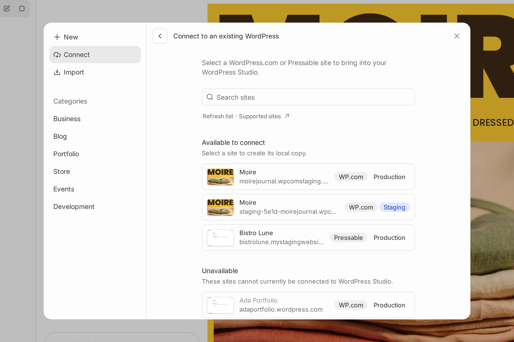
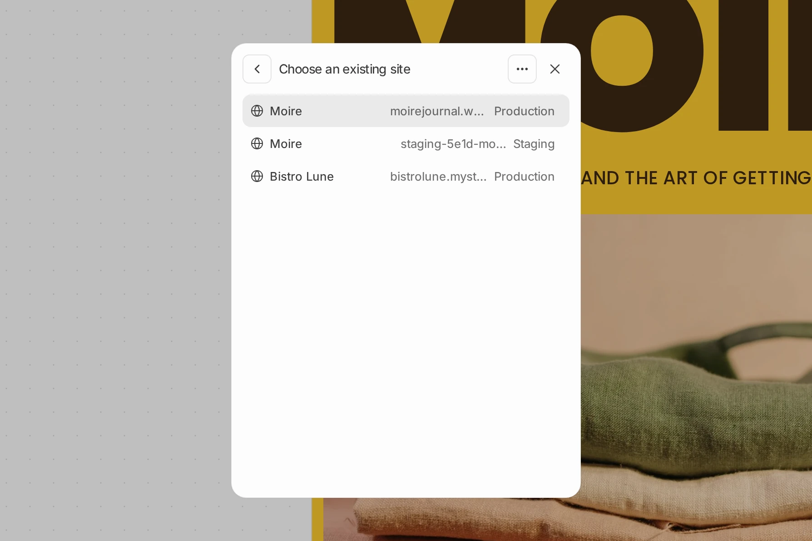
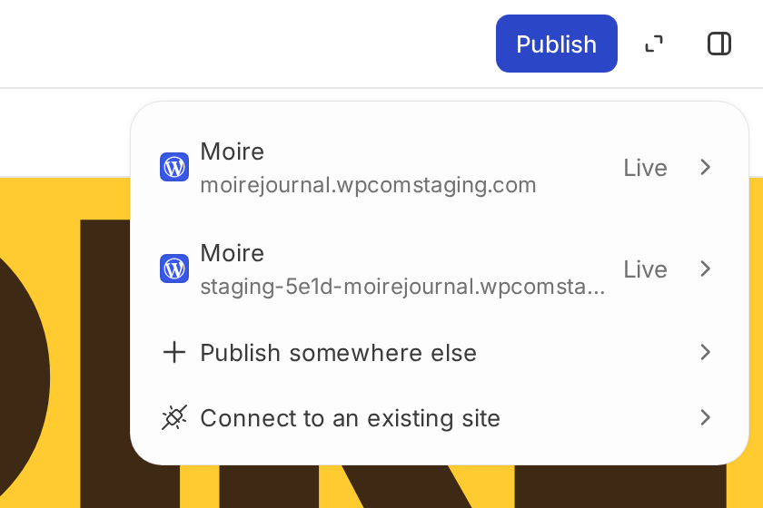
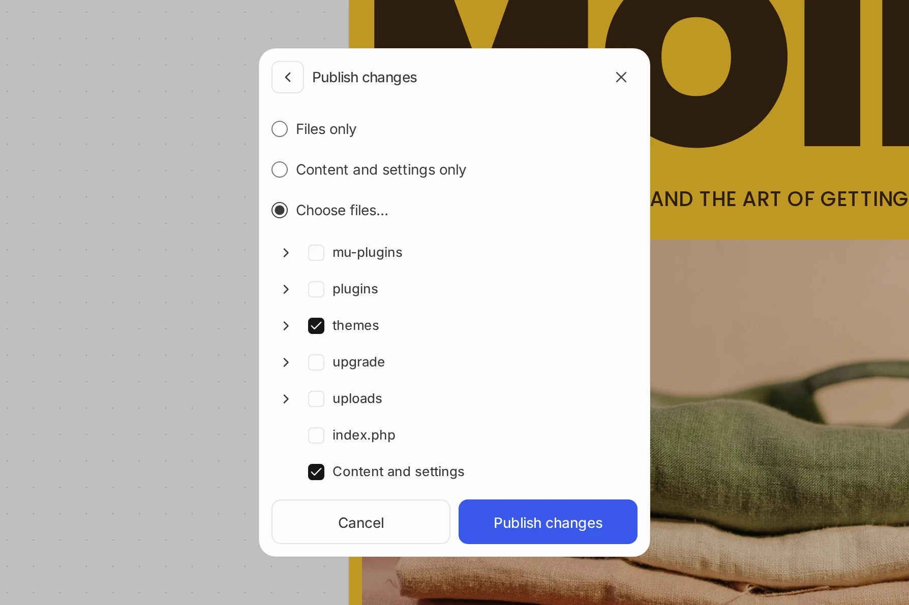

# Publish and pull your site

Publish your local site to a website on WordPress.com or Pressable, or pull the website’s latest version back into WordPress Studio.

To publish, connect your local site to the website and click **Update…** in the **Publish** panel. To pull, click **Pull from live site…**. Pulling copies the website into your local site and leaves the website unchanged.

**Applies to:** the WordPress Studio app and WordPress Studio CLI, with a WordPress.com account. The website must be on a paid WordPress.com plan, or on Pressable with Jetpack enabled, and you must be an administrator of it. To publish a static copy instead, you need a Spacefast account.

In the app, publishing and pulling live under the **Publish** button above the site preview. The same panel [shares previews](https://wordpress.studio/docs/preview-sites/), temporary copies of your site. To move a site to another host, [export it](https://wordpress.studio/docs/import-export/).

## Before you start

- A WordPress.com account, logged in to WordPress Studio. See [Connect to WordPress.com](https://wordpress.studio/docs/#connect-to-wordpresscom).
- A website on a paid WordPress.com plan with [its plan features activated](https://wordpress.com/support/activate-your-plan/), or a Pressable site with Jetpack Security activated and connected. Sites on the Free or Pro (legacy) plans need an [upgrade](https://wordpress.com/support/manage-purchases/upgrade-your-plan/) first.
- [Administrator](https://developer.wordpress.com/docs/platform-features/user-management/#roles) access to the website.

### Compatible sites

<span id="wordpress-studio-sync-and-jetpack-backups"></span><span id="wordpresscom-sites"></span><span id="pressable-sites"></span>Publishing and pulling rely on [Jetpack Backups](https://jetpack.com/support/backup/). The website must have one of these plugins activated and connected to WordPress.com:

- VaultPress Backup
- Jetpack Security
- Jetpack Complete

| Website | What you need to do |
| --- | --- |
| WordPress.com, paid plan | [Activate your plan features](https://wordpress.com/support/activate-your-plan/), if you haven’t. Commerce plan sites are activated automatically. |
| Pressable | Activate and connect the Jetpack Security plugin, which Pressable includes. Use the same WordPress.com account in Jetpack and in WordPress Studio, or the site won’t appear in the list of sites to connect. See the [Pressable documentation](https://pressable.com/knowledgebase/studio-for-pressable/). |

### Hosting providers

To publish from WordPress Studio, connect an account under **Hosting providers** in **Settings → Providers**. [Providers in WordPress Studio](https://wordpress.studio/docs/providers/) covers that page in full. You can also connect one from the **Publish** panel.

- **WordPress.com** publishes to a new or existing WordPress.com site, or updates a site you host on Pressable. It also hosts previews. Click **Connect** to log in with your WordPress.com account.
- **[Spacefast](https://spacefast.com)** hosts a static copy of your site. See [Publish a static copy to Spacefast](https://wordpress.studio/docs/sync/#publish-a-static-copy-to-spacefast).

**Default hosting provider** sets which connected provider the **Destination** menu shows first when you publish a site you haven’t published yet. Without one, WordPress Studio shows the provider you used last.

## Bring an existing website into WordPress Studio

<span id="bring-an-existing-wordpresscom-site-into-wordpress-studio"></span>Use this when the website isn’t in WordPress Studio yet. WordPress Studio creates a new local site and pulls the website into it.

1.  Click **Add site** (**+**) next to **Sites** at the top of the sidebar.
2.  Choose **Connect**.
3.  If you aren’t logged in, [log in to WordPress.com](https://wordpress.studio/docs/#connect-to-wordpresscom).
4.  Under **Available to connect**, click the website. Use **Search sites** to filter the list.
5.  Review the site name and site folder. The folder must be empty.
6.  Click **Add site**.

WordPress Studio creates the local site, saves the connection, and opens the site. It pulls the website into the local site in the background, and a **Pulling changes…** notification shows the progress.

Each site in the list is labeled as a WordPress.com or Pressable site, and as production, staging, or development. Sites that can’t be connected are listed under **Unavailable**, with the reason. Some entries link to WordPress.com so you can fix the problem. **View plans** appears for a site that needs a supported plan. **Enable hosting features** appears for a site that needs hosting features turned on. Click **Refresh list** to load the list again. Click **Supported sites** to see which sites you can connect.



To add a WordPress site that’s already on your computer instead, see [Add a new site using an existing WordPress directory](https://wordpress.studio/docs/sites/#add-a-new-site-using-an-existing-wordpress-directory).

## Connect a local site to an existing website

<span id="connect-wordpress-studio-to-an-existing-wordpresscom-site"></span>Use this when the site is already in WordPress Studio and the website already exists on WordPress.com or Pressable.

1.  In the sidebar, select the local site.
2.  Click **Publish** at the top right of the site preview.
3.  If the panel already shows a site or a preview, click **Publish somewhere else**.
4.  Open the **Destination** menu and choose **Connect to an existing site**.
5.  If you haven’t connected a hosting provider yet, click **Connect to WordPress.com** and log in.
6.  Under **Choose an existing site**, click the website. Use **Search sites** to filter the list.



The list shows the sites of every hosting provider you’ve connected, with each site’s name, address, and hosting provider. WordPress.com and Pressable sites also show whether they’re a **Production**, **Staging**, or **Development** site. Sites you can’t connect are listed under **Unavailable**, with the reason. To load the list again, click **Refresh list**. To go back without connecting, click **Back**.

A local site publishes to one website at a time. If it’s already connected to one, WordPress Studio tells you that connecting another disconnects the current one. The current website’s content doesn’t change. Previews aren’t affected.

Once the website is connected, the **Publish** panel shows:

- The website’s address. Click it to open the website in your browser.
- **Site actions** (**⋯**): **Copy link**, **Disconnect site…**, and for WordPress.com sites, **Manage on WordPress.com**, **Manage domains**, and **View backups**.
- **Who can view**, for WordPress.com sites. See [Choose who can view the website](https://wordpress.studio/docs/sync/#choose-who-can-view-the-website).
- **Plan**, with the website’s plan, for sites on a paid WordPress.com plan. Click it to manage the plan on WordPress.com.
- **Publish somewhere else**, to publish to another website or share a preview.
- **Pull from live site…** and **Update…**, and when you last published.

You can also choose **Publish** from the site menu, or search for **Publish** in the command palette.

Teammates can connect their own local sites to the same website with the same steps.

### Choose a site

<span id="choose-a-connected-website"></span>When a local site has more than one place to publish, for example a website and a preview, the **Publish** panel opens on **Choose a site**. It lists websites first, then previews.

- A dot next to a name means your local site has changes that aren’t there yet.
- **Live** marks a website you’ve published to or that’s launched.



Click a website or preview to open it. To go back to the list, click **Back**. **Choose a site** also has **Publish somewhere else** and **Connect to an existing site**.

The **Publish** button shows a dot too when the local site has changes that aren’t published.

### Choose who can view the website

For a WordPress.com site, **Who can view** shows and changes who can open the website:

- **Only you**: visitors see a Coming Soon page.
- **Everyone**: the website is public.

The change applies on WordPress.com right away. A private website shows **Invited people**, which you can’t choose from WordPress Studio. To change other settings, choose **Manage on WordPress.com** at the bottom of the menu.

### Disconnect a website

1.  Open the website’s **Site actions** (**⋯**) menu.
2.  Choose **Disconnect site…**.
3.  In **Disconnect site?**, click **Disconnect site**.

Disconnecting leaves both your local site and the website unchanged.

## Publish to a new WordPress.com site

<span id="connect-wordpress-studio-to-a-new-wordpresscom-site"></span>To publish your local site to a site that doesn’t exist yet, buy a WordPress.com hosting plan from WordPress Studio. WordPress Studio connects the new site for you.

1.  In the sidebar, select the local site.
2.  Click **Publish** at the top right of the site preview.
3.  If the panel already shows a site or a preview, click **Publish somewhere else**.
4.  Under **Destination**, choose **WordPress.com**.
5.  Under **Who can view**, choose **Everyone**.
6.  Click **Continue on WordPress.com**. WordPress.com opens in your browser.
7.  Choose a domain and a plan for the new site.
8.  Complete the checkout.
9.  When the new site is added, accept the prompt to open WordPress Studio, or click **Connect Studio** on your site’s Home screen.

On a site you haven’t published or shared yet, **Launch on WordPress.com** opens the same checkout.

WordPress Studio connects the new site, shows “Your site is ready to publish”, and shows the new site in the **Publish** panel as **Not published yet**. Click **Update** to publish the entire site to it. If the new site isn’t available yet, WordPress Studio tells you, and you can try again.

A new site starts out unlaunched, in Coming Soon mode. The first time you publish to it, WordPress Studio also launches it, so it’s public when the publish finishes. If the local site was already connected to another website, that website stays connected until the first publish to the new site.

## Publish a WordPress Studio site to a WordPress.com site

Publishing replaces the parts of the website you choose with the same parts of your local site. This works for WordPress.com sites, Pressable sites, and their [staging sites](https://wordpress.com/support/how-to-create-a-staging-site/).

> **Warning:** Publishing the database replaces the website’s whole database, including changes made on the website, such as new comments, orders, and customer data. WordPress Studio starts a full site backup before it publishes. To find these backups on a WordPress.com site, choose **View backups** in the **Site actions** (**⋯**) menu.

1.  In the sidebar, select the local site.
2.  Click **Publish** at the top right of the site preview.
3.  If the panel opens on **Choose a site**, [choose the website](https://wordpress.studio/docs/sync/#choose-a-site).
4.  Click **Update…**.
5.  In **Publish changes?**, open **What to publish** and choose what to send: **Everything**, or any of **Database** (posts, pages, and settings), **Plugins**, **Themes**, and **Uploads**.
6.  Click **Publish changes**.

If your local site hasn’t changed since you last published, the dialog asks **Publish again?** instead.

To publish individual files and folders, click **Choose specific files** in the **What to publish** menu. In **Choose files**, select the files and folders, and click **Done**.



A **Publishing changes…** notification shows the progress, with a **Cancel** button. When the publish is done, **Changes published** has a **View** button to open the website. Publishing doesn’t send the `wp_users` and `wp_usermeta` tables, so Jetpack features on the website keep working. See [Why don’t my local users appear on the WordPress.com site after publishing?](https://wordpress.studio/docs/frequently-asked-questions/#why-dont-my-local-users-appear-on-the-wordpresscom-site-after-publishing)

**Publish changes?** warns you when:

- You [previewed changes to this website](https://wordpress.studio/docs/preview-sites/#preview-changes-to-a-live-site) and the local site has changed since that preview was last updated. Publishing sends your current local site, including changes the preview didn’t show. You can still publish.
- Your local site is a multisite network. WordPress.com doesn’t support multisite.

### Exclude files with .deployignore

When you publish to WordPress.com or Pressable, WordPress Studio leaves out any files listed in a `.deployignore` file at the root of your site directory, for example build artifacts, vendor dependencies, or large media folders. It’s the same file previews use. See [Exclude files from a preview with .deployignore](https://wordpress.studio/docs/deployignore/) for the syntax and examples.

Even without a `.deployignore` file, publishing leaves out `.git`, `node_modules`, `.DS_Store`, and `Thumbs.db`. It also leaves out these WordPress Studio files, which shouldn’t be uploaded to the website:

```gitignore
/wp-content/database
/wp-content/db.php
debug.log
studio-error.log
sqlite-database-integration
/wp-content/cache
```

Only the `database` folder and `db.php` file directly in `wp-content` are left out, so plugins with a `Database` folder or a `db.php` file are published in full.

Excluded files are hidden from the file tree when you choose files to publish, and left out of the archive uploaded to the website.

## Pull a WordPress.com site into WordPress Studio

Pulling replaces the parts of your local site you choose with the same parts of the website. The website stays unchanged. You can pull from WordPress.com and Pressable sites, but not from Spacefast.

1.  In the sidebar, select the local site.
2.  Click **Publish** at the top right of the site preview.
3.  If the panel opens on **Choose a site**, [choose the website](https://wordpress.studio/docs/sync/#choose-a-site).
4.  Click **Pull from live site…**.
5.  In **Update local site from** and the website’s address, choose what to replace: **Entire site**, **Files only**, **Content and settings only**, or **Choose files…**.
6.  Click **Replace selected content**.

With **Choose files…**, expand folders such as `plugins`, `themes`, and `uploads` to pick individual items, and choose whether to include **Content and settings** (the database).

A **Pulling changes…** notification shows the pull’s progress. It has a **Cancel** button until the pull starts changing your local site, so you can cancel from anywhere in the app. When the pull is done, **Changes pulled into** and the site’s name has a **View** button to open the local site. If WordPress Studio couldn’t restart the site after the pull, click **Start site**.

If you can pull from a website but not publish to it, for example because it needs a plan upgrade, **Pull from live site…** is the main button, and the panel says why you can’t publish.

## Publish a static copy to Spacefast

[Spacefast](https://spacefast.com) hosts static sites. WordPress Studio can turn your local site into static HTML files and publish them to a *Space*, a static site in your Spacefast account. Forms, comments, and other features that need WordPress running don’t work in the published copy.

To connect your Spacefast account:

1.  Open **Settings**.
2.  Select the **Providers** page.
3.  Under **Hosting providers**, click **Connect** next to **Spacefast**. The **Connect to Spacefast** dialog shows a sign-in code.
4.  Click **Open Spacefast**.
5.  In your browser, check that the code matches the one in WordPress Studio, and approve the connection.

Spacefast shows as **Connected**. If you need to enter the code yourself, click **Copy code**. To disconnect, click **Disconnect** next to **Spacefast**.

To publish a site to Spacefast:

1.  In the sidebar, select the local site.
2.  Click **Publish** at the top right of the site preview.
3.  If the panel already shows a site or a preview, click **Publish somewhere else**.
4.  Under **Destination**, choose **Spacefast**.
5.  If you haven’t connected Spacefast yet, click **Connect to Spacefast**, and approve the code in the browser window that opens.
6.  If **Who can view** appears, choose **Restricted**, for your team and people you give access to, or **Everyone**. If your Spacefast team only allows restricted sites, **Everyone** is unavailable.
7.  Click **Publish**.

WordPress Studio creates a Space named after your local site and publishes to it. To publish to one of your existing Spaces instead, choose **Connect to an existing site** under **Destination**.

Once the site is published, click **Update** to publish it again. **Who can view** changes who can open the Space, and **Manage on Spacefast** at the bottom of that menu opens its access settings. **Add a domain** opens Spacefast to add a domain to the Space. The **Site actions** (**⋯**) menu has **Copy link**, **Manage on Spacefast**, **View versions**, and **Disconnect site…**.

Each publish replaces the Space with your site as it is now. You can’t choose what to publish, and you can’t pull from Spacefast. If the site isn’t running, WordPress Studio starts it to generate the pages, then stops it. Files named `_redirects`, `_headers`, `robots.txt`, or `llms.txt` at the root of your site folder are published as they are.

## Publish and pull from the terminal

| Command | What it does |
| --- | --- |
| `studio push` | Publishes the local site to its connected website. |
| `studio pull` | Pulls the connected website into the local site. |
| `studio push --remote-site spacefast` | Publishes the site to Spacefast. Add `:<space>` with a Space’s ID, URL, or slug to choose a Space. Without one, it publishes to the Space the site last published to. |
| `studio export-static <output-dir>` | Writes the static files to a folder instead. Run it from the site’s folder, or add `--path` with the site’s folder. |

See [Publish and pull](https://wordpress.studio/docs/cli/#publish-and-pull) in the CLI reference for all options.

## Limits

- You can publish up to 5 GB at a time to WordPress.com. If your selection is larger, WordPress Studio tells you it exceeds the 5 GB publishing limit and won’t publish until you choose fewer files, for example with **Choose specific files**.
- If the website doesn’t have a backup yet, such as a site on a free plan, you can pull **Entire site**, **Files only**, or **Content and settings only**. **Choose files…** is unavailable until the website has a backup.
- While a pull or publish is running, other actions on that site, such as starting and stopping it, are unavailable.
- If you quit WordPress Studio during a pull or publish, WordPress Studio warns you first. If the operation can still be cancelled, quitting cancels it. If it can no longer be stopped safely, it keeps running and appears again in the **Publish** panel when you relaunch WordPress Studio.

## Troubleshooting

### Why can’t I publish or pull?

<span id="why-are-pull-changes-and-publish-changes-turned-off"></span><span id="when-you-cant-publish-or-pull"></span>The **Publish** panel tells you why you can’t publish to or pull from a website when:

- You don’t have administrator access to the website.
- The website needs a hosting plan that supports publishing or pulling from WordPress Studio.
- Hosting isn’t fully activated yet. Finish activating hosting on WordPress.com first.
- The website has been deleted. Choose another website.
- The website isn’t a supported WordPress.com or Pressable site.
- You’re offline. Connect to the internet to publish or pull changes.
- Another operation is running on the site. Wait for it to finish.

### Why doesn’t my Pressable site appear in the list?

Jetpack on the Pressable site must be activated, connected, and using the same WordPress.com account you use in WordPress Studio. See [Compatible sites](https://wordpress.studio/docs/sync/#compatible-sites).

### Why can’t I create a site from the Connect tab?

The local folder must be empty, because WordPress Studio pulls the website into it. If the folder contains files, including an existing WordPress site, WordPress Studio shows an error. Choose an empty folder.

### What if my connected website was deleted?

If a connected website was deleted, or you no longer have access to it, WordPress Studio tells you, and you can choose another website.

### Why wasn’t my new WordPress.com site launched?

If WordPress.com can’t launch the site yet, for example because your email address isn’t verified, the publish reports an error. WordPress Studio tries the launch again the next time you publish.

### What do I do when a publish or pull fails?

The notification says **Publishing didn’t finish** or **Pulling didn’t finish**, with what went wrong. When the website reports why it couldn’t apply a publish, the message includes that reason. Fix the problem, then publish or pull again. To see more detail, click **Open logs**, or [open the logs](https://wordpress.studio/docs/frequently-asked-questions/#how-can-i-access-wordpress-studio-logs) yourself.

### Why were plugin files missing after I published?

Before WordPress Studio 2.4, publishing left out every folder named `database` or `Database` and every file named `db.php`, wherever they were in the site. Plugins with such files, such as WooCommerce, arrived incomplete. Publish the affected plugins again with WordPress Studio 2.4 or later.

## Related

- [Share a preview of your site](https://wordpress.studio/docs/preview-sites/)
- [Exclude files from a preview with .deployignore](https://wordpress.studio/docs/deployignore/)
- [Providers in WordPress Studio](https://wordpress.studio/docs/providers/)
- [Import & export](https://wordpress.studio/docs/import-export/)
- [WordPress Studio CLI](https://wordpress.studio/docs/cli/)
